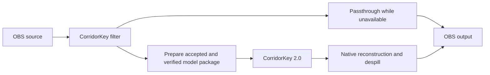

<!-- SPDX-License-Identifier: GPL-3.0-or-later -->
# CorridorKey for OBS

**Pre-alpha / work in progress.** The native CK2 pipeline and model manager are
available on Windows. Missing models or unavailable backends leave video in
passthrough. CK1 is still being implemented.

A native OBS Studio video filter for neural background keying on Windows x64
and Linux x86_64. No model weights or derived graphs are included.

See [design specifications](docs/design/) for the planned architecture, models, interface and implementation backlog.

## Features and remaining work

- CorridorKey 2.0 with Facecam, Balanced and Quality profiles. CK1 is planned.
- Native matte reconstruction, despill and advanced controls in filter properties.
- Optional learned Edge Refiner v12 with a tile budget selected in filter properties.
- In-OBS model management with licence acceptance, resumable downloads and SHA-256 verification.
- CK2 GPU inference through ONNX Runtime: NVIDIA TensorRT / CUDA and DirectML.
  Additional providers still need pipeline integration and hardware validation.
- Live processing and input-to-output delay, with optional audio sync adjustment.

CPU execution is intended for debugging. AMD providers still need hardware testing.



## Requirements

- OBS Studio **30.2 or newer**, subject to the compatibility checks below.
- Windows 10/11 x64, or Ubuntu 24.04 x86_64 with a compatible OBS installation.
- The Qt 6 libraries provided by OBS on Windows, or the distribution on Linux.
- A supported GPU, a compatible runtime and separately downloaded models.
  Windows release packages include DirectML; optional NVIDIA bundles have their
  own licence acceptance and installation step.

Add **CorridorKey** to a source's video filters, open **Manage models...**, then
choose **Set up CorridorKey**. Review the model licences before downloading.
Follow the illustrated [first-run guide](docs/user/first-run.md) for setup,
local weight preparation and activation.

## Build

The CMake infrastructure is based on the [official OBS plugin template](https://github.com/obsproject/obs-plugintemplate/tree/3e7d7ac3b5342cd7d9b88890b9c70b472d1520fc).
`buildspec.json` records reproducible SDK downloads with SHA-256 checks: OBS
30.2.0 and its matching OBS dependencies/Qt 6 for release builds, plus current
stable OBS 33.0.0 and 2026-10-23 dependencies for compile checks. These are build
inputs, not an exact-version runtime restriction. C++20, Qt and the frontend API
are enabled. You can also supply a compatible external SDK.

### Windows x64

Install Visual Studio 2022 Build Tools with Desktop development with C++, a recent
Windows SDK, and CMake 3.28 or later. The template downloads dependencies and builds
the OBS development libraries automatically. Use a normal PowerShell prompt:

```powershell
cmake --preset windows-x64 -DCORRIDORKEY_FETCH_ONNXRUNTIME=ON
cmake --build --preset windows-x64 --parallel
cmake --install build_x64 --config RelWithDebInfo --prefix "$PWD/stage"
```

With OBS closed, copy `stage/corridorkey` to
`C:/ProgramData/obs-studio/plugins/corridorkey`. Do not install into a running OBS.
The default install rules and Windows zip target OBS 33+: the module sits at
`corridorkey/corridorkey.dll`, beside `data/`. For OBS 30.2–32, use the `-legacy.zip`
asset, or configure with `-DCORRIDORKEY_WINDOWS_LAYOUT=LEGACY` to place the module
in `corridorkey/bin/64bit/`. CMake installs remove the alternate module copy.
The installer detects OBS in its default location and lets you choose the host
range for a custom installation. It installs one layout, removes obsolete module
copies from both ProgramData layouts and the default Program Files location,
and includes an uninstaller. Remove any custom-location older copies manually.
Neither package contains Qt, OBS or model weights. Packaged Windows releases
include the DirectML baseline runtime; a raw CMake install needs runtime assembly.

Do not install both zip layouts together. When upgrading manually, remove the
old `corridorkey.dll` before copying the new layout. In portable OBS 33+, use
`plugins/corridorkey/{corridorkey.dll,data/}` inside the portable installation.
Portable OBS 30.2–32 uses `obs-plugins/64bit/corridorkey.dll` and
`data/obs-plugins/corridorkey/`. The installer targets installed OBS, not portable
copies. See [OBS's migration guide](https://obsproject.com/kb/legacy-plugin-developer-info).

To compile-check the current SDK, use a separate build directory:

```powershell
cmake --preset windows-x64 -B build_current -DCORRIDORKEY_OBS_SDK=current
cmake --build build_current --config RelWithDebInfo --parallel
```

Release artifacts always use the baseline SDK. To supply another compatible SDK,
set `CORRIDORKEY_USE_BUNDLED_SDK=OFF` and `CMAKE_PREFIX_PATH` to its installation.

### Ubuntu 24.04 x86_64

Ubuntu 24.04 remains a supported build lane for compatible OBS 30.2–32 hosts
from the distribution/backports or the OBS PPA. The stock initial 30.0 package
is below the intended floor. CI builds the exact baseline SDK from source against
Ubuntu's FFmpeg libraries, independently of the installed OBS application:

```sh
sudo apt-get update
sudo apt-get install -y build-essential cmake ninja-build pkg-config python3 \
  qt6-base-dev extra-cmake-modules libsimde-dev uthash-dev libjansson-dev \
  libx11-dev libx11-xcb-dev libxcb1-dev libxcb-xinput-dev libdrm-dev \
  libegl1-mesa-dev libgl1-mesa-dev libglib2.0-dev uuid-dev zlib1g-dev \
  libavcodec-dev libavformat-dev libavutil-dev libswscale-dev libswresample-dev
python3 tools/bootstrap-linux-sdk.py --sdk baseline
cmake --preset ubuntu-x86_64 -DCMAKE_PREFIX_PATH="$PWD/.deps/linux-sdk-baseline" -DCORRIDORKEY_FETCH_ONNXRUNTIME=ON
cmake --build --preset ubuntu-x86_64 --parallel
DESTDIR="$PWD/stage" cmake --install build_x86_64 --prefix /usr
```

Linux uses an installed or locally built OBS SDK rather than Windows dependency
archives, with no upper version limit. An already installed SDK 30.2+ may also be
used directly. For an optional current-SDK check, pass `--sdk current` to build
OBS 33 and minimal FFmpeg 8 into `.deps/linux-sdk-current`, then use that prefix.
This does not install an OBS host. OBS 33 itself dropped upstream Ubuntu 24.04
and Qt 6.4–6.9 support; its host needs a compatible newer distro/Qt stack. The
24.04 release lane does not advertise an OBS 33 host on the stock 24.04 stack.

### Optional inference dependency

`CORRIDORKEY_FETCH_ONNXRUNTIME` defaults to `OFF`. See
[the dependency notes](cmake/dependencies/README.md) for the pinned Linux CPU/CUDA
archives and the Windows DirectML source build. Enabling this prepares a runtime;
it does not add inference to this filter or bundle that runtime in releases.

### Formatting and packages

Use clang-format 19.1.7 and gersemi 0.22.2. CI checks all tracked C/C++ and CMake
files. Release tags must match `v` plus `buildspec.json`'s version. A `v*` tag builds
Windows modern/legacy zips, an installer and Linux deb/tar.xz assets into a **draft** GitHub Release.
The workflow uses the repository's automatic token; no custom secrets are needed.

## Compatibility

See the [compatibility matrix](docs/compatibility.md) for backend evidence,
tested host versions and how to collect a redacted support report.

| Platform / host | Intended support | Verification in this foundation |
| --- | --- | --- |
| Windows x64, OBS 30.2–32.x | 30.2.0 hardware-tested; 31.x–32.x expected | MSVC build loaded in the legacy portable layout with a color source/filter |
| Windows x64, OBS 33.x | 33.0.0 hardware-tested | Baseline MSVC DLL loaded from the modern ProgramData layout exactly once; the current-SDK build also passed |
| Ubuntu 24.04 x86_64, OBS 30.2–32 | Expected to work | Baseline build job configured; first hosted run and runtime validation pending |
| Newer/unknown OBS releases | Load with a warning when the ABI remains compatible | Simulated version 99 loaded and retained pass-through; real newer hosts remain untested |
| CK2 GPU inference on Windows | Available through installed model packages and runtimes | See [pipeline validation](docs/dev/ck2-pipeline.md) and [first-run evidence](docs/dev/validation-w09b.json); shared GPU, no clean performance claim |

The filter uses longstanding OBS APIs. It logs the host version; an unreviewed
version alone never causes rejection. Future optional APIs must be resolved at
runtime, and missing inference/provider capabilities must leave pass-through
available. A genuine host ABI break may still prevent loading before plugin
initialization. No exact Qt, ORT or GPU-driver version whitelist is imposed.
Build download pins are separate from runtime compatibility. Qt must have the
host-compatible ABI; inference negotiates ORT's versioned C API and
check actual provider/device capabilities before use.

Please [open an issue](https://github.com/MinersWin/CorridorKey-for-OBS/issues/new/choose)
when something fails. Copy diagnostics from the model manager, review the
preview and paste it into the form. An OBS log is optional; review it for private
information before attaching it. Runtime support remains provisional until the
corresponding matrix entry records an actual test.
See [local validation notes](docs/VALIDATION.md) for the compiler, logs and limits
of these tests. Installer execution, Linux compilation and hosted CI remain pending.

## Licensing

Plugin code is **GPL-3.0-or-later**; see [LICENSE](LICENSE). A separate
[section 7 additional permission](LICENSE-EXCEPTION.md) permits linking or loading
specified proprietary GPU runtimes and drivers where the relevant copyright
holders grant it. It does not grant redistribution rights to vendor libraries.

**CorridorKey models are not included and are not covered by the plugin's GPL.**
Users must accept the applicable **Corridor Key Licence** before downloading.
Credit: **Corridor Digital LLC / Niko Pueringer**. MoGe-2 is MIT; RVM is CC BY 4.0.
See [THIRD_PARTY_NOTICES.md](THIRD_PARTY_NOTICES.md) for sources and attribution.
This is an independent integration, not an official Corridor Digital product.
