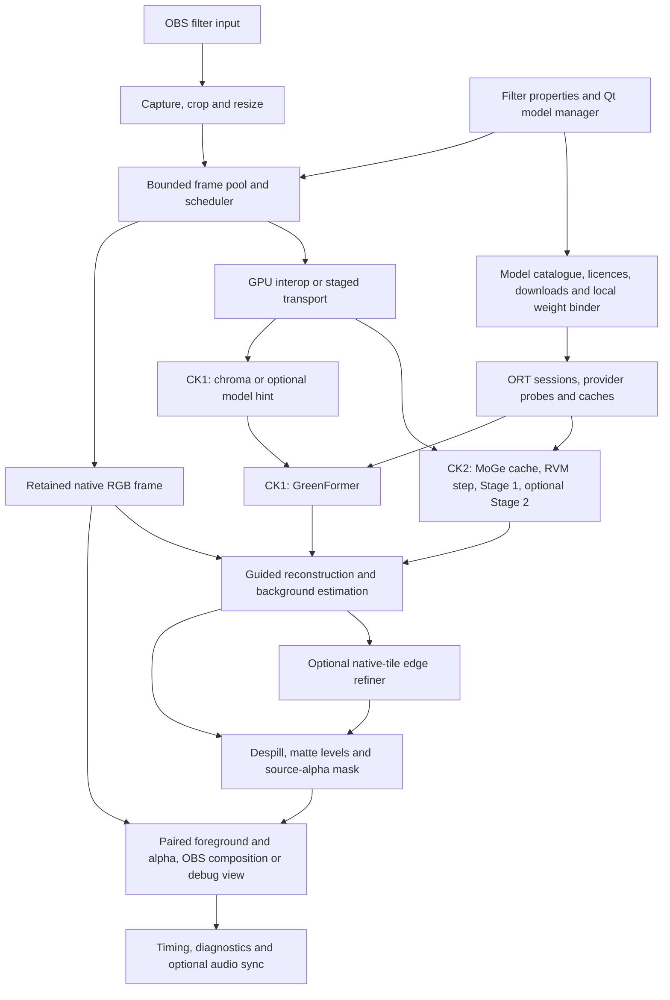

<!-- SPDX-License-Identifier: GPL-3.0-or-later -->
# Design specifications

These specifications record the design baseline of 28 October 2026. They describe planned behavior and release requirements, not implemented behavior. Test evidence and unresolved questions retain their original scope; see the [main README](../../README.md) for current implementation and validation status.

- [Architecture](ARCHITECTURE.md) specifies module boundaries, frame ownership, GPU transport, inference scheduling, reconstruction and failure handling.
- [Models](MODELS.md) records publisher artifacts, licence evidence, manifest and weight-binding requirements, downloads and hint-model candidates.
- [Filter and model-manager design](UX_DESIGN.md) specifies presets, controls, defaults, setup, status messages and accessibility.
- [Documentation plan](DOCS_PLAN.md) defines user guides, option references, compatibility reports and the real OBS screenshot shot list.
- [Implementation work packages](TASKS.md) defines the backlog, dependencies, acceptance criteria and release risks.
- [AMD and ROCm assessment](ROCM_AMD.md) records the DirectML and MIGraphX plans, vendor evidence, testing requirements and hardware gaps.

## Planned pipeline and modules

The diagram follows the module boundaries and pipeline contract in [Architecture](ARCHITECTURE.md). Each completed result stays paired with its captured input frame.

