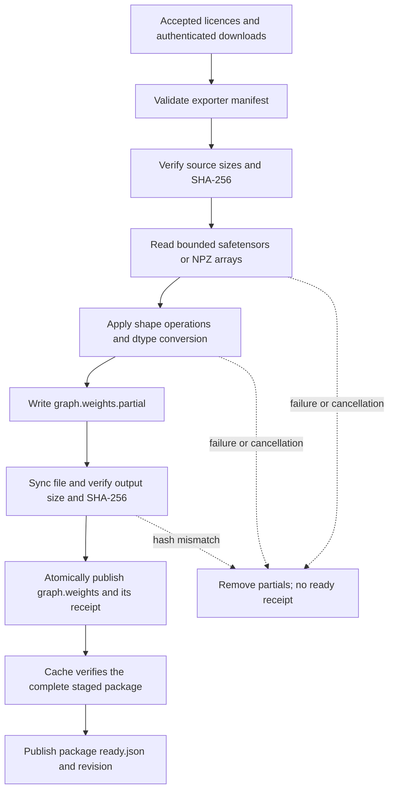

<!-- SPDX-License-Identifier: GPL-3.0-or-later -->
# Native weight binding

The binder builds ordinary ONNX external-data files from the exporter's per-graph
JSON and the original publisher checkpoints. It implements the final safetensors
and NPZ contract. The older storage-map proposal in `docs/design/MODELS.md` is
superseded: MoGe uses encoder-only safetensors, and there is no pickle reader.

`CatalogueService` uses the native binder when its optional `BindWeights` callback
is empty. Licence acceptance, downloads and source verification run first. After
binding, `Cache::publish` verifies every graph and output hash before publishing
the immutable package. `ReadyModel` still carries W04's reader lease. Runtime
compatibility and inference probes belong to W06.



## Worker API and UI progress

Include `models/binder.hpp`. Both functions are synchronous and belong on a
worker thread. They throw on failure; `Failure::code` carries the existing error
category. A callback exception also aborts binding.

```cpp
BindingResult bind_weights(
    std::string_view export_json,
    const std::map<std::string, std::filesystem::path> &sources,
    const std::filesystem::path &output,
    std::string_view expected_sha256 = {},
    std::stop_token stop = {},
    BindingProgress progress = {});

void bind_package(const Manifest &, Cache &, std::stop_token = {},
                  BindingProgress = {});
```

The source map resolves exporter IDs to local files. The binder never downloads
anything. Each JSON source must pin a byte count, SHA-256 and supported format;
these are checked before its binary header is parsed. `bind_package` resolves IDs
through authenticated cache blobs and validates the JSON against the package.
Its caller must hold the revision lock and call `Cache::prepare` first. The
catalogue already does both.

`BindingProgress` receives the existing `Progress` type on the calling thread.
It reports output bytes, including alignment padding. Package progress sums the
declared graph outputs. The first callback reports zero; subsequent callbacks
follow writes of at most 1 MiB. Progress can remain at zero while source hashes
are checked, or at 100 percent while output verification finishes. Only the
catalogue's `ready` state means the whole package is available.

W07 can continue polling `ModelCatalog::snapshot()`: `ModelState::binding` now
has a byte total and cancellation status. Marshal callbacks to Qt if using the
standalone API. Do not access UI objects directly from the worker. Existing
three-argument custom `BindWeights` callbacks remain supported; those callbacks
are responsible for their own reporting.

## Tensor semantics

Every weight row declares its output dtype, shape, aligned offset and exact byte
length. Rows may arrive in any order; the binder sorts them and rejects overlaps,
duplicate names, arithmetic overflow and mismatched lengths. Gaps are zero-filled.
Lengths need not be aligned; offsets must be multiples of 64.

Operations run in their listed order. `squeeze` removes one singleton axis.
`transpose` requires a complete permutation. `merge` combines axes `[a,b)` using
C-order reshape semantics, including after a transpose. `zeros` requires a null
file/key and is the only operation allowed for a source-free row. Unknown
operations fail. Shape checks run before materialization.

The current real manifests and all five publisher sources are float32. Readers
also accept float16, int32, int64, uint8 and bool. Identity copies preserve their
bytes. The only cross-dtype conversion is float32 to float16, with integer-based
round-to-nearest, ties-to-even; signed zero, subnormals and infinities are
preserved, and NaNs are quieted. Other casts fail explicitly. There is no BF16
conversion. The output dtype requests the cast; `cast` is not a recipe opcode.

Safetensors requires contiguous, nonoverlapping data spans covering the payload.
NPY versions 1, 2 and 3 accept a literal three-field header with C order and
explicit little-endian numeric dtypes (`|u1` and `|b1` are byte-order independent).
Fortran order, big/native endian, object/structured/string arrays, expressions,
unknown fields and trailing payload bytes are rejected. Unused NPZ members are
indexed and bounded but never interpreted as arrays.

ZIP supports stored and raw-deflate members, ZIP64 sizes/directories, and data
descriptors. It validates local/central names, sizes, methods and flags, checks
CRC after extraction, and rejects overlaps, encryption, split archives, links,
devices, duplicate keys and unsafe names. ZIP paths are lookup keys only. A
requested member is streamed to a fixed scratch filename, never extracted to its
archive path. The implementation links W04's existing zlib target.

## Limits and publication

Limits are fixed in the native implementation; the manifest cannot raise them.

| Resource | Limit |
| --- | ---: |
| Source or output file | 16 GiB |
| One tensor | 4 GiB; rank at most 8 |
| Safetensors JSON header | 16 MiB; at most 100,000 tensors |
| Exporter JSON | 32 MiB; at most 100,000 weight rows and 32 sources |
| Operations per row | 16 |
| NPY header | 64 KiB |
| ZIP directory | 8 MiB; at most 10,000 members |
| Expanded ZIP member / archive total | 256 MiB / 8 GiB |
| ZIP expansion ratio | At most 1,000:1 |
| Copy/write buffer | 1 MiB |
| Transform read window | At most 16 MiB |

JSON parsing and tensor indexes consume additional memory bounded by those
metadata limits. Large tensors are never loaded wholesale. Transposes map output
indices back to source indices through the operation sequence. A transform with
poor locality beyond the 16 MiB window can be slow; current RVM tensors fit in it.
Only one expanded NPZ member is kept on disk at a time. Admission checks free
space for the output plus 256 MiB of scratch; write errors still abort if space
changes during the run.

Each output has an OS lock. Binding removes its old `.weights.ready.json` before
starting. The partial output is flushed and synced (`_commit` on Windows,
`fsync` on POSIX), read back for SHA-256, then atomically renamed. The separately
synced receipt follows. POSIX directory updates are synced; Windows publication
uses `MOVEFILE_WRITE_THROUGH`. The receipt records binder version, exact JSON
digest, output size and SHA-256. A supplied expected digest or optional exporter
`weights_sha256` must match; conflicting pins fail.

Exceptions clean partial files. A process crash can leave partials, or complete
weights without a receipt; neither grants package readiness. A retry overwrites
those files. Package publication remains W04's separate final step and verifies
the signed package's expected output hashes. A standalone computed hash records
what was built; it is not an independent authenticity claim.

Paths reject symlinks and Windows reparse points. Use a user-owned cache on a local
filesystem. As with W04, path checks do not defend against a hostile local process
replacing directories between filesystem calls. Locks serialize cooperating
writers; installed revisions must remain immutable while readers hold leases.

## Validation tools

The portable build adds `corridorkey_bind_weights`. It needs no Python at runtime:

```text
corridorkey_bind_weights graph.json graph.weights EXPECTED_SHA256 source-id local-checkpoint ...
```

Use `-` for the digest to compute and record it without an expected output pin.
All source hashes are still required. The command prints output size/hash as JSON
and exits nonzero on failure.

`ctest -E binder_local_parity` runs synthetic tests, including malformed headers,
overflow, object arrays, ZIP bombs, path traversal, CRC failures, operation
composition, half rounding, cancellation, abrupt process exit and restart. All
binary fixtures are generated at test time. The mutation corpus changes bits in
small valid containers and checks for clean success or rejection.

`binder_local_parity` calls `tools/check-bound-weights.py`. It returns CTest's skip
code 77 when the private exports or original checkpoints are absent. The local
defaults point to the research/release directories; override them with
`--exports`, `--research`, and repeated `--source ID=PATH` arguments. It performs
both expected-SHA verification and a separate chunk-by-chunk byte comparison.
Missing/incomplete reference weights or concurrent exporter changes fail the run.

```sh
python tools/check-bound-weights.py build-contracts/RelWithDebInfo/corridorkey_bind_weights.exe \
  --exports S:/CorridorKey2-Release/onnx_test --output-dir build-contracts/binder-parity
```

The output directory must differ from the export directory. Bound weights are
removed after each successful comparison unless `--keep` is supplied. The local
`results.json` records graph names, hashes, byte counts and verification times.
Do not commit those generated model files. See [validation results](binder-validation.md)
for the tested graph set and remaining platform coverage.
