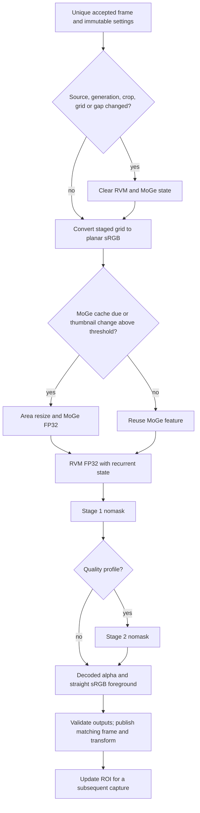

<!-- SPDX-License-Identifier: GPL-3.0-or-later -->
# CK2 pipeline integration

W09 implements the four CK2 stages behind the existing `Pipeline` contract. The
production catalogue loads revision
`5d88114f169cb082cda238426af47feffb9724af` of
`mantelmoritz/CorridorKey-ONNX-Graphs`. The hash-only fixture is
`tests/fixtures/ck2-release-r3.json`; graphs, checkpoints, bound weights and reference
arrays stay outside Git. The model manager installs and binds the production packages; normal builds
activate them through W04 reader leases. Catalogue signing remains a release
provisioning step; the bundled index uses a compiled installer digest.

## Frame processing



Each filter owns its sessions, RVM state, MoGe feature, thumbnail and ROI. Duplicate
or out-of-order submissions are rejected. MoGe refreshes on the first accepted
frame and every third accepted frame thereafter, or when mean absolute change
from its cached 32×32 RGB thumbnail exceeds 0.05. RVM runs on every accepted frame.
Settings can change the refresh interval and threshold.

A generation/source change, user crop change, colour-space change, source-size
change or gap above 500 ms clears temporal state. Explicit cut/reset notifications
use the generation/reset contract. A changed sampled ROI also clears recurrent
and cached features without restarting the ROI update cadence. Captured sessions
are recreated on the worker before processing a changed sampling transform. A gap
or cut only zeros temporal data at the existing device addresses. This prevents
a slow initial capture from causing an endless gap/recapture cycle.

Facecam uses the full user crop at H×W = 256×512. Balanced and Quality use 512×512.
ROI proposals use alpha > 0.1 on a quarter-native-resolution canvas, add 20% per
side, enforce a minimum normalized side of 0.35, and apply EMA 0.8. Proposals run
on the first processed frame and every fourth frame thereafter. An empty matte
expands toward the user crop. Capture adopts a proposal only after publishing its
matching result.

Preparation and reset run on workers. Submission and polling use try-locks; the
pipeline holds at most one outstanding job/result. Cancellation is checked between
stages and forwarded to ORT. Three consecutive inference failures stop admission
until reset. Experimental head passes, staggered stages, aspect correction and
masked hints are rejected explicitly.

## Export I/O and preprocessing

All released graph inputs and outputs are FP32. TensorRT's FP16 setting controls
internal stage execution, not the external tensor type. Names, types and static
shapes are checked against both the JSON manifest and the loaded ORT session.

For grid H×W, MoGe receives `[1,3,7H/32,7W/32]`; RVM receives
`[1,3,H/4,W/4]` plus state `[1,1+HW/4096,384]`. Their feature tensors retain the
export's singleton temporal dimension: `[1,1,C,H/64,W/64]`, with C = 768 and 384.
Stage 1 receives grid RGB, both features, a zero hint and hint quality -1. It emits
half-grid alpha/foreground and baton `[1,1,512,H/16,W/16]`. Stage 2 nomask receives
grid RGB and that baton, then emits full-grid alpha/foreground.

The foundation input resize uses area/adaptive-average sampling, matching the
released reference generator and research engine. RGB is sRGB in [0,1]. Encoder
normalization and CK colour decoding remain inside the graphs. Revision 3 removes
MoGe's identity antialiased Resize. The earlier external-bicubic export note does
not describe this revision's input contract.

`ck2::LowResolutionResult` carries planar decoded alpha and straight sRGB
foreground, the source/crop/ROI transform, next ROI and stage timings. `FrameResult`
accepts matching half-grid maps from Stage 1 or full-grid maps from Stage 2.
W08's staged transport uploads the corresponding texture size and reconstructs
against the retained native frame. The reconstruction working grid matches that
texture size; Stage 1 first reduces guide RGB to its half grid. See
[quality parity](quality-parity.md) for the correction and measured differences.
Guided coefficients, colour deltas, push-pull,
finishing/despill and crop mapping run through W08. There is no CPU upsample in
this handoff. [W13](refiner.md) refines native tiles between raw reconstruction
and final despill/levels.

The asynchronous capture/publication mailboxes and W15 timing hooks survive the
integration. The CK2 worker receives OBS's monotonic clock so capture, submission,
inference and publication share one epoch. W17 receives actual backend probe
results through `diagnostics::record_probe`; logged provider details are redacted.

## Sessions and CPU policy

The per-graph candidate order is captured TensorRT, uncaptured TensorRT, CUDA,
then DirectML, restricted by the user's backend choice and compatible loaded ORT
core. MoGe and RVM use FP32; stage graphs use FP16 under TensorRT and FP32 under
CUDA/DirectML. CPU diagnostic execution is never an automatic candidate.

TensorRT capture defaults on for RVM and both stages, and stays off for MoGe.
Each graph owns fixed CUDA allocations and persistent OrtValues. Inputs overwrite
those allocations; outputs and recurrent state currently round-trip through host
memory between stages. Captured bindings cannot change addresses. The disposable
helper warms captured sessions twice before in-process loading. Preparation
failure tries the uncaptured alternative and logs the reason. A recoverable
inference exception also retries uncaptured. An in-process driver crash cannot be
caught by C++ exception handling.

Revision 3 runs MoGe and RVM fully on DirectML. The temporary hash-pinned CPU
exception has been removed completely. Every live session disables CPU fallback;
profiling confirmed GPU-only partitions for all eight graphs. The optional merged
`stage1rvmnomask` graphs are not selected: keeping RVM separate preserves FP32
execution under weakly typed TensorRT.

DirectML uses persistent host OrtValues but rebinds them after each host write.
ORT may upload CPU-bound inputs during binding; binding them only once left stale
features and recurrent state on the device. The three-step sequence comparison
caught this bug and verifies the fix. CUDA-backed sessions bind their fixed device
allocations once and update those addresses in place.

## Development setup

Build with ORT enabled and `CORRIDORKEY_CK2_DEV=ON`, then set
`CORRIDORKEY_CK2_DEV_CONFIG` to a local JSON file. Its fields are `models`, `cache`,
`helper`, `scratch`, `fixture_fp32`, `fixture_fp16`, `bundles`, `adapter`, and
optionally `profiles`, `build_timeout_ms`, `capture` and `release_fixture`.
`models` contains the graph/JSON/bound-weight siblings. Bundle values are W06
runtime descriptor paths keyed by `tensorrt`, `cuda` or `directml`. The release
fixture verifies local graph and manifest bytes before loading. Use absolute
paths in this local file; none are compiled into the plugin.

The developer override bypasses catalogue download/licence UI and must remain
disabled in distributed builds. Normal builds do not consult the environment
variable. The production integration accepts a verified `ReadyModel` reader lease
and uses its graph hashes and binding recipe in W06 cache identities.
When Edge refiner is enabled, activation also checks licence acceptance and
acquires the catalogue's refiner package. The prepared model retains both reader
leases; the tile budget selects `refiner_b<N>`. The pipeline cache key includes
both package digests, the refiner switch and tile budget. Toggling refinement
therefore prepares the matching sessions before replacing the active pipeline.

The native harness accepts:

```text
corridorkey_ck2_validate CONFIG parity HEIGHT STAGE REPORT.json BACKEND
corridorkey_ck2_validate CONFIG chain HEIGHT reference REPORT.json BACKEND [quality]
corridorkey_ck2_validate CONFIG clip HEIGHT INPUT.npy REPORT.json BACKEND [quality]
```

Stages are `moge`, `rvm`, `stage1nomask`, `stage2nomask`. Clip input is FP32 NCHW
sRGB at the selected grid. It writes low-resolution alpha beside the JSON report.
It also writes planar straight sRGB foreground to `.fg.f32` beside the report.
The grid-only clip harness disables ROI because it has no native image to recrop.
Graph parity uses every `in_*` and compares every `out_*` from `.ref.npz`.
Chain parity runs the same RGB three times from zero state, matching the exporter's
reference state history. Reported errors are measurements, not pass/fail quality
thresholds.

## Validation on RTX 5070 Ti (shared GPU)

Windows 11, driver 610.62 (KMD 616.92), TensorRT 10, ORT 1.31.1/CUDA 13 and
DirectML ORT 1.24.4. The native plugin builds against the OBS 30.2 SDK. Both grid
manifests were rebound with W05 from the original sources; all eight bound files
were byte-identical to the exporter's weights.

All timings in this report were taken before 08:00 while the GPU was shared with
an export-side training/evaluation job and desktop applications. They require a
clean re-measure with no other compute process. Utilization and whole-device memory
samples accompany the revision-3 results in `validation-w09.json`.

The historical revision-2 warm medians below use five runs after the first run, including host copies and
ORT dispatch. They must not be compared directly with exporter device-only times.

| Graph | Grid H×W | Backend / precision | Warm ms | First preparation ms |
|---|---|---|---:|---:|
| MoGe | 256×512 | TRT + CUDA / FP32, uncaptured | 3.762 | 65150 |
| RVM | 256×512 | TRT / FP32, captured | 1.087 | 103289 |
| Stage 1 | 256×512 | TRT / FP16, captured | 6.791 | 175737 |
| Stage 2 | 256×512 | TRT / FP16, captured | 7.160 | 128036 |
| MoGe | 256×512 | DirectML / FP32 | 2.981 | 1391 |
| MoGe | 512×512 | DirectML / FP32 | 3.233 | 1603 |
| Stage 1 | 256×512 | DirectML / FP32 | 16.699 | — |
| Stage 1 | 512×512 | DirectML / FP32 | 24.877 | — |
| Stage 2 | 256×512 | DirectML / FP32 | 20.178 | — |
| Stage 2 | 512×512 | DirectML / FP32 | 40.042 | — |

The cached three-stage Facecam chain took 12.94 s / 10.31 s / 21.41 s to prepare
MoGe / RVM / Stage 1. Cache reuse avoids engine building but still hashes runtime
files, copies private cache artifacts and creates sessions. The large development
bundle's standard-op probe took 35 seconds. Graph preparation now uses the
configured compilation deadline for the probe (120 seconds by default; 300 in
this development setup). Successful backend/precision probes are reused across
stages within one preparation.

The three-frame TRT chain produced alpha max/mean absolute error
0.00908086 / 0.000234134 and foreground 0.00958470 / 0.000363608. Its warm
frames took 11.10 and 11.37 ms including CPU preprocessing and output validation.
Individual Stage-1 alpha was 0.00905035 / 0.000231772 on TRT and
0.00141926 / 0.000009570 on DirectML. These TRT maxima exceed the coordinator's
exporter sample of about 0.0081; they are reported without rounding them into that
target.

The isolated TRT graph runs reached 11.3–13.7 GiB of whole-device memory during
preparation. Other desktop/OBS processes were present, and WDDM did not expose
per-process memory through `nvidia-smi`; these are not plugin-only VRAM figures.


Revision-3 TensorRT Facecam chain alpha max/mean error is 0.00975225 /
0.000323066; foreground is 0.0102561 / 0.000411302. Its two warm frames took
12.82 and 13.55 ms. All three graphs ran without CPU partitions. The stage
graphs are byte-identical to revision 2; the rewritten foundations have new
cache identities.

Revision-3 DirectML standalone measurements (shared GPU, host-inclusive warm medians):

| Graph | Grid HxW | Warm ms | Output | Max abs | Mean abs |
|---|---|---:|---|---:|---:|
| moge | 256x512 | 3.012 | moge_feat | 0.00140357 | 0.0002265714 |
| moge | 512x512 | 3.331 | moge_feat | 0.001442671 | 0.0002257627 |
| rvm | 256x512 | 3.049 | rvm_feat | 3.671646e-05 | 3.474613e-06 |
| rvm | 256x512 | 3.049 | state_out | 4.601479e-05 | 3.788798e-06 |
| rvm | 512x512 | 3.171 | rvm_feat | 4.810095e-05 | 4.256642e-06 |
| rvm | 512x512 | 3.171 | state_out | 4.592538e-05 | 4.684629e-06 |
| stage1nomask | 256x512 | 16.970 | alpha | 0.001419261 | 9.57342e-06 |
| stage1nomask | 256x512 | 16.970 | baton | 0.004584104 | 0.0001128104 |
| stage1nomask | 256x512 | 16.970 | fg | 0.00101291 | 2.189117e-05 |
| stage1nomask | 512x512 | 28.609 | alpha | 0.001498759 | 1.22489e-05 |
| stage1nomask | 512x512 | 28.609 | baton | 0.006998777 | 0.000134564 |
| stage1nomask | 512x512 | 28.609 | fg | 0.001693673 | 2.978749e-05 |
| stage2nomask | 256x512 | 19.761 | alpha | 5.245209e-06 | 6.797163e-08 |
| stage2nomask | 256x512 | 19.761 | fg | 4.887581e-06 | 1.550893e-07 |
| stage2nomask | 512x512 | 47.242 | alpha | 4.470348e-06 | 5.881716e-08 |
| stage2nomask | 512x512 | 47.242 | fg | 6.258488e-06 | 1.485854e-07 |

Revision-3 DirectML Facecam chain alpha max/mean error is 0.00142270 /
0.00000954459, and foreground is 0.00101145 / 0.0000219110. All per-output
max/mean results for both grids are in `validation-w09.json`.

The Quality reference files do not form a matching sequence: Stage 2's `in_baton`
differs from Stage 1 nomask's `out_baton` by 0.21955 at 256x512 and 0.27543 at
512x512. The harness reports this incompatibility instead of treating a chained
output difference as a numerical parity result. Standalone Stage 2 parity remains
valid. Quality executed all four stages successfully on the 512x512 grid.

A 12-frame excerpt at 4 seconds from the 1080p reporter clip ran through the native
DirectML pipeline and the read-only research engine. Low-resolution alpha max/mean
error was 0.025422 / 0.000388623. The research engine uses BF16 and its own CUDA
graph warmup/history, so this comparison includes those differences. Learned
refinement and hints were disabled in both runs.

## Live OBS checks

The installed OBS 33 loaded the native pipeline and rendered a real key. Its
NVIDIA audio/video effects SDKs preload different TensorRT 10 libraries, which
W06 correctly rejects as a runtime collision. The remaining tests use an isolated
portable OBS 33 with process-local `NVAFX_SDK_DIR` and `NV_VIDEO_EFFECTS_PATH`
overrides pointing to an empty test directory. No installed SDK files were changed.
The installed test configuration was restored and its lock released.

Facecam processed native 1920x1080 reporter footage and a 3840x2160
headphones/dance clip through W08 reconstruction. Both used RGB guidance, delta
unmixing and no learned refiner. Changing the media source from 4K to 1080p reset
the model state and resumed keying without restarting OBS. TensorRT needed
about 50 seconds to recreate its captured sessions after that size change; OBS
continued rendering passthrough during recovery. The final portable instance
closed cleanly and its log reported zero memory leaks. No test instance or
installed-OBS lock remains.

| Backend / source | New keys/s | Age median / p95 ms | Inference median ms | OBS FPS |
|---|---:|---:|---:|---:|
| DirectML / 4K | 29.92 | 69.26 / 98.15 | 31.63 | 60.00 |
| DirectML / 1080p | 32.71 | 66.82 / 83.51 | 29.27 | 60.00 |
| TensorRT capture / 4K | 46.17 | 50.06 / 67.93 | 16.14 | 60.00 |
| TensorRT capture / 1080p | 47.96 | 50.04 / 66.95 | 15.61 | 60.00 |

These are shared-GPU samples, not a clean throughput limit. W15 timing values
remain finite and use OBS's clock. The DirectML 1080p sample reported 16.96 ms
input transfer, 7.77 ms output/publication and 8.24 ms queue time. Timing medians
are computed independently and need not add to the median age.

The DirectML live ORT profiles contain only `DmlExecutionProvider` partitions.
After excluding five initial runs, median `model_run` durations were MoGe
3.407 ms, RVM 3.418 ms and Stage 1 16.231 ms. These profiling spans exclude the
pipeline's host preprocessing and copies. Accumulated wrapper means across the
two source sizes were 4.47 / 4.51 / 19.58 ms, and 30.61 ms for the whole worker.

Whole-device memory samples were 12027 MiB at 88% GPU utilization for the 4K
DirectML screenshot and 11159 MiB at 69% for 1080p. WDDM does not provide a reliable
plugin-only allocation total here. The final 4K TensorRT sample recorded 11277 MiB at 46% utilization.
Its ORT medians were 0.841 ms for RVM and 3.716 ms for Stage 1 (2690 warm
frames each). MoGe had a 3.335 ms median across 2248 refreshes. After changing
to 1080p, RVM/Stage 1 medians were 0.842 / 3.706 ms over 4054 warm frames.
The final 1080p sample recorded 10280 MiB at 60% utilization.

The first W08 TensorRT preparation took Stage 1 219.77 s, RVM 59.55 s and MoGe
21.53 s. A second process reused the cache and took 104.74 / 63.12 / 20.06 s.
The final process took 110.06 s for Stage 1. RVM and Stage 1 logged capture
enabled; MoGe stayed uncaptured. These startup
times include probes, verification, helper work and session loading. They are
not engine-build-only measurements, and cache reuse remains too expensive.

The screenshots below are actual OBS source renders saved through obs-websocket,
without a mouse cursor. W08 samples the model texture at its own dimensions, so
Stage 1's half-grid maps receive bilinear interpolation before coefficient and
colour-delta calculation. All 13 D3D11 reconstruction fixtures passed, including
a smaller model texture compared against an explicitly expanded reference. That fixture had
maximum coefficient/raw/finished errors of 1.92e-6 / 4.49e-7 / 5.26e-7.

The ORT build passed all 10 applicable CTest suites; the build without ORT
passed all 11, including fresh local binder parity. All eight required CK2
weights matched the exporter byte for byte. The plugin was built against
OBS 30.2; the numeric GPU harness was also built against the OBS 33 SDK.
Formatting checks use clang-format 19 and gersemi 0.22.2.


Footage provenance is recorded in [the image notes](../images/dev/w09-provenance.md).

## Remaining integration work

- Provision catalogue signing for release. Normal builds use the model manager
  and verified cache path; the local override remains development-only.
- Resolve the staged refiner's latency and remaining 4K edge coverage limits;
  see [W13 measurements](refiner.md). W08 native reconstruction is integrated.
- Reduce preparation cost and avoid repeated runtime hashing/private cache copies.
  Recreating captured sessions on changing ROI is correct for capture lifetime,
  but is too expensive for a continuously moving ROI; this needs a measured
  recapture strategy before Balanced/Quality TensorRT can be called real-time.
- Resolve the Quality reference baton mismatch, then measure chained Quality parity.
- Changing the OBS canvas through `SetVideoSettings` during inference left W08
  transfer admission stalled. Ordinary media-source dimension changes recover.
  The canvas-reset case needs a separate graphics-queue lifecycle fix.
- Re-measure all timings on an idle GPU. Linux and AMD hardware are not tested here.
