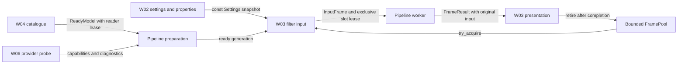

<!-- SPDX-License-Identifier: GPL-3.0-or-later -->
# Shared contracts and fake pipeline

`corridorkey_core` is C++20 and has no OBS, Qt, ONNX Runtime or GPU dependency.
Include headers from `src/` and use namespace `corridorkey`. These are internal
C++ source contracts, not a stable binary ABI.



## Files and ownership

| Package | Implementation files it owns | Shared seam |
| --- | --- | --- |
| W01 | `src/contracts/*`, `src/engine/pipeline.*`, `fake_pipeline.*`, `src/runtime/frame_pool.*`, `src/obs/fake_filter.*`, `tests/contracts_test.cpp` | Review changes to these contracts together before changing callers. |
| W02 | `src/settings/*`, `src/obs/properties.*`, locales, settings metadata and tests | `read_settings`, `set_filter_defaults`, `create_filter_properties`, `FilterControl` |
| W03 | `src/filter.*`, `src/obs/filter_input.*`, `src/runtime/scheduler.*`, staged transport and tests | `InputFrame`, `FrameResult`, `FramePool`, `Pipeline`, `FrameTransport` |
| W04 | `src/models/{manifest,catalog,licenses,download,cache}.*` and their tests | `ModelCatalog`, `ReadyModel`, `ModelReadLease`, `ModelStatus` |
| W06 | `src/engine/ort_session.*`, `src/engine/providers/*`, `tools/backend_probe/*` and their tests | `ProviderProbe`, `ProbeRequest`, `ProbeResult`, `PrepareRequest` |

Each package may add `cmake/packages/wNN.cmake`; the root build includes these
fragments after creating targets. Add portable sources to `corridorkey_core` and
OBS sources to `corridorkey` inside `if(TARGET corridorkey)`. Tests can extend
`corridorkey_contract_tests` or add a separate executable when `BUILD_TESTING`
is enabled. This avoids edits to another package's files or the root build.

The W00 property code has moved to `src/obs/properties.cpp`. Its settings adapter
currently reads only the three existing controls. W02 owns full validation,
migration, visibility and preset application. `FilterControl` is borrowed during
callbacks; a delayed UI action must acquire a separate weak lifetime reference.
W03 owns callback integration and must connect reset requests to generation
changes. W04 provides services to callers; it does not edit properties or loaders.

Later owners: W05 adds binder/container readers under `src/models`; W07 owns the
Qt manager; W08 owns `src/gpu/post` and effects; W09 owns CK2 and temporal tensors;
W10/W11/W12 own their platform transports/providers; W13 owns refiner stages;
W14 owns CK1/hints; W15 owns telemetry/audio sync. W16 extends the scheduler and
pool after coordination with W03. No pipeline shares recurrent state between
instances.

## Frame ownership and time

`FramePool` starts at generation 1 and defaults to three slots. The staged OBS
transport requests five slots for capture through GPU retirement; the maximum is
five. Inference admission and pending replacement keep their separate bounds.
`try_acquire`
uses bounded atomic operations. A move-only `FrameLease` carries the generation,
slot index and reuse counter. It follows
`capturing -> ready -> processing -> complete -> presenting -> retired`.
Destruction releases the slot, including abandoned host-only work. Invalid
transitions fail. A generation change makes old leases stale without freeing
them; even a presenting result continues to pin its slot until released.

`InputFrame` retains the original RGB, analysis image, crop/ROI transform, immutable
settings and optional capture completion token. A `FrameResult` moves that whole
input along with its foreground and alpha. Keep the result while displaying it.
Copying an image pointer alone does not pin its pool slot. GPU implementations
must keep the lease until all capture, compute and presentation fences finish,
including on cancellation. Resource deleters must defer thread-affine destruction
to the owning graphics context. `FrameTransport::try_present` returns a read
completion token for retirement after the final draw. The pool owns no GPU resources.

In the OBS pipeline, use `obs_now()` from `telemetry/obs_clock.hpp` for capture,
submission, worker completion and presentation. It carries `os_gettime_ns()` in
`TimePoint`; never mix that epoch with `Clock::now()`. Portable pipeline tests use
explicit times or `Clock::now()` independently. Do not serialize either epoch.
`video_tick` is only an OBS draw-deduplication key. `captured_at` records filter
input acquisition, not sensor exposure. Identity includes instance, generation,
sequence, tick and capture time. `presentable` checks this identity, transform,
generation, completion and age, and rejects sequences older than the last one
displayed. Repeating the same result preserves its original age. Default maximum
age is 250 ms; then display live passthrough.

Image dimensions are **width, height**. Crop fields are normalized absolute
left/top/right/bottom bounds in the source, with full output bounds retained.
Foreground is straight sRGB RGB; alpha is a separate linear float plane. Output
composition and source-alpha multiplication belong to W08. `validate_result`
checks host shapes, ranges and finite values on the worker. Device pipelines must
validate before publication. The render callback uses only `presentable`, never
a pixel validation scan. HDR is unsupported until a model color path is verified.

## Calls, settings and failures

Call `prepare`, `reset`, `capabilities` and `diagnostics` on control/worker threads.
`try_submit` and `poll_result` use try-locks: contention returns busy/empty without
waiting. Successful submission moves the input; failure leaves ownership with
the caller. The fake admits at most three outstanding jobs, counting completed
results that have not been polled. W03 adds newest-pending replacement and fair
admission; there is no unbounded queue in this layer.

`cancel` is cooperative and nonblocking. Per-frame and preparation `stop_token`s
are also supported. `shutdown` joins and therefore belongs to teardown/control,
after callbacks detach. Never destroy a pipeline on the render thread. Already
delivered results remain the caller's responsibility; invalidate their generation
or stop presentation when cancelling. Prepare a replacement separately and keep
the active pipeline until preparation succeeds.
Each implementation must retain its prepared model lease and session for every
in-flight job, even after a replacement becomes active.

`SettingsSnapshot` and `StatusSnapshot` are shared pointers to const values.
Publish new snapshots instead of mutating an existing one. UI expansion and crop
preview are separate from processing settings. `TemporalStateKey` identifies an
instance's accepted sequence; W09 owns RVM/MoGe/ROI tensors and reset policy.
Source, grid, crop, color, seek/cut and long-gap changes need a new generation.
The brief's later Facecam update specifies **384 tiles**, overriding the older
UX table's 256. Balanced stays at 512 and Quality at 768.

`ErrorCode` maps to stable `CK-E001` through `CK-E016` IDs and static action text,
so OOM reporting needs no allocation. Capability results describe what was
probed, including adapter match, precision, memory domain and transport features.
An unknown version does not imply unavailable. CPU diagnostic is explicit and
must never become an automatic live fallback. `ReadyModel` keeps a reader lease
on an immutable verified revision; W04 owns acceptance and cache safety.

## Running the fake and tests

The fake copies RGB to foreground and computes alpha as `(red + blue) / 2`.
It accepts packed host float RGB analysis up to 1,048,576 pixels and retains the
original image, which may be a device resource. Capture must already be complete.
Delay is configured in milliseconds; an additional odd-sequence delay produces
out-of-order completion. Faults can target one sequence or every frame: OOM,
unavailable backend and nonfinite output. Invalid output is marked failed before
publication. Configure options before prepare/reset; failed preparation preserves
the previous active options. The fake does not enforce production retry policy.

Manual mode uses `advance(time)` for deterministic tests. Worker mode runs the
same completion logic on a private thread. Fake timing fields describe simulated
delay and are not performance measurements of a neural model.

Configure the Windows preset with `-DCORRIDORKEY_ENABLE_FAKE_FILTER=ON` to add
W03's "Input capture diagnostics (no neural model)" group. Its checkbox defaults
off. It runs the fake on the actual filter input through a fenced staged transport.
Delay, odd-frame delay and fault controls exercise the worker; failure or staleness
returns to passthrough. Texture creation/destruction stays outside render. The
core tests still use synthetic image fixtures. The default build has no
diagnostic controls or fake worker in the filter. See the
[W03 capture and validation notes](validation-w03.md) for ownership and measurements.

```sh
cmake -S . -B build-contracts -DCORRIDORKEY_BUILD_PLUGIN=OFF
cmake --build build-contracts --config RelWithDebInfo
ctest --test-dir build-contracts -C RelWithDebInfo --output-on-failure
```

These commands need no OBS SDK; the workflow runs them on Windows and Linux. The tests
use doctest 2.4.11 (MIT), fetched with a SHA-256 pin. Offline builds can supply
`FETCHCONTENT_SOURCE_DIR_DOCTEST`. With the plugin preset, run CTest in its build
directory; see [validation](../VALIDATION.md) for SDK/toolchain reuse.

`tools/generate-test-graph.py` generates and checks a rank-four FP32 Add graph
(opset 18, IR 8), external `tiny.weights`, a safetensors input and a small binding
recipe. Its four constants are authored here. CI installs ONNX 1.17.0 for this
development tool; it is not a runtime dependency or a CK export. Generated
artifacts stay in the build directory. W05/W06 can consume these fixtures before
real model artifacts arrive.
