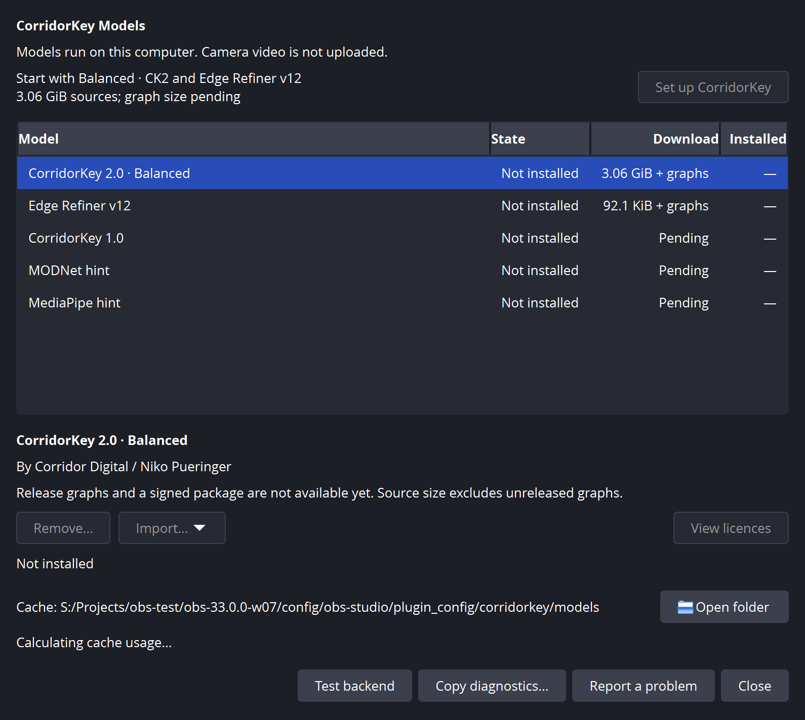
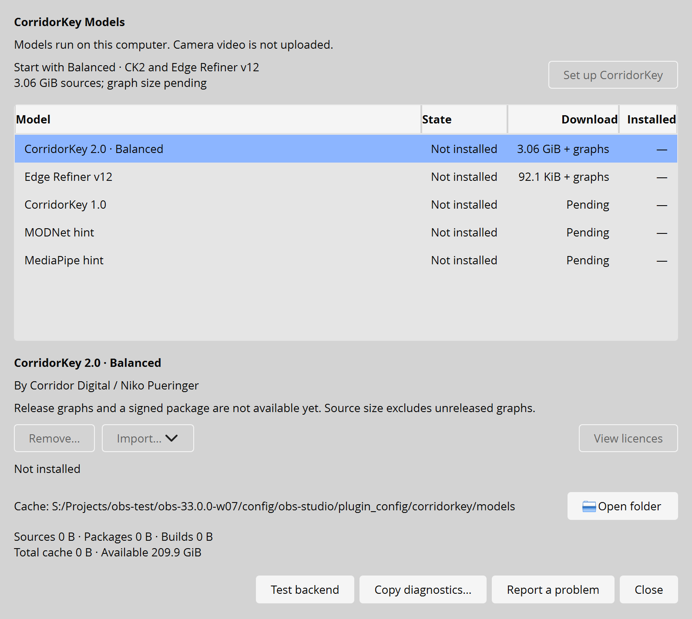
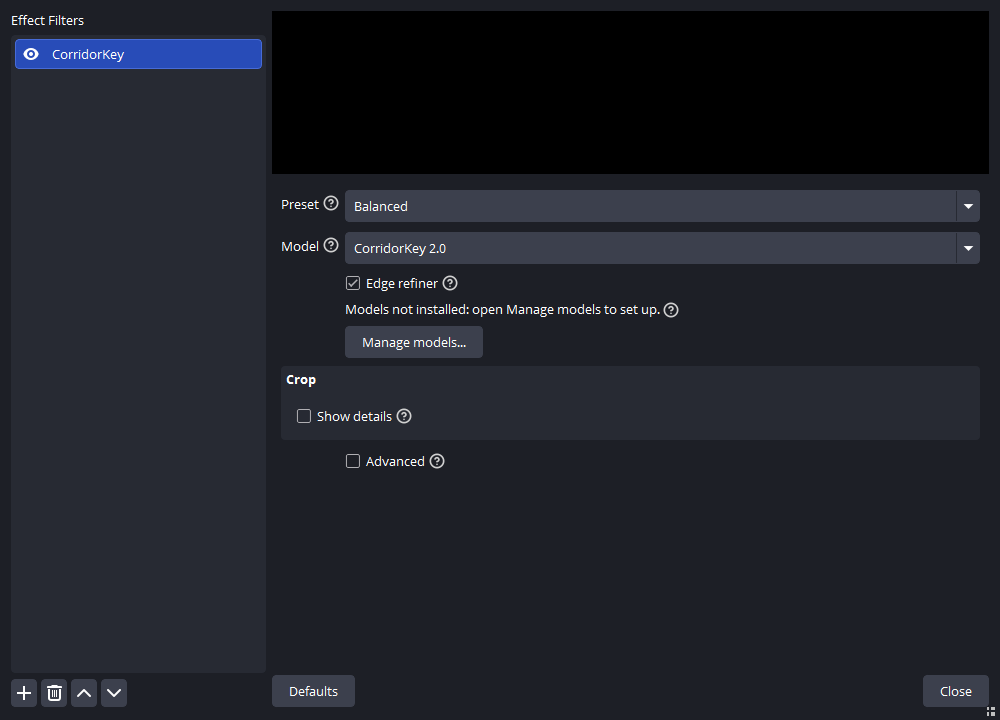

<!-- SPDX-License-Identifier: GPL-3.0-or-later -->
# Visual design review, 29 October 2026

The model manager now gives setup one clear primary action, keeps the catalogue
compact, and separates model work from storage and support. The filter starts
with Preset, Model and Edge refiner, followed by Crop. Detailed controls live
under Advanced.

## Before and after

| Earlier manager, Yami | Current manager, Yami |
| --- | --- |
|  |  |

| Earlier manager, Yami Light | Current manager, Yami Light |
| --- | --- |
|  |  |

| Earlier properties | Current properties |
| --- | --- |
|  |  |

The earlier manager capture used a catalogue whose setup action was genuinely
disabled. The current catalogue was already available before this design pass;
the visual change gives its enabled action OBS's Highlight/HighlightedText
colours. This pass does not bypass an unavailable package or the licence gate.

## Decisions

The title has a stronger hierarchy, while section labels use semibold and
publisher, path and notices use caption sizing. Layout spacing uses an 8 px
grid with 16 px outer margins. The host font and palette remain in control.
Only the title, primary button, table header and secondary footer have scoped
styling; there is no application-wide theme override.

The list has content-sized state and numeric columns, a flexible model column
and rows sized to their contents. Distinct missing, waiting, ready, update and
error symbols accompany the text. Ready and working icons use the host Link
role; selected icons use HighlightedText. Colour is supplementary. All nine
SVGs in `data/icons` were drawn for this plugin under GPL-3.0-or-later, with
1.5 px strokes and round joins. No icon pack or emoji is included.

Balanced is selected initially, matching the setup offer. Its description
explains the choice without exposing graph-stage names. Revisions and detailed
publisher metadata remain in tooltips. While a task runs, progress replaces
repeated explanatory copy. Idle rows no longer repeat Not installed below the
model actions.

Storage has one usage line. Its tooltip retains the source/model/build breakdown.
The path is middle-elided, with a full tooltip and accessible description.
Open folder uses the same monochrome icon style as the support actions. Test
backend, Copy diagnostics and Report a problem align left; Close is the default
button on the right. Closing still leaves an explicit installation running.

Properties use only public OBS properties and refresh APIs. The previous scan
for private QLabel widgets and injected markers is gone. The two-second refresh
waits while a spin box, slider, text field or combo box has focus, or while a
popup/mouse edit is active. Status gives a recovery action instead of a CK-E
code. A ready status puts backend, fps, time per key and delay on one line;
error identifiers and raw details remain in the tooltip and diagnostics.

## Evidence and checks

All four combinations of Yami/Yami Light and actual 100%/150% device scale were
captured in portable OBS 33. The manager set includes every state, licence
review, offline import, diagnostics, unavailable backend and a compact window.
Properties include standard, expanded Crop and Advanced. Diagnostics include
report and timing views, clipboard equality and redaction checks. Every completed
capture run reported zero OBS leaks. No cursor, browser source or firewall overlay
appears in the captures; obs-websocket was disabled. Installed OBS was not used.

The Windows build uses MSVC with compiler warnings as errors and the OBS 30.2
SDK. CTest passed all 14 runnable tests; local model parity was skipped because
its external model files were not configured. The extended properties test checks
order, Advanced visibility, readable failure text, tooltip codes and one-line
metrics in both locales. clang-format 19 and gersemi 0.22.2 passed across the
repository. No GPU, engine or filter-input file changed. The diagnostics build label retains
the configure-time base hash; the captures use the modified D1 sources.

## Self-critique and remaining work

The support footer is calmer and setup is easy to find. The catalogue still
includes unavailable future packages; a later product decision could hide them
until they can be installed. Download and Installed remain separate columns so
shared source downloads are not mistaken for installed disk usage. At the
minimum window size the contents scroll, while support actions stay available.

This is a UI validation set. Progress and Ready are labelled synthetic fixtures;
the former first-run video/download walkthrough was not replayed. A fresh live
keying walkthrough should follow the parallel GPU interop work. QWidget capture
does not include the GPU preview. The older sync-guide images are retained as
labelled historical diagnostic evidence, outside the replaced image sets.

Windows high-contrast mode, a screen-reader audit, Linux rendering and live theme
switching with an already-open manager still need testing. Palette-change events recolour footer icons, but that path has not had a full interactive review. The public OBS refresh can rebuild
the property form when idle, so scroll/focus behaviour deserves longer interactive
use. No model performance claim is based on these captures.
