<!-- SPDX-License-Identifier: GPL-3.0-or-later -->
# Windows DirectML device transport

The DirectML worker uses D3D12 buffers for model inputs, outputs, recurrent state
and cached MoGe features. OBS keeps its D3D11 renderer. Shared textures carry the
analysis grid, decoded model output and refiner atlas between the two APIs.
Conversions and atlas packing run as D3D12 compute shaders.

```mermaid
flowchart LR
    obs[OBS D3D11 capture and grid shader] --> slot[Shared D3D11 slot]
    slot --> bridge[Worker copy to NT-shared texture]
    bridge --> pack[D3D12 planar conversion]
    pack --> ort[ORT DML buffers and explicit queue]
    ort --> output[D3D12 decoded output pack]
    output --> post[Shared texture to OBS reconstruction]
    post --> atlas[OBS refiner gather shader]
    atlas --> unpack[D3D12 atlas unpack]
    unpack --> refiner[ORT DML refiner]
    refiner --> centres[D3D12 centre pack]
    centres --> blend[Shared texture to OBS blend and composite]
```

## Adapter and resource ownership

The D3D12 device must match OBS's DXGI LUID. Device ordinals and adapter names do
not establish a match. The same check runs when opening each OBS texture. The
implementation contains no CUDA, AMD or Intel calls.

OBS's existing shared textures use legacy DXGI handles. Those are opened on a
private D3D11 worker device. That device creates a second texture with
`SHARED | SHARED_NTHANDLE`; D3D12 opens its NT handle with `OpenSharedHandle`.
Creating the texture in D3D11 preserves extended format sharing, including the
RGBA32F atlas. A D3D12-created RGBA32F texture failed the D3D11 open on the test
driver. Both directions include a GPU copy between these aliases. See Microsoft's
[extended sharing formats](https://learn.microsoft.com/en-us/windows/win32/direct3d11/direct3d-11-1-features)
and [NT handle API](https://learn.microsoft.com/en-us/windows/win32/api/dxgi1_2/nf-dxgi1_2-idxgiresource1-createsharedhandle).
NT handles close after opening. Legacy DXGI handles are borrowed and never closed.
There is one worker D3D11 device per DML context, shared by its texture registrations.

This bridge preserves the OBS device and existing shared slots. D3D11On12 would
require another private device and ownership protocol; it cannot replace OBS's
already running D3D11 device. Direct NT sharing from OBS would require changing
the host-owned texture allocation path. The private copy bridge keeps that change
out of the render callback. The relevant API contracts are Microsoft's
[shared resources and fences](https://learn.microsoft.com/en-us/windows/win32/api/d3d12/nf-d3d12-id3d12device-createsharedhandle)
and [legacy handle lifetime](https://learn.microsoft.com/en-us/windows/win32/api/dxgi/nf-dxgi-idxgiresource-getsharedhandle).

Textures are single-sample, single-mip RGBA8, BGRA8 or RGBA32F. Texture copies use
`GetCopyableFootprints`, including the padded row pitch. Texture memory is never
passed to ORT as tensor memory. A compute shader writes contiguous planar floats
into a default-heap D3D12 buffer with unordered-access support.

`CreateGPUAllocationFromD3DResource` wraps each buffer; an OrtValue holds the
opaque DML allocation, with `DML` memory information. IOBinding retains fixed input
and output values. Teardown releases the OrtValue before `FreeGPUAllocation`, then
the resource. Sessions use `SessionOptionsAppendExecutionProvider_DML1` with the
context's device and explicit DIRECT queue. They retain sequential execution,
disabled memory patterns and per-session Run serialization. See the
[ORT resource API](https://github.com/microsoft/onnxruntime/blob/main/include/onnxruntime/core/providers/dml/dml_provider_factory.h)
and [DirectML provider requirements](https://onnxruntime.ai/docs/execution-providers/DirectML-ExecutionProvider.html).

## Multiple instances

Each filter owns its DML context, explicit queue, sessions, binding buffers and
texture registrations. Stage graphs within that filter share the context;
recurrent state, cached features and outputs never cross instance boundaries.
W16's admission gate schedules the pipelines. It does not share live sessions.
Verified model packages and cached graph preparation retain W16's existing reuse.

Generation changes clear DML registrations on the coordinator worker after its
running job drains. Hidden or resized sources can then release their old native
textures. Refiner registrations belong to that instance's refiner worker and
retire with its stage. No shared-session optimization was added.

W16's RGBA16F native frames remain OBS textures. Analysis grids use RGBA8 and
model/atlas bridges use RGBA32F, so native storage precision does not change the
D3D12 bridge format contract.

## Synchronization

The existing slot lease and OBS capture fence protect the first handoff. A
worker waits for that fence before accessing the captured shared alias. It copies
into the bridge texture, signals a shared fence through `ID3D11DeviceContext4`,
flushes D3D11 submission, and queues a D3D12 wait for that value.

D3D12 transitions shared textures from COMMON to the copy state and back. Tensor
buffers enter and leave conversion/copy operations in UNORDERED_ACCESS state.
Conversions, ORT work and copies use the explicit D3D12 queue. A context mutex
serializes submissions from the capture, inference and refiner workers. It is
never acquired by the OBS render callback.

For publication, D3D12 signals the shared fence. The worker D3D11 context waits,
copies into the OBS-facing alias, signals completion and flushes. The worker waits
for completion before publishing the slot. The render callback polls the existing
completion objects and retains the old result if the new one is unavailable.

Worker waits have a ten-second failure timeout. A timed-out queue is poisoned;
resources that may still be referenced, including the ORT session/runtime owner,
are retained for process lifetime. This
exceptional quarantine avoids freeing live GPU allocations. It is not recovery
from an arbitrary driver crash. Restart OBS after a device-loss diagnostic.

The frame and atlas payloads stay on the GPU. The 32x32 motion thumbnail, periodic
ROI alpha data and four-byte validation results still cross to host control code.
These transfers should be counted separately from frame or tile-atlas readback.

## Refiner and precision

The existing OBS shaders select and gather tiles. D3D12 unpacks the three atlas
planes into the refiner's 11-channel tensors, rounds each input through FP16 to
match W13's contract, then stores it as FP32. This rounding is independent of the
model's arithmetic precision. Centre packing selects the inner 32x32 pixels of
each 52x52 patch. Gather, blend, despill and final composition remain OBS shaders.

Live DirectML graphs remain FP32. `tools/dml-precision.py` converts local copies
for evaluation with unchanged FP32 interfaces. Its decoded-output MAE screen is
0.002; a screen pass alone does not authorize FP16. Q1/W13 also requires regional
reconstruction MAE at most 0.002, teacher-error gap at most 0.005, atlas input
maximum error at most 0.0005 and input MAE at most 0.000005, unchanged tile selection,
and finite outputs. No converted graph or weights belong in the repository.

## Fallback and compatibility

Auto attempts device tensors only after the normal bundle and graph probes. The
DirectML DLL must be a verified bundle preload. Before session creation, a small
buffer and refiner-rounding self-test checks the selected device and shader
arithmetic. A device/queue or binding failure selects the staged DML alternative. A failed texture registration or transfer
disables sharing for that transport's lifetime; subsequent frames use the
existing staged path. Refiner sharing fails independently to its staged atlas.
An unrecoverable backend/device failure leaves passthrough with diagnostics.

The status line identifies device or staged transport. Diagnostics name
`D3D11/D3D12 DirectML`; logs use `d3d11-d3d12-dml`. No exact driver, Windows, OBS or
ORT version is required beyond the APIs the chosen path actually uses. Missing
optional fence or device APIs disable sharing without disabling plugin loading.

AMD and Intel are expected paths awaiting community hardware reports. DML on an
NVIDIA GPU does not qualify another vendor's driver. Reports should include the
adapter, driver, OBS version, runtime bundle, graph revision, selected transport
and refiner setting. See [compatibility](../compatibility.md).

The deployment still uses the verified ORT DirectML bundle. ORT documents
DirectML as supported under sustained engineering, with new Windows deployment
features moving to WinML. A WinML migration would need its own provider-selection,
resource-binding and packaging validation; this path adds no WinML dependency.
[ORT deployment guidance](https://onnxruntime.ai/docs/execution-providers/DirectML-ExecutionProvider.html).

## Reproduction

Build with `CORRIDORKEY_CK2_DEV=ON` and the optional ORT headers. The GPU smoke test
takes an absolute DirectML DLL path. It exercises padded rows, GPU resizing,
all four atlas budgets, centre packing, shared output and nonfinite rejection.
`corridorkey_ck2_validate` selects DML resource bindings when the development
configuration has `interop: true`; `false` keeps the staged control. Use separate
processes for the two configurations.

The precision screen needs NumPy, ONNX, onnxconverter-common and
onnxruntime-directml in a separate Python environment. Run
`tools/dml-precision.py --exports EXPORTS --output OUT --graph GRAPH --prepare`,
then repeat without `--prepare`. Only local copies in `OUT` are converted.
The live measurement script uses `nvidia-smi` and the existing measurement helper,
which imports websocket-client; it does not open a websocket connection.

The W13 harness accepts `--dml-library PATH` for native atlas transfers. Use the
same research manifests, tensors and tolerance checks described in
[refiner validation](refiner.md#reproduction). `tools/measure-dml.py` drives
`tests/obs-w11.lua` in a dedicated portable OBS using local command files. It opens
no listener. The caller must own `gpu-window.lock` for the complete test block
and release it immediately afterwards.

## Qualification results

Tested on 29 October 2026: RTX 5070 Ti 16 GB, Ryzen 9 5950X, 64 GB RAM,
Windows 11 25H2, driver 616.92, portable OBS 33.0.0, ORT DirectML 1.24.4 and
DirectML 1.15.4. The branch includes W16 at `78a46f6`. These versions identify the
measurement, not a version requirement. Raw samples and graph hashes are in
[dml-validation.json](dml-validation.json).

### Live matrix

One frozen dancing-source frame at 1920x1080, a 1080p60 canvas, no encoder and no
other measurement/training workload. Each case settled for 15 seconds after
preparation, then recorded 45 seconds. The diagnostic stale timeout was 1000 ms,
so slow staged runs could publish; the normal 250 ms limit was used in the
multi-instance check below. Facecam/Balanced/Quality used 384/512/768 refiner tiles.

| Profile | Refiner | Transport | New keys/s | Displayed age, median | Age p95 | GPU memory, median |
| --- | --- | --- | ---: | ---: | ---: | ---: |
| Facecam | Off | Staged | 42.14 | 66.6 ms | 67.1 ms | 5.46 GiB |
| Facecam | On | Staged | 9.25 | 217.1 ms | 272.9 ms | 6.02 GiB |
| Facecam | Off | Device | 44.95 | 33.8 ms | 50.2 ms | 5.52 GiB |
| Facecam | On | Device | 26.49 | 100.2 ms | 116.9 ms | 6.29 GiB |
| Balanced | Off | Staged | 28.50 | 83.1 ms | 100.0 ms | 5.71 GiB |
| Balanced | On | Staged | 6.80 | 316.8 ms | 384.3 ms | 6.37 GiB |
| Balanced | Off | Device | 34.31 | 50.3 ms | 66.9 ms | 5.75 GiB |
| Balanced | On | Device | 20.34 | 133.4 ms | 150.3 ms | 6.55 GiB |
| Quality | Off | Staged | 13.24 | 133.6 ms | 167.0 ms | 7.01 GiB |
| Quality | On | Staged | 4.83 | 496.2 ms | 596.4 ms | 8.14 GiB |
| Quality | Off | Device | 16.05 | 100.3 ms | 133.6 ms | 6.96 GiB |
| Quality | On | Device | 10.84 | 201.0 ms | 266.9 ms | 8.49 GiB |

GPU memory is whole-device usage, including desktop applications. The initial
idle desktop used 2400 MiB. Cases ran sequentially in one OBS process; retained
driver allocations prevent treating these figures as isolated model footprints.
All six device cases reported D3D11/D3D12 transport. The three device refiner cases
reported zero atlas readback and centre-upload bytes.

The matrix used the 15:38 build after the W16 rebase. The final startup rounding
self-test, invalid-atlas rejection and fence-failure lifetime fix were checked
with the GPU smoke test and subsequent multi-instance/parity runs. The entire
performance matrix was not repeated after those checks were added. A later
failed-queue session-owner retention fix passed compilation and CPU tests only;
no GPU run was performed after the window closed.

The GPU lock stayed held from acquisition through the GPU validation block and
was released at 16:11 Berlin time, before documentation and commits. No further
GPU work was used for this handover.

### Image and tensor parity

All twelve FP32 release graphs ran through native DML resource bindings against
the exporter's `.ref.npz` references. The graph report includes every output's
maximum and mean error. The GPU bridge smoke test covers padded byte-texture
rows (widths 31, 512 and 513), area resize, all four refiner budgets, shared
output publication, nonfinite rejection and invalid atlas values. Atlas unpacking
and centre packing match their CPU equivalents exactly on those synthetic inputs.

The unchanged Q1/W13 harness passed 30 frames from ten segments:

| Check | Measured worst case | Limit |
| --- | ---: | ---: |
| Q1 reconstruction regional MAE | 0.00149146 | 0.002 |
| Q1 full-pipeline teacher-error gap | 0.00217736 | 0.005 |
| Refiner atlas input maximum error | 0.000488281 | 0.0005 |
| Refiner atlas input mean error | 0.00000250605 | 0.000005 |
| Tile score maximum error | 0.000000178814 | 0.000001 |
| Tile selection set difference | 0 | 0 |
| Refiner reconstruction regional MAE | 0.00167516 | 0.002 |
| Refiner full-pipeline teacher-error gap | 0.00247617 | 0.005 |

This full-pipeline sample uses the Facecam grid and 384 tiles. Balanced and
Quality have standalone graph/reference checks and live measurements, not a
full-sequence temporal-quality qualification. Q1/W13 uses its existing FP32
native-image oracle. W16's separate 17-fixture check covers RGBA16F native storage;
the live runs here exercise that storage as well.

### FP16 experiment

Local FP16 conversions retained FP32 graph interfaces and ran on DirectML with
CPU fallback disabled. Both Stage 1 sizes, both Stage 2 sizes and the three
profile refiner budgets produced finite decoded outputs and passed the 0.002
mean-error screen against the FP32 export references:

| Graph | Alpha MAE | Foreground MAE |
| --- | ---: | ---: |
| `refiner_b384` | 0.00025059 | 0.00019909 |
| `refiner_b512` | 0.00025737 | 0.00018227 |
| `refiner_b768` | 0.00025756 | 0.00018231 |
| `stage1nomask_256x512` | 0.00029494 | 0.00038461 |
| `stage1nomask_512x512` | 0.00031672 | 0.00038984 |
| `stage2nomask_256x512` | 0.00019440 | 0.00031688 |
| `stage2nomask_512x512` | 0.00018201 | 0.00031410 |

The converter needs to preserve internal FP16 consumers of Stage 1's baton when
adding the FP32 output cast. The evaluation tool handles that boundary. These
copies are not released model packages. The complete Q1/W13 reconstruction and
temporal gate was run for FP32, not for these FP16 conversions, so FP16 remains
disabled. A low reference MAE alone does not qualify it for live use.

### Multiple instances and teardown

Two moving sources ran together: 1080p Facecam and 4K Balanced, both with
refinement and device transport, on a 4K60 canvas. Over the 60-second sample they
produced 9.43 new keys/s each, at median displayed ages of 166.9 and 181.8 ms.
Whole-device memory stayed between 11042 and 11046 MiB; process private memory
changed by 0.004 MiB.

A third 719x1281 source initialized and published device-path results. The
30-second concurrency check used 14407-14411 MiB and encountered the normal
stale-frame limit under load. CPU unit tests overlapped part of that check, so
its rates are not a clean three-camera benchmark. Removing the third source and
hiding/showing the first restored two-source operation. Each instance reported
its own dimensions, profile, completion counts and transport; atlas readback
remained zero. This short check does not replace a long DirectML soak.

Both OBS runs unloaded the plugin and exited. OBS reported one remaining
allocation; an empty-scene control with no DML session reported the same count.
The allocation is still unattributed. The DML device-removal/quarantine path was
not tested with a real driver reset.

The final Windows build and all 14 CI-selected CTest groups pass. Clang-format 19
and gersemi 0.22.2 pass. Eight affected engine/provider translation units compile
to Linux x86-64 objects with Zig 0.15.2 Clang and `-Wall -Wextra -Werror`; this is
not a Linux plugin link or GPU test. AMD and Intel hardware validation remains
open, as does full FP16 qualification.
