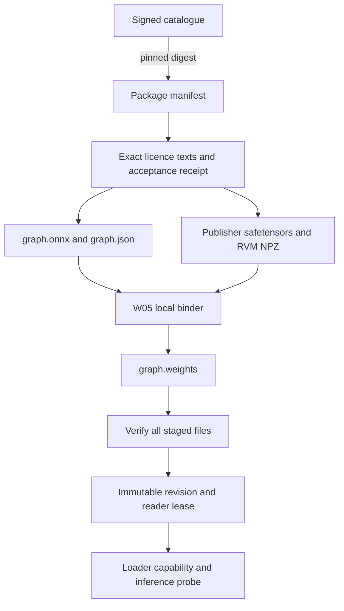

<!-- SPDX-License-Identifier: GPL-3.0-or-later -->
# Model packages and the catalogue

A package pins a set of weight-free ONNX graphs, their exporter JSON files and
all publisher checkpoints needed to bind them locally. The installer verifies
those downloads and runs the [native weight binder](binder.md); the inference loader must still
probe the resulting graphs before using them for video.

The bundled [catalogue](../../data/models/catalogue-v1.json) contains CK2 Facecam,
CK2 Balanced / Quality, and Edge Refiner v12. The CK2 packages use separate
MoGe, RVM and mask-free Stage 1 graphs; Quality adds `stage2nomask`. All graphs
pin revision `5d88114f169cb082cda238426af47feffb9724af`. The optional merged
graphs are excluded. With Edge refiner enabled, activation leases the refiner
package alongside CK2 and selects the graph matching the tile budget.

The catalogue is **unsigned and installer-only** pending coordinator key
provisioning. CMake hashes its exact bytes into `CORRIDORKEY_BUNDLED_CATALOGUE_SHA256`.
`installed_catalogue` reads only OBS's installed module data path and calls
`admit_installer_catalogue` with that compiled pin. A changed file fails admission,
including a replacement beside an unchanged plugin DLL. Package manifests are
then checked against the catalogue's sizes, SHA-256 digests and identities.
This trust starts with the installed plugin binary and its payload. Windows
builds currently have no Authenticode signature; users must obtain the installer
from the project's release channel. The digest does not authenticate a plugin
binary replaced by an attacker.

A release must provision the public key and sign the exact catalogue bytes in
the protected `release` environment. Set `CORRIDORKEY_CATALOGUE_PUBLIC_KEY` at
build time and install `catalogue-signature.json`. When a public key is compiled
in, a missing or invalid signature fails closed: there is no unsigned fallback.
Key generation and private-key handling belong to the coordinator. The release
workflow blocks its draft job until the signing placeholder is replaced; local
and CI development builds may use the pinned installer catalogue. Before enabling remote refresh, publish the
manifest assets at the catalogue's `model-catalogue-v1` release URLs; those
locators reserve the release destination and are not fetched by bundled setup.

Installer and signed admission share the persisted sequence floor and reject
conflicting bytes at the same sequence. Remote callers must continue using
`admit_catalogue`, which always requires a valid P-256 signature. Import bundles
supply blobs only. Neither network data, cache files nor an imported catalogue
can choose the compiled installer pin. Every downloaded artifact, offline source
and locally bound output still requires its declared SHA-256; installer trust
never skips content verification or licence acceptance.

[Production inventory](catalogue-v1-inventory.md) lists every size and digest,
including bound outputs. Graph pairs were downloaded anonymously once and
verified against the coordinator's revision-3 hash list and the HF API sizes.
Source metadata was checked against the HF API and CK2/RVM local hashes. The
pinned HF licence files match the bundled registry. Parity references retain
`unverified`: the existing measurements do not establish every packaged profile,
and the chained Quality reference has a known baton mismatch.

## Trust and file formats

The JSON schemas live in [`data/models/`](../../data/models/). Schema version 1
uses unsigned 64-bit integers for byte counts. The C++ parser also checks
references, destination collisions, tensor spans and arithmetic overflow, which
JSON Schema alone cannot express. Unknown fields, duplicate object keys,
unsupported versions, floating byte counts, excessive nesting and oversized
metadata fail validation.

A release catalogue contains `schema_version`, a monotonically increasing
`sequence`, and `packages`. Each package entry supplies its ID, immutable revision
and a manifest artifact with a byte count, SHA-256 and pinned HTTPS locator.
Authenticate the exact catalogue bytes with P-256/SHA-256 before following those
references. Signatures use 64 raw bytes, `r || s`, encoded as 128 lowercase hex
digits; the trusted public key is the 64-byte `x || y` point, also hex encoded.
The host supplies a release public key from its trusted installation. A downloaded
key cannot grant itself trust.

`admit_catalogue` stores the highest accepted sequence and digest in the cache.
It rejects rollback and different bytes at the same sequence. The host fetches
small catalogue/manifest metadata with bounded HTTPS requests, authenticates the
catalogue, then calls `parse_manifest` with the catalogue's digest. No remote
catalogue refresh is scheduled by this service. The bundled unsigned catalogue cannot pass remote admission.

A manifest contains:

- Package ID/revision, display name, description, publisher, pipeline and export
  contract version. IDs are portable ASCII names; revisions are 40 hex digits.
- Provenance: the source URL and exporter source revision.
- Licence IDs and exact text hashes, resolved against the bundled registry.
- Artifacts with their destination path, format, exact byte count, SHA-256,
  applicable licence IDs and origin. HF origins pin `repo`, `revision` and `file`.
  Direct HTTPS origins use the SHA-256 as their immutable revision.
- Graph records referencing an ONNX artifact, its JSON artifact and source IDs.
  Each record declares the local `.weights` path, expected bound size/hash,
  opset 18, ONNX IR version, FP32 precision, named input/output tensors, color
  contract and a pinned parity-report reference with its verification status.
- Profiles with explicit H/W grids, graph IDs, ROI use, refiner budget and settings
  schema version. The filter's settings service owns the remaining settings.
- Backend feature requirements and test evidence. `unverified`, `expected`,
  `build-only`, `hardware-tested` and `community-tested` describe evidence; they
  do not impose exact driver/runtime version equality checks. The loader owns
  capability negotiation and probes.
- Disk budgets for bound outputs, conversion workspace, engine cache and a margin.
  Authors must supply conservative nonzero estimates for work that needs space;
  zero means the package does not require that resource. Runtime RAM and precise
  GPU build budgets remain the binder/provider's responsibility.

The dependency structure has two levels: profiles reference graphs, and graphs
reference checkpoint artifacts. A checkpoint cannot reference a graph or another
checkpoint, so dependency cycles are unrepresentable. Every artifact must be
referenced. Artifact paths cannot collide, including by case on Windows. Absolute
paths, `..`, backslashes, device names, alternate data streams and cache metadata
filenames are rejected. The format list contains no executable or pickle format.

## Exporter layout



Each graph has sibling `name.onnx`, `name.json` and `name.weights` files. Only the
first two are downloaded. The ONNX external-data location is `name.weights`,
relative to the ONNX file. The manifest stores its path relative to the package
root. Do not add a downloadable `.weights` artifact or rename the graph in transit.

The exporter JSON has `graph`, `opset`, `inputs`, `outputs`, `weights` and `sources`;
grid graphs also have `H` and `W`. A weight row has `name`, `dtype`, `shape`,
`offset`, `length` and `source: {file, key, ops}`. Offsets are aligned to 64 bytes.
Lengths are the exact tensor byte counts and need not be multiples of 64. Rows
cannot overlap, and their final extent must match `weights_bytes`. The manifest's
interface and publisher source identities must match the exporter JSON.

Source IDs match the exporter: `ck2`, `stats`, `moge`, `rvm`, `refiner`. MoGe is the
encoder-only safetensors conversion, so the plugin never needs a pickle reader.
The validator admits the current RVM operations `squeeze`, `transpose`, `merge`
and `zeros`; W05 checks their tensor semantics while binding. A zero initializer
has null file/key and `[["zeros", null]]`. New operations require a reviewed
contract update. No manifest provides scripts, expressions or native libraries.

## Author example

This is the real MoGe source entry from the source inventory:

```json
{
  "id": "moge",
  "path": "sources/moge/model.safetensors",
  "format": "safetensors",
  "bytes": 351063528,
  "sha256": "be74d978c6a69cb467c057aa8b736e4b3a8eb9b2ec41622edd6b26c756573e3b",
  "licenses": ["LicenseRef-MoGe-MIT-DINOv2"],
  "origin": {
    "repo": "mantelmoritz/MoGe-2-ViT-B-Encoder-safetensors",
    "revision": "3090937b74a09929079cf6c77ad1edd40a0a9aaf",
    "file": "model.safetensors"
  }
}
```

It resolves to HF's anonymous `/resolve/<commit>/<file>` endpoint. The conversion
comes from `Ruicheng/moge-2-vitb-normal` at
`ca5f0e07ff01d3e5a364c1d954ed12ee1814b368`; the MIT text and DINOv2 Apache-2.0
notice are retained together. Check this lineage again if publishing a new
conversion.

A complete [synthetic manifest](../../tests/models/fixtures/package-v1.json)
shows the wrapper and graph references without any CorridorKey material. Its
URLs, revision and graph bytes are test fixtures and must never enter a release
catalogue. Generate its offline blob folder with:

```sh
corridorkey_models_tests --write-fixture build/example-bundle
```

## Publisher sources and licences

The inventory pins these files. HF LFS metadata was checked anonymously on
29 October 2026; the multi-gigabyte checkpoints were not downloaded in W04.

| Source | Publisher/repository | Revision | Bytes |
| --- | --- | --- | ---: |
| `ck2` | `nikopueringer/CorridorKey2.0` | `cf44a8db3f024bb49fd59daa408848ccf05f7477` | 2,661,698,720 |
| `stats` | Same | Same | 18,864 |
| `moge` | `mantelmoritz/MoGe-2-ViT-B-Encoder-safetensors` | `3090937b74a09929079cf6c77ad1edd40a0a9aaf` | 351,063,528 |
| `refiner` | `mantelmoritz/CorridorKey-Realtime-EdgeRefiner` | `6e37255904c81ab224b1a1b39cbe4512c7a6dafb` | 94,336 |
| `rvm` | [Google DeepMind GCS checkpoint](https://storage.googleapis.com/representations4d/checkpoints/pretrain_rvm_small16_256_204031069.npz) | SHA-256 content identity in inventory | 270,086,372 |

RVM's publisher MD5 is `ZJb6kj8+tasiJbVeplXu7Q==`; the GCS header was checked on
the same date. It is retained as provenance. Installation always verifies SHA-256.
This is Recurrent Video MAE, not Robust Video Matting.

[`licenses-v1.json`](../../data/models/licenses-v1.json) includes the full licence
texts, source URLs, attribution, scope and text hashes:

| Licence ID | Scope |
| --- | --- |
| `LicenseRef-Corridor-Key-2.0` | CK2, CK-derived graph exports and Edge Refiner; retain Corridor Digital / Niko Pueringer and CorridorKey attribution |
| `LicenseRef-Corridor-Key-1.0` | CK1 GitHub terms; weight-specific HF wording remains unresolved, so no CK1 package is enabled |
| `LicenseRef-MoGe-MIT-DINOv2` | Microsoft MIT text with its bundled Apache-2.0 notice |
| `CC-BY-4.0` | DeepMind RVM checkpoint |
| `Apache-2.0` | MODNet code, models and demos, excluding its GIF files; no pinned hint checkpoint is admitted yet |

The [MODNet README at the reviewed revision](https://github.com/ZHKKKe/MODNet/tree/28165a451e4610c9d77cfdf925a94610bb2810fb#license)
explicitly includes models. Do not reuse superseded 2020 licensing claims.
The CK licence records are separate because v1 and v2 terms differ. For refiner
releases, compare its pinned licence with the CK2 text before reusing that record.

Show the complete dependency list, source attribution, licence texts, destination
and disk estimate before acceptance. Call `AcceptanceStore::accept` only after the
user has accepted those exact texts. Receipts record package/revision, manifest
hash, every text hash, Unix timestamp and a local user-context label. They stay on
this machine. A changed manifest or licence text needs a new receipt.
`licence_notices` assembles the same records for an attribution view/export.

## Downloads and offline import

`CatalogueService` copies install requests into a bounded worker queue. Calls from
multiple filters share pending jobs. OS lock files deduplicate blobs and revisions
across processes; two process-wide transfer slots bound network concurrency.
Lock files remain on disk because deleting a live lock file can split its identity.
The OS releases the held lock when its process exits.

Every payload download requires a matching acceptance receipt, including files
already supplied offline. Requests use anonymous HTTPS, follow at most eight
HTTPS redirects and ask for identity encoding. The service does not read token
files, `.netrc`, browser cookies or HF account settings. Gated downloads are
unsupported. Signed CDN query strings are used only in memory; partial receipts
store a hash of the original public URL.

Partials retain a strong ETag or Last-Modified validator. Resume sends `Range`
and `If-Range` and checks the exact `Content-Range`. A full 200 response truncates
the partial and restarts. A changed/missing validator or 416 response discards the
old partial and retries. Partial responses without a usable validator restart
from zero on the next attempt. ETags never substitute for SHA-256.

Network loss, 408, 429 and server failures get at most five attempts, with capped
exponential backoff. Numeric `Retry-After` is honored up to 60 seconds; a date-form
header uses the normal backoff. Cancellation interrupts chunk processing, lock
waits and backoff. A synchronous WinHTTP call can take up to its configured network
timeout to return. Disk failures retain no finalized blob. A hash mismatch deletes
the partial and requires a new request. Finalization uses an atomic rename only
after the complete SHA-256 matches.

Offline bundles contain `blobs/<sha256>` for every artifact in the already trusted
manifest. Import a folder or a ZIP containing those entries. ZIP supports stored
and raw-deflate members, ZIP64 sizes and bounded directory metadata. Import rejects
unexpected paths, duplicate entries, links, devices, encryption, split archives,
wrong sizes, excess expansion and hash mismatches. It never extracts archive paths
into the cache. Folder blobs must resolve directly under the selected folder.
Import verifies files through the same licence, space and content checks and then
uses the normal binder path. It does not admit an unsigned manifest from a ZIP.

## Cache and handoff

The OBS adapter returns `obs_module_config_path("models")`; pass that path to
`Cache`. Tests and an explicit external-cache choice can supply another root.
The core has no OBS dependency. The cache layout is:

```text
models/
  blobs/sha256/<digest>          verified original downloads
  partial/<digest>.partial      resumable bytes
  partial/<digest>.json         origin identity and validator
  staging/<id>/<revision>/      graph pair and unfinished local weights
  packages/<id>/<revision>/     immutable verified graph/weights generation
  receipts/<manifest-hash>.json licence acceptance
  receipts/current-<id>.json    explicit active revision
  receipts/catalogue.json      highest admitted catalogue sequence
  locks/                       process locks and transfer slots
```

Space checks query the destination volume. Admission reserves all new download
bytes, staged graph copies, bound outputs, conversion workspace, engine budget
and a margin of at least 1 GiB or 10 percent. Existing rollback revisions already
consume that volume's free space. The estimate intentionally overcounts reusable
blobs; it favors a clear refusal over filling the disk. Space is checked again
before binding and during writes. W05/W06 must check their actual workspace and
engine-build requirements before those operations.

The binder runs on the worker while holding the revision
lock. It reads authenticated blobs through `cache.blob(digest)` and writes only
the declared `.weights` outputs, binding receipts and lock files under
`cache.staging(key)`. The cache copies the
ONNX/JSON pair there first. On return it validates source metadata, byte counts
and every output digest, writes the ready receipt and renames the directory.
An empty `BindWeights` callback selects the native implementation and reports
byte progress through `ModelStatus`. A supplied callback overrides it.

Installing an update never changes `current`. `select_current` is an explicit
operation after preparation; `clear_current` permits removal of the selected
revision. `ReadyModel` owns a shared OS reader lease. Removal takes an exclusive
revision lock and returns false while a reader or install holds it. Blob pruning
requires an exclusive cache-data lock and a complete keep-set supplied by the
caller; it returns false while any session or install is active.

The cache rejects symlinks and Windows reparse points at path resolution and
before publication/removal. Its root must be a user-owned configuration directory.
It does not defend against a separate hostile local process replacing directories
between filesystem calls. Locks coordinate cooperating plugin processes on a
local filesystem; network filesystems need separate validation.

## Validation and remaining release inputs

Build portable tests with OBS disabled. Linux needs system libcurl (7.85+),
OpenSSL 3 and zlib; install `libcurl4-openssl-dev libssl-dev zlib1g-dev
nlohmann-json3-dev` on Ubuntu 24.04. Windows uses WinHTTP/CNG and prefers the SDK's
static zlib. A build without zlib fetches the SHA-256-pinned zlib 1.3.2 source.
The header-only JSON dependency similarly prefers an installed copy and otherwise
fetches pinned nlohmann/json 3.11.3. These are build dependencies; users need no
Python installation.

```sh
cmake -S . -B build-contracts -DCORRIDORKEY_BUILD_PLUGIN=OFF
cmake --build build-contracts --config RelWithDebInfo
ctest --test-dir build-contracts -C RelWithDebInfo --output-on-failure
```

The local Python HTTP harness tests resume, ignored Range, changed/missing
validators, 416, 429/backoff, interrupted bodies, cancellation, full-disk injection,
bad hashes and redirect failures. It also checks process deduplication, crash lock
release, cross-process leases, folder/ZIP import and malicious archive paths. It
uses a test-only loopback transport policy; manifests always require HTTPS.

The production entries pin graph/JSON hashes and sizes, expected bound-output
hashes, ONNX IR 10, static interfaces and the existing validation report. Release
tooling still needs catalogue signing and a public-key rotation policy. CK1 licence wording and an exact MODNet checkpoint remain open. Windows
unit/HTTP tests and an OBS 30.2 SDK build do not establish Linux transport behavior,
large ZIP64 interoperability or model inference parity. W09b separately exercised
the real anonymous HF/CDN transfer, native binding and normal-cache activation
in portable OBS 33; see its [validation record](validation-w09b.md).
