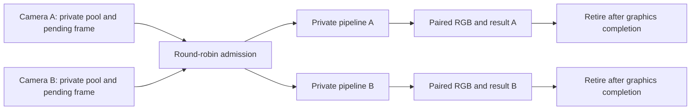
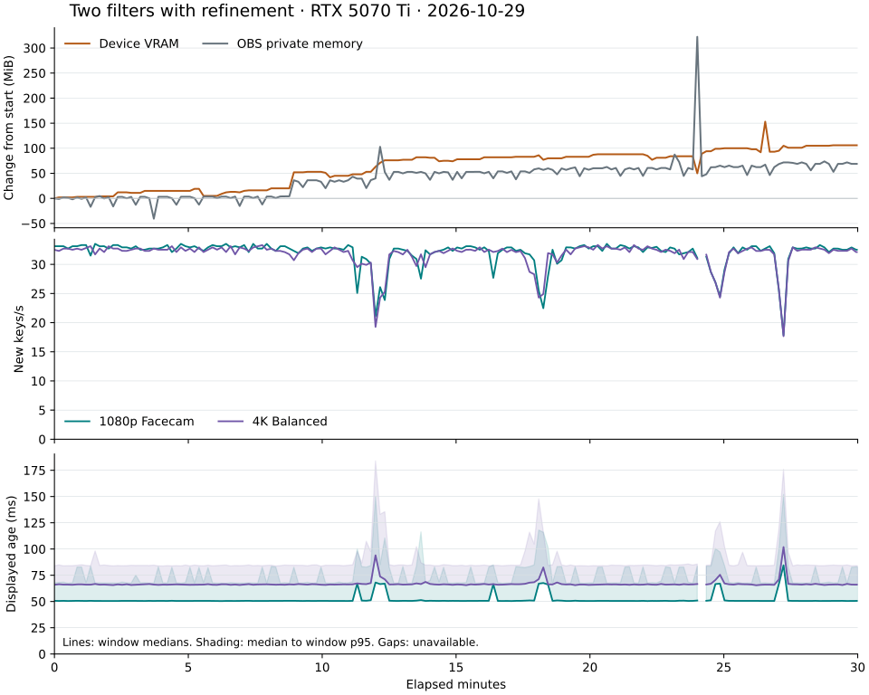

<!-- SPDX-License-Identifier: GPL-3.0-or-later -->
# Multiple sources and lifecycle

Each filter owns its recurrent tensors, MoGe cache, crop, settings snapshot,
generation, capture sequence and five frame slots. Source dimensions determine
native allocations. The model grid belongs to the preset; changing the OBS
canvas does not change either camera's input dimensions.

## Admission and retirement

One process-wide admission gate serializes model inference on the current OBS
adapter. Waiting instances take turns in registration order. Each instance keeps
one running job and replaces its single pending job with the newest ready frame.
There is no queue of old camera frames. Duplicate draws in the same video tick
reuse the current result without submitting a second inference.

Cancelling a generation drops its pending input but keeps its admission slot
until the pipeline has finished the running job. A stale result cannot release
another generation's storage or reach presentation. The fake can discard stale
results internally, so the coordinator also checks its outstanding count when
draining. Scheduler destruction follows pipeline shutdown.



Capture retirement and mailbox transfer run from `video_tick`, before drawing.
The old worker-queued transfer callback had a `transfer_queued` flag which only
the callback cleared. Losing that callback while resetting the video system
could leave transfer admission permanently closed. OBS frees that queue during
`obs_reset_video`. Tick-based servicing has no outstanding callback flag and
resumes with the video thread. Preparation and detached teardown enter the OBS
graphics context directly from their worker, without holding the filter mutex;
they do not wait for a callback that a canvas reset could discard.

After 500 ms without a render, the filter invalidates its generation and drains
work. Once all leases retire, it releases the native transport and reconstruction
textures. Showing the source allocates them again and resets temporal state.
Sessions remain loaded for reuse. CUDA capture registrations are cleared on the
coordinator worker at generation changes; old source sizes therefore do not stay
alive in the registration cache.

A transport device-loss error requests one new generation. A second failure
stays in passthrough until a settings/source change or explicit reset rearms
recovery. Driver calls that never return cannot be recovered by this mechanism.
Thread joins and CUDA unregister calls remain outside the render callback.

## Model and session ownership

The implementation uses per-instance sessions and persistent TensorRT bindings.
Sharing a captured session would also share its fixed input/output addresses;
the next source could overwrite outputs still consumed by reconstruction or the
refiner. Sharing would require additional result copies and an explicit ownership
protocol. No recurrent state or last-result texture is shared.

Opening a third captured session during live inference reproduced CUDA 900/906
errors and stalled both existing filters. Warming a graph while its own source
is in passthrough does not exclude CUDA calls from other sources.

A process-wide CUDA activity gate now excludes other plugin CUDA calls during
the first three successful bound calls for a captured session on each calling
thread. This covers
warm-up and capture startup, including provider implementations with per-thread
capture state. The current TensorRT EP uses an initial ordinary run before
capture; see its [capture policy](https://github.com/microsoft/onnxruntime/blob/v1.23.2/onnxruntime/core/providers/tensorrt/tensorrt_execution_provider.h#L391-L455).
Fixed bindings and static shapes remain required. Subsequent calls share the
gate with interop and other ordinary CUDA work.

Session construction holds a shared preparation lease. If a capture is waiting
for a slow constructor, existing inference and transfers can continue until
construction ends. The gate then drains active calls and admits capture before
new ordinary calls. Its nested scopes are worker-only; render callbacks do not
wait on it. This coordinates this plugin's CUDA use, not unrelated plugins that
make CUDA calls in the same process.

Model packages and serialized engines use the existing verified cache. A
cancellable preparation gate serializes helper work and session creation for an
identical graph hash. The helper publishes its cached engine before the next
instance opens that graph. Different graphs can prepare independently. The
on-disk engine identity still includes shape, precision, weights, adapter,
runtime and provider options.

Cache snapshot readers and publishers retry transient lock contention for up
to 30 seconds on loader/teardown threads. Previously a competing reader could
receive "Backend cache busy" immediately, causing an unnecessary backend
failure or rebuild. Each live session still has a private writable cache copy.
Cross-process cold builds can duplicate compilation; the preparation gate is
process-local. Atomic cache publication prevents partial engine reuse.

## Native storage

The five retained native frames now use RGBA16F. Outputs already used RGBA16F.
Coefficient solving, each instance's shared native raw field, refiner blending,
D3D11/CUDA atlases and low-resolution model maps retain their previous formats.

At 3840x2160, changing five native frames from 16 to 8 bytes/pixel saves
331,776,000 bytes, or 316.41 MiB, per instance. The five native frames, five
outputs and one raw field total 759.38 MiB instead of 1075.78 MiB. These are
texture-size calculations; grid maps, refiner resources, sessions, OBS and driver
allocations add to measured device memory.

All 17 D3D11 reconstruction fixtures compare RGBA16F native storage plus RGBA16F
output with the original FP32 reference. The maximum output-channel difference
is 0.001576462 with a 0.002 limit. Fixtures cover odd and portrait sizes, source
alpha, crops, singular guidance, nonfinite inputs, half-grid model output and
both foreground reconstruction modes. Existing stricter FP32 comparisons remain
unchanged. This synthetic check does not establish full-sequence model parity.

## Reproducing the checks

Build against the OBS 30.2 SDK with `CORRIDORKEY_ENABLE_FAKE_FILTER=ON`. Real
model tests also need the optional ORT runtime; the local development override
requires `CORRIDORKEY_CK2_DEV=ON`. Keep build products inside the worktree.

Load [`obs-w16.lua`](../../tests/obs-w16.lua) in a dedicated portable OBS 30.2 or
33 `CorridorKey Test` collection. Its saved settings need `directory` for the
command/acknowledgement files and `footage` for the existing test clips. The
script refuses to run in another collection. Disable obs-websocket in the test
profile. The driver uses file commands and creates no listening socket or browser
source.

The Lua canvas action posts the native frontend reset function to OBS's UI task
queue. Calling it directly from a scripting timer can crash the frontend. Scene
creation waits until the first command, after scene-collection loading. Use a
valid starting scene; OBS 30.2's bundled obs-websocket can crash on an empty
collection even with its server disabled. The tested 30.2 copy excluded that
module.

```text
python tests/obs-multi-instance.py lifecycle --directory RUN --log OBS_LOG --output lifecycle.json
python tests/obs-multi-instance.py command --directory RUN --action real1
python tests/obs-multi-instance.py command --directory RUN --action add2
python tests/obs-multi-instance.py sample --directory RUN --log OBS_LOG --pid OBS_PID --seconds 1800 --output soak.jsonl
python tests/obs-multi-instance.py close --directory RUN --log OBS_LOG --pid OBS_PID
```

Wait for both filters to finish preparation before starting a sample. Use
`add3`/`remove3` for the odd-sized third source. The lifecycle sequence exercises
three fake instances, duplicate drawing, hide/show, an empty scene, portrait
resize, crop changes, enable/disable, canvas reset, injected OOM/backend/nonfinite
failures and deletion during delayed inference. It records acknowledgements and
requires completion telemetry from at least three instances.

The sampler records process private bytes and working set, whole-device VRAM,
GPU utilization, GPU process inventory and per-instance counters every ten
seconds. `keyed_fps` counts distinct results displayed in the recent five-second
window. `dropped` includes skipped capture opportunities, superseded pending
frames, rejected submissions and discarded pipeline results; it is not an OBS
render-skip counter. Displayed age preserves the original capture timestamp when
a result repeats.

Coordinate the GPU reservation with other work, check `nvidia-smi` for competing
workloads, and release the reservation when measurements finish. Never close an
OBS process that the test did not launch.

## Automated validation

The Windows MSVC build uses C++20 and warnings as errors. All 14 CI-selected
CTest suites pass. A separate MSVC AddressSanitizer build passes all 13
applicable portable suites. The local-model binder test is excluded from those
totals. MSVC AddressSanitizer
does not provide ThreadSanitizer or leak-sanitizer coverage.

New stress tests run eight workers through 16,000 admission cycles and another
16,000 shared-pool acquisitions with concurrent generation changes. Tests also
cover admission exhaustion/reuse, cancellation while owning admission, cancelled
preparation waiters and 40 contending cache read/publish operations. Existing
tests cover independent CK2 recurrence, fake OOM and invalid output, immutable
settings, cancellation during binding and model-manager lifetime tracking.

The added mixed-family test runs real CK1/MODNet and CK2 pipeline workers with
deterministic graph fixtures through one admission gate. It checks distinct frame
identities, grids and native sizes, different alpha results, and CK2 recurrent
state across eight rounds. Capture-gate stress covers 1,600 shared/exclusive
entries, nested scopes and continued live work while a constructor delays
capture. Both checks pass normally and under AddressSanitizer.

## Lifecycle results

Measurements include W14's CK1 selection and settings changes from `9a5577e`.
The final branch was rebased again onto `327bb68`, which adds catalogue signing
and packaging changes. The measured runtime sources are unchanged by that rebase.
The shared `PixelFormat` enum gained an appended `rgba_f16`
value so the retained native texture's metadata matches its storage. No settings
or pipeline selection rules changed.

Portable OBS 33.0.0 and 30.2.0 passed the scripted fake-pipeline sequence. A
1080p Facecam source, a 4K Balanced source and a 719x1281 source continued keying
after hide/show, scene changes, resize, duplicate draws, crop edits, disable/enable,
canvas reset and injected failures. Removing a filter during delayed fake
inference and during real TensorRT preparation both completed without a crash.
The latter cancelled its helper; a replacement filter prepared successfully.
OBS 30.2 also exited with filters present, unloaded the plugin and reported zero
OBS memory leaks.

A separate 40-second libobs harness repeatedly changed the canvas while a 1080p
source kept drawing. Baseline `b33fe0f` stopped at 281 completed jobs after a
reset; captures stopped and displayed keys/s became unavailable. The candidate
completed 2,390 jobs, still displayed 59.7 keys/s in its final window and unloaded
cleanly. These functional runs overlapped other W16 tests, so their timings are
not performance benchmarks.

The first two frontend-driver attempts failed before this validation: a reset
from the scripting thread crashed OBS 33, and creating scenes during collection
loading crashed OBS 30.2. The driver now defers both operations appropriately.
The separate obs-websocket startup failure described above was also excluded
before rerunning the complete 30.2 sequence.

## Steady-state measurements

On 2026-10-29, the final build used TensorRT through D3D11/CUDA transport on a
3840x2160, 60 FPS canvas. Stage 1 and the refiner used FP16; MoGe and RVM used
FP32. Capture was enabled except for MoGe. Both clips looped with CPU decoding,
and no encoder ran. The export evaluation had exited before these samples.

Each row covers 60 seconds after preparation and warm-up. VRAM is the entire
device, including desktop apps. It excludes temporary engine-build peaks.
Frame rates and ages below are medians of sampled rolling telemetry; the p95
column is the median of those windows' p95 ages, not a full-run percentile.

| Active filters | Whole-device VRAM | Process private memory range |
| --- | ---: | ---: |
| 1080p Facecam | 4,841–4,848 MiB | 5,967–5,972 MiB |
| + 4K Balanced | 8,023–8,029 MiB | 11,879–11,896 MiB |
| + 719x1281 Facecam | 10,056–10,063 MiB | 16,109–16,152 MiB |

| Active filters | Source | New keys/s | Median age | Window p95 age |
| --- | --- | ---: | ---: | ---: |
| 1 | 1080p Facecam | 59.6 | 33.5 ms | 33.7 ms |
| 2 | 1080p Facecam | 33.3 | 50.5 ms | 67.5 ms |
| 2 | 4K Balanced | 32.9 | 66.0 ms | 84.0 ms |
| 3 | 1080p Facecam | 22.5 | 66.7 ms | 84.4 ms |
| 3 | 4K Balanced | 22.5 | 66.8 ms | 98.6 ms |
| 3 | 719x1281 Facecam | 22.9 | 65.6 ms | 84.0 ms |

These results support keeping per-instance captured sessions: three filters fit
within the 16 GB card, and all three keep making progress at similar rates.
A shared live session was not benchmarked. It would need a different result
ownership scheme and extra copies before another source could reuse its fixed
bindings. The existing shared engine cache avoids duplicating serialized
artifacts, while native scratch stays private where graphics work can overlap.

Adding the third filter no longer produced the earlier CUDA capture errors.
Removing it during live inference returned the remaining two to roughly
33 keys/s before the soak began.

## Thirty-minute soak

The two refined clips ran from 14:43:00 to 15:13:01 CET on 2026-10-29. The
sampler covered 1,800.14 seconds with 179 samples. There was no export evaluation
or other scheduled GPU workload. Desktop applications remained open.

| Source | Completed work | Dropped work | Median new keys/s | Median age | Median window p95 age |
| --- | ---: | ---: | ---: | ---: | ---: |
| 1080p Facecam | 58,041 | 49,089 | 32.7 | 50.6 ms | 67.9 ms |
| 4K Balanced | 57,943 | 49,021 | 32.3 | 66.2 ms | 84.5 ms |

The counters include completed work that was not ultimately displayed. Dropped
work includes replaced or skipped inputs as described above; a 60 Hz source
does not build a queue while inference runs at about 33 keys/s. Every full
sampling interval had new completions from both filters. The final sample was
only 3.8 seconds after its predecessor and reused the same ten-second log counters.

Whole-device VRAM rose from 8,039 to 8,145 MiB, a 106 MiB increase, with a range
of 8,039–8,192 MiB. OBS private memory rose from 12,052.6 to 12,121.5 MiB, a
68.9 MiB increase, with a range of 12,012.1–12,374.9 MiB. Working set ended
27.1 MiB higher. Linear fits give 3.86 MiB/min for device memory and 2.98 MiB/min
for private memory. This positive trend needs a longer allocation-profiled run
to distinguish retained decoder/driver allocations from a leak.

Both filters briefly reported “Warming up” around 15:07:01 and resumed keying
by 15:07:10 without a command or CUDA error. The trigger was not identified.
One sample per filter therefore has unavailable timing. Those values are omitted
from timing summaries and shown as gaps in the plot. Among valid samples,
minimum new keys/s was 17.9/17.7, and the largest window p95 age was
151.9/183.9 ms for Facecam/Balanced. Both filters recovered automatically, but
throughput and latency varied during the run.



The [measurement data](validation-w16.json) contains the sample series, counters,
test conditions and one/two/three-instance summaries. It excludes process names,
local paths and source images.

## Hiding and restoring sources

After the soak, hiding the 1080p source reduced whole-device VRAM to
7,726–7,733 MiB. Switching to an empty scene reduced it further to
6,747–6,754 MiB. Each sample lasted 30 seconds after a five-second drain.
The two live filters had used 8,145 MiB at the end of the soak. Model sessions
remained loaded; the reduction therefore comes from released source/native
resources rather than unloading all inference state. Both filters resumed
keying when their scene and visibility were restored. The subsequent 30-second
sample had median rates of 32.4 and 32.2 new keys/s, with no engine rebuild.

## Mixed CK1 and CK2

The first source then switched to experimental CK1 at 384x384 with MODNet and
refinement off. The second kept CK2 Balanced at 4K with refinement on. CK2
continued keying while the CK1 and MODNet graphs prepared. After preparation,
a 60-second sample produced these rolling-window medians:

| Source | New keys/s | Median age | Window p95 age |
| --- | ---: | ---: | ---: |
| 1080p CK1 + MODNet | 33.5 | 33.4 ms | 50.6 ms |
| 4K CK2 Balanced, refined | 34.7 | 65.7 ms | 88.5 ms |

Both completion counters advanced in every sample. Whole-device VRAM ranged
from 6,564 to 6,591 MiB, and OBS private memory from 8,872 to 8,892 MiB.
There were no CUDA 900/906 errors. This short mixed-family check does not replace
the two-CK2 soak or evaluate CK1 image quality.

OBS 33 then exited while both filters were active. The plugin unloaded, OBS
reported zero memory leaks, and whole-device VRAM fell to 2,396 MiB immediately
after exit. That OBS leak count covers its allocator, not every driver allocation.
The GPU reservation was released at 15:22 CET.

## Limits

The real-model checks use looping prerecorded 1080p and 4K clips, plus a solid
719x1281 source for the third instance. They do not exercise physical camera
drivers, an encoder, streaming or a game sharing the GPU. Tests used Windows 11,
an RTX 5070 Ti and NVIDIA driver 616.92. Linux and AMD hardware were not available.

OOM, unavailable-backend and invalid-output recovery are injected through the
fake pipeline. A real TDR or adapter removal was not forced on the shared
workstation. The transport's bounded device-loss retry is therefore not a claim
of recovery from a driver hang. An in-process driver call that stops returning
can still prevent shutdown; a native driver fault can still crash OBS.

Cancellation during download/binding and model-manager lifetime changes have
unit coverage. The live deletion test interrupts TensorRT preparation and fake
inference; it does not repeat every download/bind phase through the OBS UI.
The native texture checks are synthetic numeric parity tests, not a new
end-to-end visual-quality evaluation of the models.
