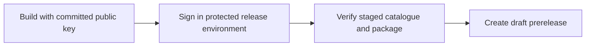

<!-- SPDX-License-Identifier: GPL-3.0-or-later -->
# Packaging and runtime distribution

W19 keeps the plugin installer small and downloads NVIDIA runtimes separately.
No model weights, CorridorKey ONNX graphs or compiled model engines enter release
packages. The two `tools/probe-*.onnx` files are synthetic Add diagnostics with
four constants authored in `packaging/package.py`. They are not neural models.

## Package lanes

Windows release packages use the OBS 30.2 SDK and host-provided Qt. CI also
compiles the current SDK lane. The installer detects an OBS x64 executable,
chooses flat modules for 33+ or `bin/64bit` for 30.2–32, and lets the user correct
the host choice. It refuses installation and uninstall while any `obs64.exe`
process is running. Enumeration failure also stops installation; it never
terminates OBS. Upgrades remove both old module positions inside the selected
plugin target, then install one. Manual legacy copies in the selected OBS root
cause an actionable refusal rather than deletion outside that target.

Portable installs use the documented zips. The smoke-only Inno `PackagingSmoke`
define changes the uninstall identity and privileges so a portable test cannot
overwrite the normal system uninstall entry. Its payload and layout logic are
the same. Windows executables and installers lack Authenticode signatures.
Installation to ProgramData requires administration. The compiler is Inno Setup
6.5.4, pinned by SHA-256. Its
licence permits distributing generated installers; original attribution remains
in the installer. See [Inno licensing](https://jrsoftware.org/isinfo.php).

Linux stages `/usr/lib/x86_64-linux-gnu/obs-plugins`,
`/usr/share/obs/obs-plugins/corridorkey` and `/usr/libexec/corridorkey`.
Configure `CMAKE_INSTALL_PREFIX=/usr` before compiling, because the helper path
is compiled into the Qt manager. Passing `--prefix /usr` only during install
does not fix a helper path compiled as `/usr/local/libexec`.
Ubuntu 24.04 and 26.04 get separate artifacts and dependency metadata. Both
build against the 30.2 public API baseline, with their own distro Qt/OS floor.
The newer lane avoids dropping 24.04 when upstream OBS raises its dependency
floor. Flatpak is excluded. Linux compilation and `.deb` installation still
require CI/native validation; no local Linux runtime is available here.

## Licence evidence and delivery

The review date is 29 October 2026. The exact archive URLs, byte counts, hashes,
selected member paths and extracted-file hashes live in
`packaging/runtime-lock.json` and `data/runtimes/runtime-recipes-v1.json`.
Build pins identify reviewed artifacts, not a version-string equality policy
for the user's host or driver. W06 negotiates ORT APIs and probes providers.

| Component | Evidence and decision |
| --- | --- |
| ORT DirectML 1.24.4 | Microsoft's official NuGet package contains `LICENSE` (MIT) and `ThirdPartyNotices.txt`. Copy both with the x64 core and shared-provider DLL. [Official package](https://www.nuget.org/packages/Microsoft.ML.OnnxRuntime.DirectML/1.24.4) |
| DirectML 1.15.4 | The official `Microsoft.AI.DirectML` NuGet `LICENSE.txt`, section 1(a), permits copying and distribution in Windows/Xbox applications and services. Section 3(c) retains notices; 3(e) excludes standalone distribution except the express grant. Ship only `bin/x64-win/DirectML.dll`, with `LICENSE.txt` and `ThirdPartyNotices.txt`, as part of the plugin application. [Official package](https://www.nuget.org/packages/Microsoft.AI.DirectML/1.15.4) |
| ORT GPU/core 1.31.1 | Microsoft publishes the GitHub Windows archive and the Linux PyPI wheel with MIT and third-party notices. Runtime recipes select native files only; no Python bindings are installed. The Linux base package uses the smaller CPU archive. [ORT release](https://github.com/microsoft/onnxruntime/releases/tag/v1.31.1) |
| CUDA runtime, cuBLAS, cuRAND, NVRTC, nvJitLink | CUDA's SDK EULA and Attachment A identify redistributable runtime libraries and require the associated notices and application distribution conditions. Retain each wheel's complete licence, including embedded third-party notices. NVIDIA-owned wheels are downloaded directly; W19 does not mirror or upload these binaries. [CUDA EULA](https://docs.nvidia.com/cuda/eula/index.html) |
| TensorRT 10.15.1.29 | The official NVIDIA-index wheel includes its SLA and supplement in `LICENSE.txt`. The supplement allows runtime distribution as part of an application with additional functionality and downstream restrictions. A general standalone library mirror would not satisfy that use. Use the vendor URL and show the complete supplied agreement. TensorRT 11 cannot replace the imported TensorRT 10 library names. [NVIDIA index](https://pypi.nvidia.com/tensorrt-cu13-libs/), [TensorRT SLA](https://docs.nvidia.com/deeplearning/tensorrt/latest/reference/sla.html) |
| cuDNN 9.27.0.42 | The official wheel includes an older supplement that names `cudnn64_7.dll`, despite shipping version-9 DLLs. That is not evidence that this project may mirror the version-9 Windows files. Use NVIDIA's official publisher URL and show the wheel's exact agreement. Keep the upstream ambiguity visible; do not replace it with an invented permissive notice. [cuDNN SLA](https://docs.nvidia.com/deeplearning/cudnn/backend/latest/reference/eula.html) |
| TensorRT-RTX 0.5.0 / 1.7.1.116 | The EP wheel has no standalone licence files. The matching official SDK supplies `doc/Acknowledgements.txt` and a README linking the SLA. The SDK's RTX and ONNX parser DLL hashes match the EP wheel byte for byte. The recipe retains those notices, the full reviewed SLA snapshot and the EP project's Apache/MIT `LICENSE`. [SDK download page](https://developer.nvidia.com/tensorrt-rtx), [RTX SLA](https://docs.nvidia.com/deeplearning/tensorrt-rtx/latest/reference/sla.html), [EP licence](https://github.com/NVIDIA/TensorRT-RTX-EP-ABI/blob/v0.5.0/LICENSE) |

RTX SLA 1.1 permits application distribution under its listed conditions;
2.5 preserves notices and 2.7 limits applying open-source terms to the runtime.
The plugin's GPL section-7 GPU permission keeps these separate terms intact.
RTX SLA 2.13 also restricts public disclosure of performance/benchmark output.
This package adds no published NVIDIA benchmark measurements. Review that clause
before publishing new results; an optional download does not remove its terms.

All NVIDIA components use vendor-direct delivery, including those whose terms
permit application redistribution. PyPI `files.pythonhosted.org` URLs refer to
the wheels published by NVIDIA, linked through its documented installation
routes; they are not a project mirror. The SDK URL is the stable NVIDIA download
entry point. Its temporary redirect token is never pinned or committed.

The RTX SLA is a complete readable text snapshot of the SDK README's linked
agreement, including the April 21, 2025 version line. Its SHA-256 pins the exact
acceptance text. Archive licence files remain byte-for-byte copies. Long ORT
notices are split at line boundaries for W04's 256 KiB per-text limit; their
concatenation equals the full notice. Acceptance covers every chunk.

## Runtime trust and installation

`src/packaging/runtime_install.*` adapts installer-owned runtime metadata into
W04 `Manifest`, `LicenceRegistry`, `AcceptanceStore` and `DownloadEngine` objects.
It does not add native libraries to the model manifest schema. The executable
and plugin embed the runtime recipe file's SHA-256 at build time. A modified
recipe fails before showing an enabled download. Model catalogues cannot supply
runtime descriptors or change that trust anchor.

The worker verifies each archive's size and SHA-256 through W04, extracts only
catalogued ZIP members to catalogued relative paths, checks expanded size, CRC
and SHA-256, and publishes the complete directory with a rename. It writes
descriptors last. The ZIP reader rejects duplicate selected members, encrypted
entries, unsupported compression and unreviewed ZIP64 directories. It supports
large vendor files with bounded buffers; NPZ's smaller tensor limit is not
changed. Cancellation leaves unexposed staging files and resumable downloads.
Existing versioned bundles are not overwritten.

The GUI is **Tools → CorridorKey runtimes…**. It shows complete licence text,
requires acceptance, and runs download/extraction off the UI thread. It blocks
new installations during streaming/recording. The installed CLI provides the
same flow without Python:

```text
corridorkey-runtime <installed-runtime-recipes-v1.json> <runtime-cache> <bundle-id> show
corridorkey-runtime <installed-runtime-recipes-v1.json> <runtime-cache> <bundle-id> install
```

`install` requires the user to type `I ACCEPT`; `show` does not create a cache or
download anything. GUI caches live under the default model cache's
`runtime-cache/bundles/<bundle-id>`. Model data and downloaded runtimes therefore
share the installer's keep/remove-cache choice. The default DirectML/CPU
descriptor is indexed in `data/runtimes/probes.json` for W07's existing backend
test. The runtime dialog can test downloaded descriptors in the disposable
helper. W09 still owns live provider selection and graph preparation.

DirectML uses ORT 1.24.4; NVIDIA uses ORT 1.31.1. A mixed core supporting every
provider was not built. The runtime UI requires an OBS restart when switching
cores, and W06's collision checks remain in force. Seamless cross-core fallback
must not be advertised. Driver and GPU support follow each vendor's supported
ranges and the probe result; no single exact driver version is required.

Linux runtime files are flattened into their own versioned directory without
modifying vendor binaries. ELF inspection found `$ORIGIN` in the core,
cuBLAS/cuDNN/TensorRT search paths. The ORT EPs use explicit full-path preloads
for their NVIDIA dependencies. The NVIDIA driver and standard OS libraries stay
system dependencies. `libcurand.so.10` is needed by the Linux CUDA EP and is
included. This static inspection does not replace a native load/inference test.

## Release automation

Only standard GitHub-hosted `windows-2022`, `ubuntu-24.04` and `ubuntu-26.04`
runners are used. [GitHub documents](https://docs.github.com/en/repositories/releasing-projects-on-github/about-releases)
a limit below 2 GiB per asset, with no aggregate release/bandwidth limit. Each
published package and checksum is checked against that limit. The Linux
TensorRT vendor wheel alone is 3,713,901,680 bytes, so it cannot be a GitHub
release asset. Vendor-direct delivery avoids that limit. Stage and package
Actions artifacts have one-day retention. Ordinary branch/PR builds upload no
stages; release runs upload only the baseline Windows stage and the Linux lanes.
No optional NVIDIA libraries, SDKs or models are uploaded. Standard hosted
builds in public repositories are [free](https://docs.github.com/en/billing/concepts/product-billing/github-actions).
Actions artifact storage has a separate account allowance (500 MB on GitHub
Free), so concurrent release candidates can still consume that pool. The workflow
keeps large vendor downloads out of it and uses short retention. No paid or
self-hosted runner is configured.

`packaging/package.py` stages pinned base runtimes, creates actual-content
`THIRD_PARTY_NOTICES.md` and `BUNDLE_CONTENTS.json`, and produces zips or Linux
packages. `packaging-build.json` records linked dependency/SDK versions. Linux
dependencies come from `dpkg-shlibdeps`, and helper execute bits are preserved.
The old project-wide dependency list is retained as `PROJECT_DEPENDENCIES.md`,
separate from the shipped-payload inventory. The legacy zip's inventory records
its relocated module path. Generated inventories exclude their own hash.

`release.yml` accepts `v<buildspec-version>`, `-rc.N` and `-test.N`.
Production and RC tags run in this order:



The reusable build workflow reads `packaging/catalogue-public-key.txt` and passes
its contents as `-DCORRIDORKEY_CATALOGUE_PUBLIC_KEY`. CMake records that public
point and the exact catalogue digest in installed `models/catalogue-build.json`.
The signing job installs the pinned `tools/requirements-signing.txt` dependency
and runs `tools/sign-catalogue.py`. It reads the PKCS#8 PEM key only from the
step's `CATALOGUE_SIGNING_KEY` environment variable, checks that the public point
matches the committed key, and signs the exact bytes of
`data/models/catalogue-v1.json`. It verifies the result before uploading the
catalogue and signature. The envelope is `{"signature":"<128 lowercase hex digits>"}`,
with the raw P-256/SHA-256 `r || s` format expected by the C++ verifier.

The private key lives only in the protected `release` environment secret and an
owner-held offline backup. The environment requires MinersWin's approval and
allows `v*` tags. No build or packaging job receives the private key.
`tools/stage-catalogue.py` checks the build's public point, compiled digest,
staged catalogue bytes and signature before copying `catalogue-signature.json`
beside the installed catalogue. Missing signatures, wrong keys or changed bytes
stop packaging. All package formats inherit this verified payload. Signed
plugins reject a missing or invalid signature without an unsigned fallback.

All build and package steps still run for `-test.N` tags. Signing is skipped,
the build uses the compiled digest path, and no job requests the release
environment. The payload contains `UNSIGNED-TEST.txt`; package filenames start
with `unsigned-test-`, and Actions artifact names end with `-unsigned-test`.
Test tags create no GitHub Release. Ordinary branch/PR builds also retain the
unsigned pinned path. A branch `workflow_dispatch` produces unsigned test
artifacts with the same labels.

To run a release, update `buildspec.json`, review the catalogue and manifests,
and push a matching version or RC tag through the normal maintainer process.
Approve the protected signing job after reviewing its commit and catalogue.
The workflow packages both platforms and requests approval for the draft job.
Normal and RC tag pushes create a draft prerelease; maintainers review its
checksums and inventories before publication. No step publishes it automatically.
For `workflow_dispatch`, select an existing version tag; `create_draft=false`
signs and packages only, while `create_draft=true` also requests the draft.

For key rotation, the coordinator replaces the environment secret and offline
backup, commits the replacement public point, and rebuilds all release binaries.
Coordinate those changes before approving signing; a mismatched key fails the
job. Existing installations need the rebuilt plugin because their trusted key
is compiled in. If the key leaks, stop approvals, cancel pending runs, remove
the compromised secret, rotate the key and review or withdraw affected drafts
and assets. Publish recovery instructions requiring a plugin upgrade. See
[catalogue key custody and recovery](models-catalogue.md#signing-and-key-custody)
for the sequence-floor and trust implications.

For a local Windows package build, stage a baseline ORT-enabled CMake build,
install Python 3.12+ with `onnx==1.19.1` for the synthetic diagnostics, then run:

```powershell
python packaging/package.py --platform windows-x64
ISCC /DPluginVersion=0.1.0 /DStageDir=<absolute-stage> packaging/windows/installer.iss
python packaging/package.py --checksums-only
```

Normal builds consume the checked-in recipes and do not download NVIDIA SDKs.
`update-runtime-recipes.py` is a development-only refresh tool. It checks pinned
vendor archives in an ignored cache and regenerates hashes, sizes and licence
texts. A new artifact requires a new licence and dependency review. It performs
no catalogue signing or key operation.
