<!-- SPDX-License-Identifier: GPL-3.0-or-later -->
# Key quality parity

Stage 1 reconstruction now matches the research engine within the declared
numerical tolerances on 30 sampled frames. The grid correction restores native
skin and clothing detail and reduces edge-alpha error substantially. **The
halo-free visual acceptance is not met:** the matched `rgb3` research output also
has magenta fringes on the 4K dance frame. The screenshots below retain those
fringes so the remaining problem is visible.

The later [W13 refiner evaluation](refiner.md) adds native-tile inference and
compares it with the research engine's `refiner` mode. This page records the Q1
`rgb3` baseline.

## Root causes and fixes

Facecam inference uses a 512 x 256 analysis image, but Stage 1 returns 256 x 128
foreground and alpha. W08 enlarged those outputs to the analysis grid before
building guided-filter coefficients and colour deltas. The research engine
instead reduces the guide RGB to the decoded output grid first.

That mismatch had two effects. Radius two covered half the intended source
distance, changing the edge matte. Subtracting the finer guide from an enlarged
foreground also put guide detail into the colour correction. Adding that delta
to the native frame cancelled detail and produced the blotchy face and washed-out
clothing seen in the baseline.

The transport now selects a reconstruction instance at the decoded model size.
Guide sampling uses explicit bilinear pixel-centre coordinates before computing
moments or deltas. Both grid variants are allocated before capture and share the
native scratch target. Stage 2 continues to use the full grid. No model code,
weights, graphs or proprietary colour constants were added.

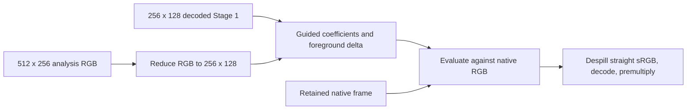

The audit also found that the nondefault compositing-equation mode solved
`I = alpha F + (1-alpha) B` in sRGB. It now decodes both colours, solves in linear
light and encodes the result before blending the correction. An analytic
mixture test and both GPU renderers verify this fix. This mode was not responsible
for the default delta-path defect and is not part of the real-clip parity table.

## Comparison method

`corridorkey_post_probe` has an `offline` mode that uploads native RGBA, analysis
RGB and decoded foreground/alpha from FP32 NPY files. It runs the production
`Reconstruction::prepare()` and `finish()` through libobs/D3D11, then reads back
raw straight foreground/alpha, coefficients, deltas, FP32 linear premultiplied
RGBA and RGBA16F output. It does not substitute a CPU reconstruction.

`tools/quality-parity.py` imports the external research checkout without modifying
it. It runs `engine.py` with `guide_mode="rgb3"`, the fused post pass, no learned
refiner, Facecam's 256 x 512 inference grid, Stage 1 only and `CK_SWIN_MASK=0`.
Radius is two decoded-model pixels, epsilon is 0.0005, despill is 0.65, contrast
is 1.05 and `unmix_inner` is 1. Temporal state resets between segments. Three
successive stored frames from each of the six `eval` and four `ck1` segments
were tested, starting at frame zero. This is a short correctness sample, not all
32 frames in each segment and not a temporal-quality certification.

Two comparisons separate reconstruction from inference:

1. Both C++ revisions consume the research engine's identical decoded model
   outputs and guide. Their retained native frame remains FP32. A second oracle
   calls the research post pass on that same native input to isolate BF16 input
   rounding from shader arithmetic.
2. W09's C++ `SequenceState` runs MoGe, RVM and mask-free Stage 1 through DirectML
   FP32. Its input is resized native RGB quantized to RGBA8, matching the staged
   inference contract. The same decoded C++ outputs feed the before and after
   reconstruction paths. The research engine retains its native BF16 execution.
   This comparison includes inference and input-precision differences. Real OBS
   capture and presentation are checked separately below.

Teacher alpha and linear foreground come from the existing EXR references.
Teacher foreground receives the same sRGB encoding and despill as
`tools/eval_realtime.py`. The edge band is teacher alpha in `(0.02, 0.98)`, dilated
by `max(2, round(6 H / 2160))` pixels. Interior means teacher alpha at least 0.98
outside that band. Every pixel in each region contributes to the reported means;
straight foreground is intentionally also measured at low-alpha edge pixels.
Premultiplied RGB means sRGB foreground times alpha, consistent with the research
eval convention. The separate transfer check verifies the plugin's actual
linear-premultiplied output.

Numerical acceptance requires every measured region's reconstruction MAE against
research to be at most **0.002**. For the complete DirectML pipeline, every
per-frame alpha, straight-foreground and premultiplied-RGB MAE against the teacher
must differ from research's teacher MAE by at most **0.005**, in both regions.
These are mean-error bounds, not maximum-pixel bounds or guarantees of visual
quality. The script's `check` action enforces them.

## Results

All values in the tables are MAE multiplied by 1000; lower is better. Means give
each of the 30 frames equal weight. Full per-frame means and maxima are in
[quality-parity.json](quality-parity.json).

| Error against teacher | C++ before, DirectML | C++ after, DirectML | Research |
| --- | ---: | ---: | ---: |
| Edge alpha (`sad_band`) | 109.000 | 61.721 | 61.997 |
| Edge straight foreground | 76.278 | 81.137 | 81.019 |
| Edge premultiplied RGB | 49.676 | 41.225 | 41.146 |
| Interior straight foreground | 19.846 | 10.817 | 10.873 |
| Interior alpha | 3.700 | 2.427 | 2.415 |

Straight edge-foreground error increases while approaching the reference. The
old reconstruction was not uniformly worse in every teacher metric; its alpha
and interior detail were the main regressions.

| Segment | Edge alpha before | After | Research | Interior FG before | After | Research |
| --- | ---: | ---: | ---: | ---: | ---: | ---: |
| ck1_clown_a | 89.130 | 72.865 | 73.456 | 17.810 | 12.639 | 12.452 |
| ck1_clown_b | 87.267 | 73.343 | 74.143 | 20.226 | 12.380 | 12.234 |
| ck1_druid_a | 88.225 | 51.362 | 51.554 | 14.700 | 7.180 | 7.263 |
| ck1_druid_b | 92.005 | 58.995 | 59.188 | 28.319 | 12.058 | 12.305 |
| curly_blond_4k | 139.668 | 47.729 | 47.917 | 24.720 | 12.087 | 12.195 |
| facecam_headphones_1080 | 61.625 | 48.529 | 49.287 | 8.727 | 5.024 | 5.366 |
| headphones_suit_4kdci | 185.983 | 80.153 | 79.947 | 25.869 | 15.735 | 15.529 |
| headset_glasses_720 | 146.569 | 72.078 | 72.030 | 16.101 | 8.408 | 8.495 |
| talking_head_1080 | 97.626 | 57.815 | 57.857 | 12.086 | 6.652 | 6.825 |
| wavy_tousle_4k | 101.902 | 54.341 | 54.592 | 29.902 | 16.005 | 16.066 |

With identical model outputs, mean edge-alpha disagreement with research falls
from 65.259 to 1.155; interior foreground disagreement falls from 14.639 to
0.618. The largest per-frame regional MAE is 0.0014905, passing the 0.002 bound.
The largest complete-pipeline teacher-error gap is 0.0020412, passing 0.005.
Pointwise differences are larger: maximum edge-alpha error against research is
0.008653 for reconstruction and 0.048700 for the complete DirectML pipeline.
The latter includes BF16-versus-FP32 inference, RGBA8 input and recurrent-state
differences, rather than just graph export parity on fixed FP32 tensors.

## Suspect audit

| Suspect | Evidence and outcome |
| --- | --- |
| Delta outside the alpha band | The default `unmix_inner=1` deliberately applies correction in opaque interiors in both implementations. With inner weight zero and despill zero, the opaque checker fixture preserves native RGB. No band restriction was added. |
| Interior taken from the low-resolution foreground | Native RGB was already the base. The wrong-grid subtraction cancelled some of its detail; matching the decoded grid fixes that cancellation. Colour correction and despill still mean the default output is not a byte-for-byte native copy. |
| Missing or double gamma | OBS input differs from the original PNG by at most one 8-bit code value, with mean difference 0.00000390 code values. The final linear transfer check has maximum error 2.39e-7. The separate compositing-equation mode had an sRGB solve and was corrected. |
| Premultiplication order | Finish decodes straight foreground, then multiplies by final alpha. Synthetic source-alpha and both presentation branches pass. |
| Push-pull bleeding | The delta path does not read the background estimate. All-foreground and absent-background fixtures pass. The terminal 1 x 1 convention still differs from the research helper's terminal-grid average in expert equation mode. |
| Guided radius/epsilon | Epsilon remains in sRGB squared units. Radius two now uses decoded-model pixels. Real coefficient maximum difference against research is 2.35e-4; the stable central-moment solve and research's raw FP32 moments have different cancellation error. |
| ROI/pixel mapping | Explicit bilinear weights use pixel centres and `align_corners=false` coordinates. Synthetic crop intersection, odd sizes and higher-resolution-guide cases pass. Dynamic ROI on real clips is outside this full-frame Facecam sample. |
| Despill on premultiplied colour | Despill operates once on straight sRGB before output decoding/premultiplication. Its colour redistribution also occurs in the research reference. |
| RGBA16F precision | Maximum storage difference from FP32 is 0.00048822. It cannot explain the large baseline errors. |

With the same FP32 native input, maximum post-pass alpha/foreground disagreement
is 0.001995 / 0.001966, dominated by the research pass's BF16 output rounding.

## OBS and crop evidence

The source is frame 3.000 seconds of Mixkit's
[girl dancing with earphones](https://mixkit.co/free-stock-video/girl-dancing-with-her-earphones-on-a-green-background-28306/),
decoded once to a 3840 x 2160 PNG and reused in both OBS runs. The footage retains
the [Mixkit Stock Video Free License](https://mixkit.co/license/). No source video
or model artifact is included in this repository.

OBS 33's isolated `obs-33.0.0-q1` instance used DirectML, the Facecam grid, delta
unmix, inner weight 1 and no refiner. `SaveSourceScreenshot` saved the original
RGBA renders without a cursor. Both runs used the same source PNG; the baseline
DLL was the W09 test build. The installed OBS and installed plugin were untouched.
The test instance was closed after capture.

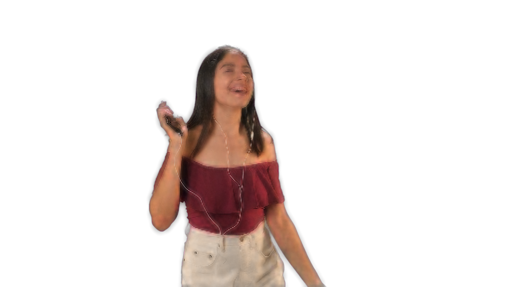


These are unscaled crops of those OBS screenshots:

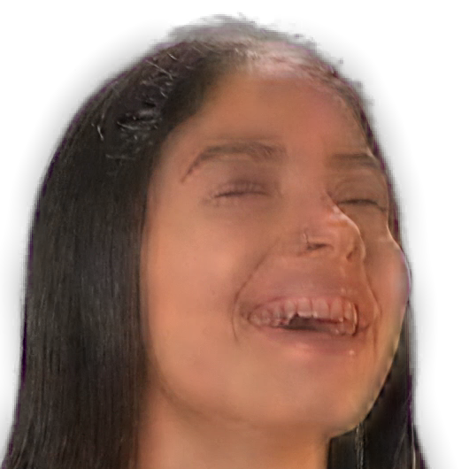
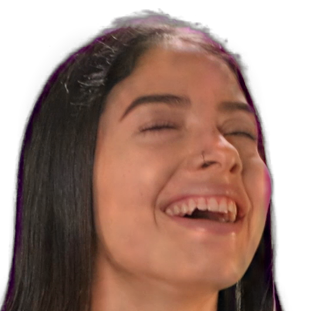
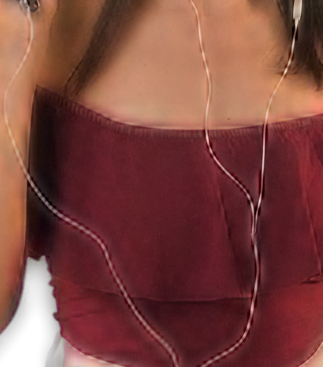

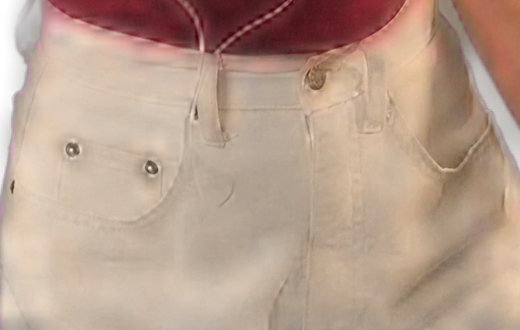
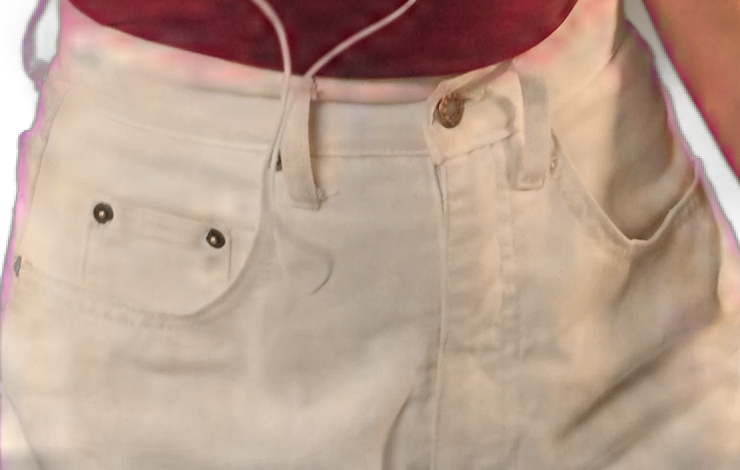

The remaining arm fringe appears in both the corrected OBS output and the
research engine's first-frame result. They have different recurrent histories,
so this visual comparison is not the matched-tensor numeric test:

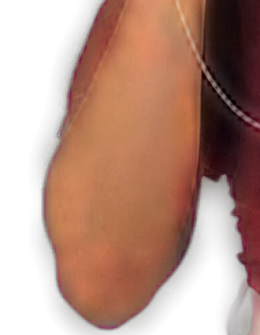
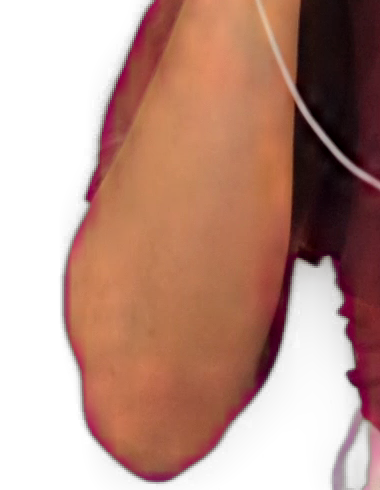
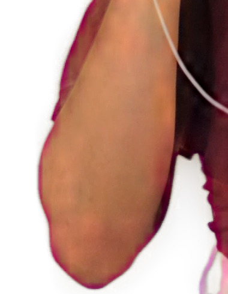

The [full research frame](../images/dev/q1-research-4k.png) is included as well.

The following arm crops show absolute premultiplied-RGB difference against the
same-input research post pass, multiplied by eight. Both use the same decoded
model outputs in the offline host:

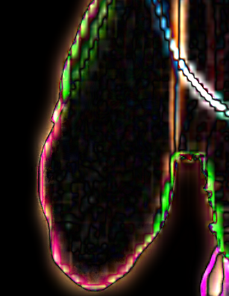
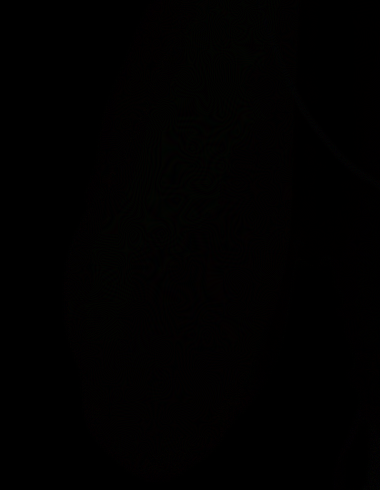

The corrected key has sharper face, cable and fabric detail. It is not halo-free.
The reference's experimental compositing mode was also inspected on this frame;
it leaves edge contamination and does not satisfy that visual requirement.
Removing it requires a further edge-colour method or a different reference
configuration, followed by another teacher evaluation. No preset was changed to
hide this remaining limitation.

## Reproduction and checks

Use the research environment for the Python commands. `ROOT` is a read-only
research checkout; `OUT` is an ignored directory inside this worktree. Build
`corridorkey_post_probe` and, with `CORRIDORKEY_CK2_DEV=ON`,
`corridorkey_ck2_validate`. Keep a baseline probe and its matching `post.effect`
from commit `44281b3` for the before run. `CONFIG` follows the W09 local runtime
configuration; it must point to verified bound graphs and a DirectML bundle.

```text
python tools/quality-parity.py prepare --research ROOT --output OUT --frames 3
python tools/quality-parity.py render --research ROOT --output OUT --label before --probe BASELINE_PROBE --data BASELINE_DATA
python tools/quality-parity.py render --research ROOT --output OUT --label after --probe PROBE --data data
python tools/quality-parity.py inference --research ROOT --output OUT --validator VALIDATOR --config CONFIG
python tools/quality-parity.py render --research ROOT --output OUT --manifest dml-manifest.json --label dml-before --probe BASELINE_PROBE --data BASELINE_DATA
python tools/quality-parity.py render --research ROOT --output OUT --manifest dml-manifest.json --label dml-after --probe PROBE --data data
python tools/quality-parity.py measure --research ROOT --output OUT
python tools/quality-parity.py check --research ROOT --output OUT
```

`--image INPUT.png` runs the research oracle on a separate diagnostic still.
The OBS capture helper is `tests/obs-quality-capture.py`; it requires
`websocket-client` and an already configured dedicated local test instance.
It captures an existing source and can select input, alpha or foreground views.
Do not point it at an owner's live OBS instance.

Validation on Windows 11 / RTX 5070 Ti used OBS 33 with an OBS 30.2 build SDK,
ORT DirectML 1.24.4 and the existing research venv. All work ran on a shared GPU;
no performance claim is made. The development plugin build succeeds.
All 15 CTest groups pass, including local binder parity. `settings_obs` initially
failed to find its OBS DLLs; it passes with the host runtime directory on PATH.
The changed contracts/reference tests were rerun after the equation-mode fix.
Both D3D11 and Windows OpenGL pass 165 GPU comparisons. Clang-format 19.1.5 and
gersemi 0.22.2 checks pass. Documentation received the humanizer pass.

TensorRT was not rerun for this package. The reconstruction fix is shared by
both backends, but complete TensorRT quality parity, all 32-frame sequences,
real dynamic ROI and Linux GPU execution remain unverified.
