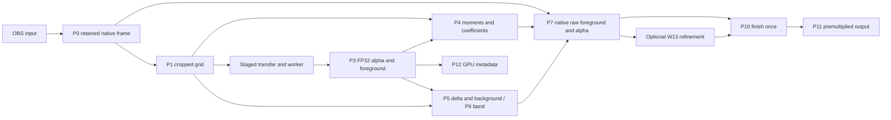

<!-- SPDX-License-Identifier: GPL-3.0-or-later -->
# Native reconstruction

The diagnostic fake now produces native-resolution output from its low-resolution
foreground and alpha. The same post-processing interface accepts decoded model
outputs: straight sRGB foreground `(1,3,h,w)` and linear alpha `(1,1,h,w)`.
This does not load or validate a neural model.

## Passes and ownership

`Reconstruction` owns reusable FP32 scratch textures. Call it with OBS graphics
ownership. `prepare()` produces the raw fields; `finish()` accepts an optional
native refined texture and applies finishing once. The caller retains the input
lease and its finished output until presentation fences complete. Scratch fields
remain valid until the next `prepare()` call; W13 must consume them before then.

| Logical pass | Implementation | Inputs | Output |
| --- | --- | --- | --- |
| P0 | `capture.effect:Capture` | OBS floating-point linear premultiplied input | Native FP32 sRGB-domain premultiplied RGBA, including source alpha |
| P1 | `capture.effect:Downscale` | Retained native frame, normalized sampled ROI | Straight sRGB grid; staged RGBA8 analysis for the diagnostic worker |
| P3 | Transport upload | Validated foreground and alpha | Packed FP32 RGBA on the inference grid; no colour decoding constants |
| P4 | `Solve`, `Box` | Guide RGB, model alpha | Smoothed `(aR,aG,aB,b)` coefficients |
| P5 | `Delta`, `BackgroundSeed`, `Pull`, `SeedTop`, `Push`, `EncodeBackground` | Grid RGB, model foreground/alpha | sRGB foreground delta and background estimate |
| P6 | `Band`, `Box` | Model alpha, lower threshold, gain | Dilated, alpha-weighted, feathered uncertainty |
| P7 | `Reconstruct` | Native RGB, coefficients, delta, optional background | Native straight sRGB foreground and raw alpha |
| P10 | `Finish` | P7 or optional refined fields, controls, source alpha and crop | Linear premultiplied RGBA; transport stores it in RGBA16F |
| P11 | `Present` | Finished texture, host linear-sRGB state | Premultiplied OBS draw using ONE / INVSRCALPHA |
| P12 | `Reduce` | Grid RGB and model alpha | 32 x 32 RGB means and cell maximum alpha |

P2 hints, neural inference, top-K tile selection and P8/P9 refinement belong to
their pipeline packages. P12 stays on the GPU for a later asynchronous metadata
consumer. The diagnostic P1 resize is bilinear; it is not the separately specified
MoGe antialiased bicubic resize.



## Math

The colour guided filter uses the local linear model from
[He, Sun and Tang, *Guided Image Filtering*](https://kaiminghe.github.io/publications/eccv10guidedfilter.pdf).
Each grid pixel accumulates RGB/alpha moments over a radius-two box. Windows
truncate at image borders and divide by their actual sample count. A local RGB
origin reduces cancellation in FP32 on constant or nearly constant guides.
The symmetric covariance matrix receives `epsilon = 5e-4` on its diagonal.
A closed-form adjugate/determinant solve gives the three slopes; the intercept
is mean alpha minus the slopes dotted with mean RGB. A second box filter smooths
all four coefficients. Invalid solves fall back to zero slopes and mean alpha.

At native pixel centres, reconstruction evaluates `alpha = clamp(a.RGB + b)`.
Coefficient and colour-map interpolation uses four point samples with explicit
FP32 bilinear weights and edge clamping. This matches `align_corners=false`
coordinates and avoids hardware texture-filter weight quantization.

The foreground delta is `model_foreground - guide_RGB`. Its native contribution
is full strength below alpha 0.90, interpolates toward `unmix_inner` between 0.90
and 0.99, and uses `unmix_inner` above 0.99. The expert compositing-equation mode
instead estimates foreground from the native RGB and background, with an alpha
denominator floor of `1e-4`.

Background confidence is `(1-alpha)^4`. The seed stores linear RGB times
confidence and confidence itself. A 2 x 2 average pyramid includes partial edge
cells at odd sizes and reaches 1 x 1. The top estimate divides colour by confidence
with a `1e-6` guard; an all-foreground frame starts from black. The descending
pass blends each level's weighted colour with the coarser estimate according to
missing confidence. This terminal 1 x 1 convention is part of this implementation;
the research helper terminates earlier and averages its terminal grid.
The filled grid is encoded to sRGB before exposure to reconstruction or refinement.

The uncertainty mask expands by two grid pixels, multiplies by clamped nearby
alpha times band gain, then uses a radius-one mean. Positive gain increases the
weight. No despill or levels are applied to raw fields supplied to refinement.
After refinement, average-green despill removes
`strength * max(green - (red + blue)/2, 0)` from green and redistributes half to
red and half to blue. Contrast, offset and black/white levels affect alpha once.
Source alpha and the intersection of user cut and sampled ROI mask the result
at the end. Cropping preserves the full source output dimensions.

## Colour contract

The OBS filter declares sRGB awareness and captures into a floating-point SDR
intermediate. Its incoming pixels are linear and premultiplied. Capture divides
by source alpha, encodes straight RGB with the standard sRGB transfer function,
then stores RGB times alpha in a native FP32 texture. Grid sampling unpremultiplies
that representation for inference. Source alpha remains on the native grid.

Guided filtering, delta reconstruction and average-green despill operate in sRGB.
Background estimation and output composition operate in linear light. Finish
decodes straight foreground before multiplying it by final alpha. Presentation
uses linear values when OBS requests linear sRGB; the legacy nonlinear branch
encodes straight colour before premultiplication. Alpha never receives gamma.
Both presentation branches restore blend and framebuffer-sRGB state.

The diagnostic staging path quantizes guide RGB to eight bits. Model foreground
and alpha uploads are FP32, including very small alpha. RGBA16F presentation
storage adds its normal half-precision rounding. Invalid pixel values become
finite zeros; the worker also rejects nonfinite model results before publication.
Unsupported HDR source spaces bypass processing and show
"HDR input is not supported by this model; passthrough."

## Numeric and pixel checks, 29 October 2026

The test-only C++ reference uses double-precision central moments and pivoted
Gaussian elimination. It shares no production solve implementation. The libobs
probe renders the actual effect and reads back its fields. Twelve fixtures cover
both 512 x 256 and 512 x 512 grids, portrait and odd dimensions, 1 x 1 and 1 x 7
grids, constant/singular guides, tiny alpha, absent background, crop intersection,
compositing-equation unmix and NaN/Inf inputs. It also compares the refinement
entry point, metadata reduction and both output blend branches.

| Field | Maximum absolute error, D3D11 | Maximum absolute error, OpenGL | Allowed |
| --- | ---: | ---: | ---: |
| Coefficients | 3.87e-6 | 3.65e-6 | 1e-4 |
| Delta | 5.47e-8 | 5.47e-8 | 2e-6 |
| Background | 3.77e-7 | 3.76e-7 | 1e-5 |
| Band | 1.26e-7 | 1.26e-7 | 2e-6 |
| Reduction | 1.37e-6 | 1.37e-6 | 1e-5 |
| Raw reconstruction | 6.84e-6 | 7.55e-6 | 1e-4 |
| Finished output / refinement entry point | 3.72e-7 | 5.19e-7 | 1e-4 |
| Linear composition | 3.63e-7 | 5.19e-7 | 1e-4 |
| Nonlinear composition | 3.24e-7 | 5.80e-7 | 1e-4 |

Both renderers ran on Windows 11, OBS 33.0.0 and an RTX 5070 Ti. OpenGL used OBS's
effect-to-GLSL translator and NVIDIA's OpenGL 3.3 context. This is live OpenGL
evidence, not a Linux hardware test. The changed C++ translation units also compile
to Linux x86-64 objects with Zig 0.15.2 and `-Wall -Wextra -Werror`.

Real OBS 30.2 screenshots use the authored calibration fixture with image-source
linear alpha enabled. The grey ellipse has sRGB 128/255 and source alpha 128/255.
The fake's alpha is 128/255, so final alpha is about 0.252. Screenshot probes give
64/255 in alpha view, 129/255 in input/foreground view, and grey 153 or 78 over
the light or dark checker cells. Linear-light composition predicts 153 and 78;
the one-code-value input difference comes from OBS's image premultiplication and
capture precision. Opaque magenta remains `(255,0,255)`.


The PNGs are unmodified OBS source screenshots without a mouse cursor. Additional
input and background-fill views sit beside them. The calibration fixture and
driver are `tests/create-w08-fixtures.py` and `tests/obs-w08.lua`.

## Capture pacing

The original three-slot path completed roughly 30 frames/s on a 60 Hz canvas.
Keeping the same transfer-task cadence and changing only retained-frame capacity
to five brought steady 1080p intervals to 59.7 frames/s. Those slots cover capture,
worker ownership, completed publication, active presentation and GPU retirement.
The generic pool still defaults to three; the OBS staged transport explicitly
uses five. The inference scheduler still admits one running job and one newest
pending input. The fake's own three-result bound is unchanged.

Capture rate limits use OBS tick timestamps with a fixed phase, including a small
integer-rounding allowance. Scheduling the next capture from callback wall time
could skip every other frame when a 60 FPS cap met a 60 Hz canvas.

Initial offscreen OBS 33 measurements with reconstruction enabled completed
601 frames per 601 canvas ticks at 4K in the final ten-second interval, with no
capture drops. Render self-time p95 was 0.05 ms and transfer-task CPU p95 was
1.48 ms. These are CPU timings, not GPU execution times. The baseline completed
286 frames during a comparable 601-tick 4K interval. Displayed-age measurements
and the publication-latency follow-up use the W15 timing hooks.

Five native FP32 frames, five RGBA16F outputs and one shared native raw FP32 field
need about 1.1 GiB at 4K before grid maps, OBS intermediates and driver overhead.
This is bounded but expensive for multiple instances. Interop and narrower native
storage can reduce that cost after parity testing.

## Reproducing validation

Build the diagnostic plugin and `corridorkey_post_probe` against an OBS 30.2+
SDK. Set `OBS_TEST_GRAPHICS` to the host's absolute D3D11 or OpenGL graphics
module and `OBS_TEST_DATA` to its libobs data directory, including the trailing
slash. Put the host runtime libraries on the test process's loader path.

```text
corridorkey_post_probe unused <plugin-data-directory> 1920 numeric
corridorkey_post_probe <plugin-module> <plugin-data-directory> 1920 32
corridorkey_post_probe <plugin-module> <plugin-data-directory> 3840 32
```

Numeric mode exits nonzero for a failed comparison. The ordinary CTest suite also
checks source alpha, sRGB round trips, singular guides, bounded pool reuse and
15/24/30/60 FPS pacing. Live screenshots require the dedicated CorridorKey Test
collection. Installed-OBS testing must acquire the shared lock first.

Real neural-model parity, learned refinement, Linux runtime/fence behaviour,
AMD/Intel hardware, HDR reconstruction and GPU execution-time measurements remain
unverified. The synthetic fixture checks reconstruction and colour handling;
it does not establish hair-keying quality on real footage.
