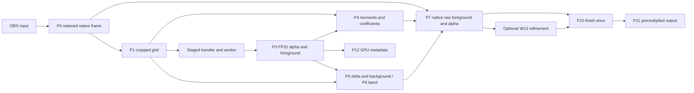
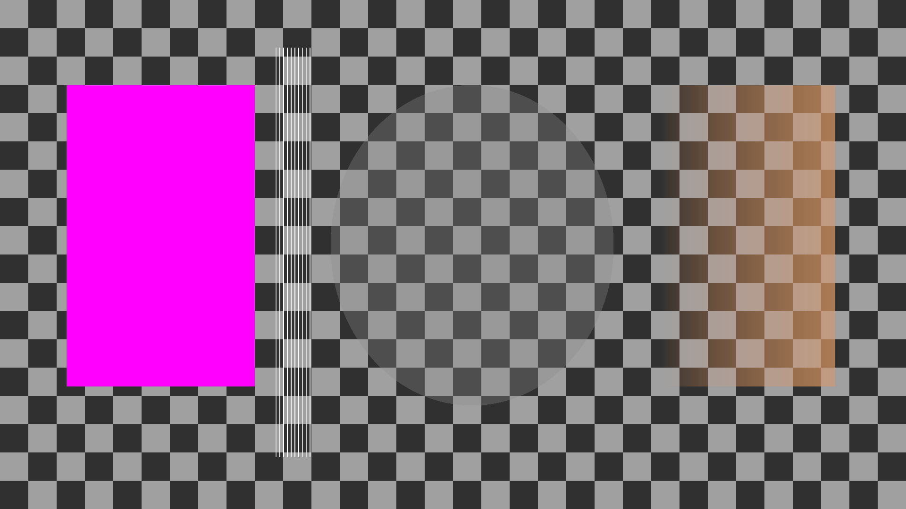
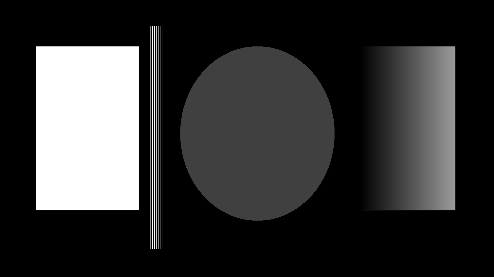
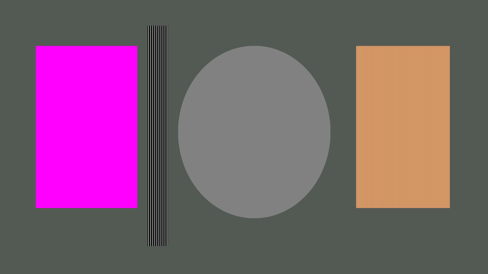
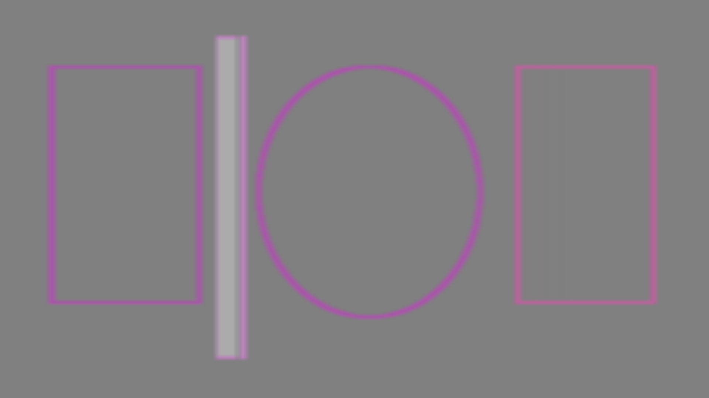
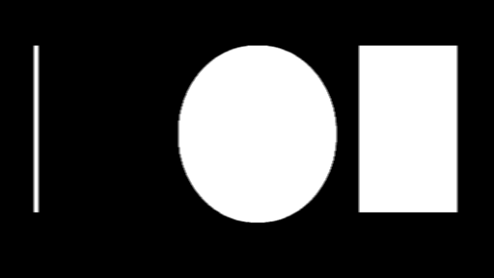
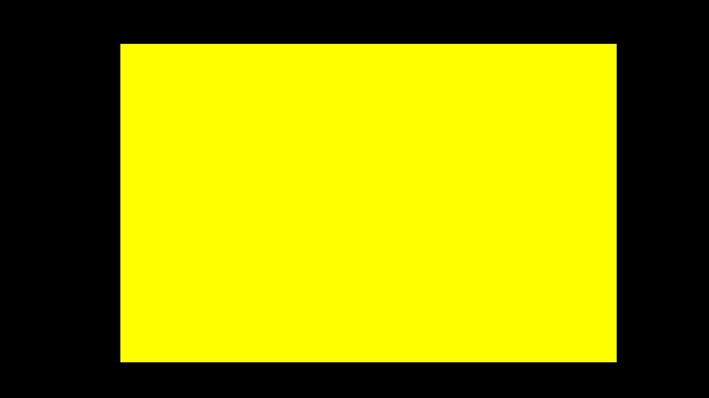

<!-- SPDX-License-Identifier: GPL-3.0-or-later -->
# Native reconstruction

The diagnostic fake now produces native-resolution output from its low-resolution
foreground and alpha. The same post-processing interface accepts decoded model
outputs: straight sRGB foreground `(1,3,h,w)` and linear alpha `(1,1,h,w)`.
This does not load or validate a neural model.

[CK2 integration](ck2-pipeline.md) feeds Stage 1 half-grid or Stage 2 full-grid
maps into this interface. Reconstruction runs on the decoded model grid. For
Stage 1, the RGB guide is bilinearly reduced from the analysis grid before
computing moments and foreground deltas. Expanding Stage 1 outputs to the
analysis grid first caused edge halos and cancelled native detail; see
[quality parity](quality-parity.md). Full-grid and half-grid scratch maps are
preallocated and share one native raw target. The higher-resolution-guide GPU
fixture checks the reduction against an independently averaged reference.

## Passes and ownership

`Reconstruction` owns reusable FP32 scratch textures. Call it with OBS graphics
ownership. `prepare()` produces the raw fields; `finish()` accepts an optional
native refined texture and applies finishing once. The caller retains the input
lease and its finished output until presentation fences complete. Scratch fields
remain valid until the next `prepare()` call; W13 must consume them before then.

| Logical pass | Implementation | Inputs | Output |
| --- | --- | --- | --- |
| P0 | `capture.effect:Capture` | OBS floating-point linear premultiplied input | Native FP32 sRGB-domain premultiplied RGBA, including source alpha |
| P1 | `capture.effect:Downscale` | Retained native frame, normalized sampled ROI | Straight sRGB grid; staged RGBA8 analysis for the diagnostic worker |
| P3 | Transport upload | Validated foreground and alpha | Packed FP32 RGBA on the inference grid; no colour decoding constants |
| P4 | `Solve`, `Box` | RGB sampled on the model grid, model alpha | Smoothed `(aR,aG,aB,b)` coefficients |
| P5 | `Delta`, `BackgroundSeed`, `Pull`, `SeedTop`, `Push`, `EncodeBackground` | Grid RGB, model foreground/alpha | sRGB foreground delta and background estimate |
| P6 | `Band`, `Box` | Model alpha, lower threshold, gain | Dilated, alpha-weighted, feathered uncertainty |
| P7 | `Reconstruct` | Native RGB, coefficients, delta, optional background | Native straight sRGB foreground and raw alpha |
| P10 | `Finish` | P7 or optional refined fields, controls, source alpha and crop | Linear premultiplied RGBA; transport stores it in RGBA16F |
| P11 | `Present` | Finished texture, host linear-sRGB state | Premultiplied OBS draw using ONE / INVSRCALPHA |
| P12 | `Reduce` | Grid RGB and model alpha | 32 x 32 RGB means and cell maximum alpha |

P2 hints, neural inference, top-K tile selection and P8/P9 refinement belong to
their pipeline packages. P12 stays on the GPU for a later asynchronous metadata
consumer. The diagnostic P1 resize is bilinear; it is not the separately specified
MoGe antialiased bicubic resize.



## Math

The colour guided filter uses the local linear model from
[He, Sun and Tang, *Guided Image Filtering*](https://people.csail.mit.edu/kaiming/publications/eccv10guidedfilter.pdf).
Each model-grid pixel accumulates RGB/alpha moments over a radius-two box. Windows
truncate at image borders and divide by their actual sample count. A local RGB
origin reduces cancellation in FP32 on constant or nearly constant guides.
The symmetric covariance matrix receives `epsilon = 5e-4` on its diagonal.
A closed-form adjugate/determinant solve gives the three slopes; the intercept
is mean alpha minus the slopes dotted with mean RGB. A second box filter smooths
all four coefficients. Invalid solves fall back to zero slopes and mean alpha.

At native pixel centres, reconstruction evaluates `alpha = clamp(a.RGB + b)`.
Coefficient and colour-map interpolation uses four point samples with explicit
FP32 bilinear weights and edge clamping. This matches `align_corners=false`
coordinates and avoids hardware texture-filter weight quantization.

The foreground delta is `model_foreground - guide_RGB`. Its native contribution
is full strength below alpha 0.90, interpolates toward `unmix_inner` between 0.90
and 0.99, and uses `unmix_inner` above 0.99. The expert compositing-equation mode
instead decodes the native RGB and background to linear light, solves
`F = (I - (1-alpha) B) / alpha`, then encodes foreground to sRGB before blending
the correction. Its alpha denominator floor is `1e-4`.

Background confidence is `(1-alpha)^4`. The seed stores linear RGB times
confidence and confidence itself. A 2 x 2 average pyramid includes partial edge
cells at odd sizes and reaches 1 x 1. The top estimate divides colour by confidence
with a `1e-6` guard; an all-foreground frame starts from black. The descending
pass blends each level's weighted colour with the coarser estimate according to
missing confidence. This terminal 1 x 1 convention is part of this implementation;
the research helper terminates earlier and averages its terminal grid.
The filled grid is encoded to sRGB before exposure to reconstruction or refinement.

The uncertainty mask expands by two grid pixels, multiplies by clamped nearby
alpha times band gain, then uses a radius-one mean. Positive gain increases the
weight. No despill or levels are applied to raw fields supplied to refinement.
After refinement, average-green despill removes
`strength * max(green - (red + blue)/2, 0)` from green and redistributes half to
red and half to blue. Contrast, offset and black/white levels affect alpha once.
Source alpha and the intersection of user cut and sampled ROI mask the result
at the end. Cropping preserves the full source output dimensions.

## Colour contract

The OBS filter declares sRGB awareness and captures into a floating-point SDR
intermediate. Its incoming pixels are linear and premultiplied. Capture divides
by source alpha, encodes straight RGB with the standard sRGB transfer function,
then stores RGB times alpha in a native FP32 texture. Grid sampling unpremultiplies
that representation for inference. Source alpha remains on the native grid.

Guided filtering, delta reconstruction and average-green despill operate in sRGB.
Background estimation and output composition operate in linear light. Finish
decodes straight foreground before multiplying it by final alpha. Presentation
uses linear values when OBS requests linear sRGB; the legacy nonlinear branch
encodes straight colour before premultiplication. Alpha never receives gamma.
Both presentation branches restore blend and framebuffer-sRGB state.

The diagnostic staging path quantizes guide RGB to eight bits. Model foreground
and alpha uploads are FP32, including very small alpha. RGBA16F presentation
storage adds its normal half-precision rounding. Invalid pixel values become
finite zeros; the worker also rejects nonfinite model results before publication.
Unsupported HDR source spaces bypass processing and show
"HDR input is not supported by this model; passthrough." The filter forwards
colour-space negotiation to its target, and detection asks for both SDR and HDR
spaces so OBS cannot silently negotiate HDR down to SDR before the check. A
synthetic extended-709 source verifies the forwarded space and this status text.
Real HDR camera/display combinations remain untested.

## Numeric and pixel checks, 29 October 2026

The test-only C++ reference uses double-precision central moments and pivoted
Gaussian elimination. It shares no production solve implementation. The libobs
probe renders the actual effect and reads back its fields. Twelve fixtures cover
both 512 x 256 and 512 x 512 grids, portrait and odd dimensions, 1 x 1 and 1 x 7
grids, constant/singular guides, tiny alpha, absent background, crop intersection,
compositing-equation unmix and NaN/Inf inputs. It also compares the refinement
entry point, metadata reduction and both output blend branches.

| Field | Maximum absolute error, D3D11 | Maximum absolute error, OpenGL | Allowed |
| --- | ---: | ---: | ---: |
| Coefficients | 3.87e-6 | 3.65e-6 | 1e-4 |
| Delta | 5.47e-8 | 5.47e-8 | 2e-6 |
| Background | 2.18e-7 | 2.18e-7 | 1e-5 |
| Band | 1.26e-7 | 1.26e-7 | 2e-6 |
| Reduction | 1.37e-6 | 1.37e-6 | 1e-5 |
| Raw reconstruction | 2.94e-6 | 3.15e-6 | 1e-4 |
| Finished output / refinement entry point | 4.19e-7 | 5.19e-7 | 1e-4 |
| RGBA16F storage | 4.84e-4 | 4.84e-4 | 5e-4 |
| Linear composition | 4.19e-7 | 5.19e-7 | 1e-4 |
| Nonlinear composition | 3.24e-7 | 5.80e-7 | 1e-4 |

Each renderer passes 132 comparisons. The RGBA16F storage check permits one
half-precision step near 1.0 (`5e-4`); it does not use the FP32 arithmetic bound.
The measured storage error is larger than a round-to-nearest half-step, so callers
must not assume that rounding rule for these render targets.

Both renderers ran on Windows 11, OBS 33.0.0 and an RTX 5070 Ti. OpenGL used OBS's
effect-to-GLSL translator and NVIDIA's OpenGL 3.3 context. This is live OpenGL
evidence, not a Linux hardware test. Both the default and diagnostic MSVC plugin builds pass. The changed C++ translation units also compile
to Linux x86-64 objects with Zig 0.15.2 and `-Wall -Wextra -Werror`.

Real OBS 30.2 screenshots use the authored calibration fixture with image-source
linear alpha enabled. The grey ellipse has sRGB 128/255 and source alpha 128/255.
The fake's alpha is 128/255, so final alpha is about 0.252. Screenshot probes give
64/255 in alpha view, 129/255 in input/foreground view, and grey 153 or 78 over
the light or dark checker cells. Linear-light composition predicts 153 and 78;
the one-code-value input difference comes from OBS's image premultiplication and
capture precision. Opaque magenta remains `(255,0,255)`.








The PNGs are unmodified OBS source screenshots without a mouse cursor. Additional
input and background-fill views sit beside them. The calibration fixture and
driver are `tests/create-w08-fixtures.py` and `tests/obs-w08.lua`.

## Capture pacing

The original three-slot path completed roughly 30 frames/s on a 60 Hz canvas.
Keeping the same transfer-task cadence and changing only retained-frame capacity
to five brought steady 1080p intervals to 59.7 frames/s. Those slots cover capture,
worker ownership, completed publication, active presentation and GPU retirement.
The generic pool still defaults to three; the OBS staged transport explicitly
uses five. The inference scheduler still admits one running job and one newest
pending input. The fake's own three-result bound is unchanged.

Capture rate limits use OBS tick timestamps with a fixed phase, including a small
integer-rounding allowance. Scheduling the next capture from callback wall time
could skip every other frame when a 60 FPS cap met a 60 Hz canvas.

The worker no longer waits for a graphics task on every inference poll. One
bounded input mailbox and one completed-result mailbox connect it to the video
thread. Their lock is separate from the render-state lock: waking the worker
must not make capture fall back to passthrough. The worker checks completion at
roughly one-millisecond intervals and wakes immediately for a mapped input.

Readback gets a zero-timeout fence check in the video tick and another in the
after-draw graphics task. A ready fence is sufficient; there is no artificial
"later tick" restriction. A not-ready fence leaves the slot pinned. When several captures are ready,
readback selects the newest sequence and releases older completed captures; slot
index must not determine which frame reaches inference. There is at
most one queued transfer task, admitted once per canvas tick. OBS's public
staging map still has driver overhead after the fence succeeds.

Ready results are uploaded and reconstructed in the next pre-draw video tick.
They can appear in that canvas frame, avoiding the former after-draw upload and
extra presentation tick. All GPU access stays on the OBS video thread. The
render callback does not map, allocate textures, wait for inference or poll a
blocking fence. Tick readback and post submission consume frame budget, so their
CPU timings are logged separately from render self-time. Shutdown drains the
queued callback before releasing its mailboxes and graphics resources.

Measurements use the same W15 `FrameTiming` recorder and `obs_now()` clock as the
status line. Age includes repeated displayed frames, and keyed FPS counts fresh
results in the preceding five seconds. The input and output transfer columns
include queueing; output includes CPU packing, waiting for publication and post
submission. They are not GPU execution times. A diagnostic fake still spends CPU
time constructing and validating its output even with zero configured delay.
W15's fake inference field measures the configured delay and polling interval;
the separate `fake_cpu_ms` counter measures synthesis and numeric validation.

The original three-slot baseline completed 301/601 canvas frames at 1080p
(30.05 FPS) and 286/601 at 4K (28.55 FPS). Five slots alone restored intervals at
59.7 to 60 FPS. Before the asynchronous publication change, W08 plus W15 measured
50.06/66.75 ms displayed age (median/p95) at zero delay, with 19.64 ms input and
6.28 ms output transfer. At 20 ms configured delay it measured 100.05/116.73 ms,
with 33.70 ms inference timing: the task wait rounded the delay up to a canvas
interval. These are this probe's measurements, separate from W15's earlier
50/67 ms zero-delay and 117 ms delayed measurements.

Final OBS 33 / D3D11 runs used a 60 Hz canvas and the balanced 512 x 512 grid:

| Native / fake delay | Completed throughput | W15 fresh FPS, last window | Displayed age median / p95 | Input / output transfer median |
| --- | ---: | ---: | ---: | ---: |
| 1920 x 1080 / 0 ms | 59.8 FPS | 59.40 | 33.38 / 34.10 ms | 18.14 / 7.90 ms |
| 3840 x 2160 / 0 ms | about 60 FPS | 60.00 | 33.36 / 33.62 ms | 17.88 / 8.45 ms |
| 1920 x 1080 / 20 ms | 34.5 FPS | 33.51 | 66.89 / 83.44 ms | 18.99 / 12.43 ms |

The zero-delay runs captured every canvas tick after startup. At 1080p, two
captures were superseded before submission during the run; at 4K none were
dropped. Render self-time p95 was 0.05 ms at both sizes, including capture and
presentation. Pre-draw post submission p95 was 0.91 / 0.83 ms, pre-draw readback
0.42 / 0.38 ms, and after-draw transfer tasks 1.32 / 1.09 ms (1080p / 4K).
Fake synthesis and validation alone took about 5 to 6 ms median. A 20 ms artificial
wait therefore cannot produce 50 FPS in this CPU fake.

The selected log excerpts and numeric maxima are in
[the validation evidence](reconstruction-evidence.md).
The shared desktop had other applications running. Some intermediate runs had
long scheduling stalls; this is not a guarantee under concurrent GPU or CPU load.
The staged path still commonly waits one canvas interval for readback. Removing
that remaining latency needs a transport that can signal completion between
OBS video ticks, such as the later interop path.

Five native FP32 frames, five RGBA16F outputs and one shared native raw FP32 field
need about 1.1 GiB at 4K before grid maps, OBS intermediates and driver overhead.
This is bounded but expensive for multiple instances. Interop and narrower native
storage can reduce that cost after parity testing.

## Reproducing validation

Build the diagnostic plugin and `corridorkey_post_probe` against an OBS 30.2+
SDK. Set `OBS_TEST_GRAPHICS` to the host's absolute D3D11 or OpenGL graphics
module and `OBS_TEST_DATA` to its libobs data directory, including the trailing
slash. Put the host runtime libraries on the test process's loader path.

```text
corridorkey_post_probe unused <plugin-data-directory> 1920 numeric
corridorkey_post_probe <plugin-module> <plugin-data-directory> 1920 32
corridorkey_post_probe <plugin-module> <plugin-data-directory> 3840 32
corridorkey_post_probe <plugin-module> <plugin-data-directory> 1920 22 20
corridorkey_post_probe <plugin-module> <plugin-data-directory> 1920 12 0 stress
corridorkey_post_probe <plugin-module> <plugin-data-directory> 1920 3 0 hdr
```

Numeric mode exits nonzero for a failed comparison. Stress mode repeatedly
changes source dimensions, crop, enabled state, fake delay and injected failures
before destroying the filter with work still pending. The ordinary CTest suite also
checks source alpha, sRGB round trips, singular guides, bounded pool reuse and
15/24/30/60 FPS pacing. All eleven rebased CTest groups passed, including the
local binder parity check; that check verifies weight binding, not reconstructed
model output. Live screenshots require the dedicated CorridorKey Test
collection. Installed-OBS testing must acquire the shared lock first.

The later [quality-parity evaluation](quality-parity.md) compares real CK2
reconstruction with the research engine. [W13](refiner.md) adds learned
refinement and measures the staged atlas path. Linux runtime/fence
behaviour, AMD/Intel hardware, HDR reconstruction and GPU execution-time
measurements remain unverified.
