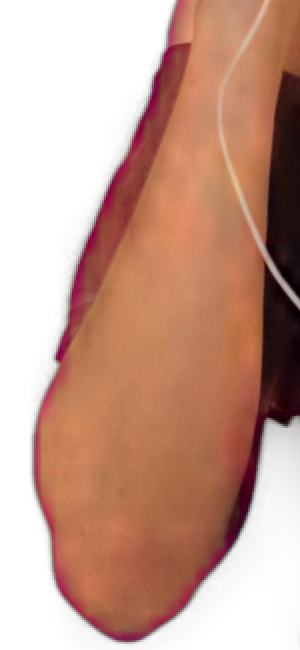
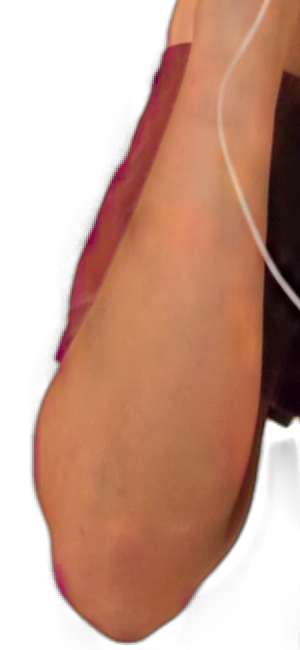
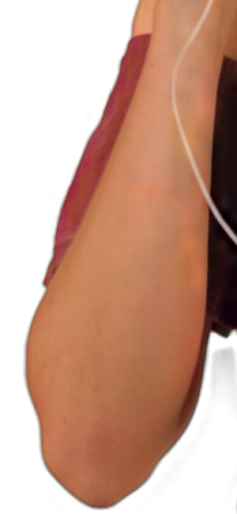
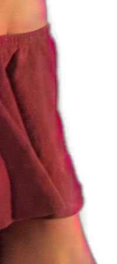
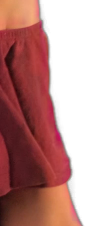
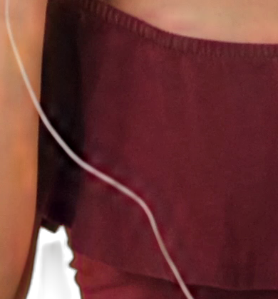
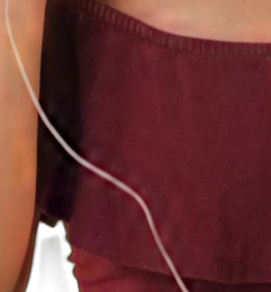
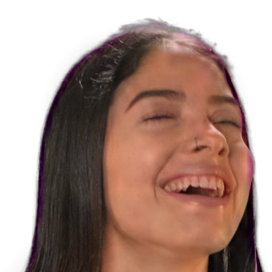
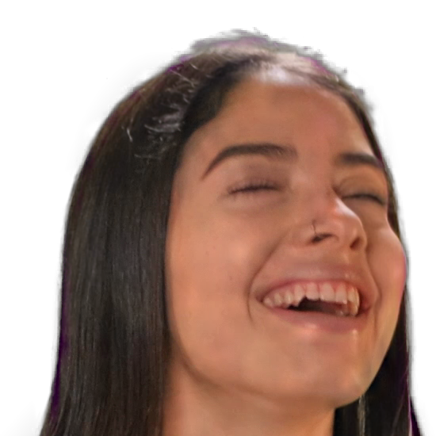
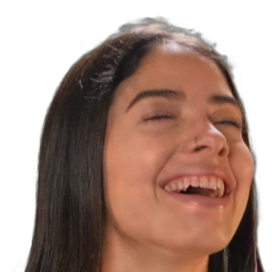

<!-- SPDX-License-Identifier: GPL-3.0-or-later -->
# Native-resolution edge refiner

The shipped refiner is [Edge Refiner v15](refiner-v15.md), using graph revision 5.
The measurements and captures below describe the earlier W13 v12 validation.
They have not been rerun as full-pipeline quality evidence for v15.

W13 added the v12 refiner after native reconstruction. The Edge refiner checkbox
switches it live; disabling it uses the existing Q1 reconstruction path. Facecam
uses 384 tiles, Balanced 512 and Quality 768. The 256-tile export also works as
an advanced budget.

The matched-input comparison passes Q1's 0.002 regional-MAE tolerance on the same
30 frames used for reconstruction validation. The worst region differs from the
research refiner by 0.001715. Edge-alpha error against the teacher falls from
0.0620 with research `rgb3` to 0.0414 with the plugin refiner; the research refiner
scores 0.0415. This sample does not reproduce the research report's 57 to 28–31
result: it uses Q1's three stored frames per segment and its edge-band definition.

The staged implementation is not ready for real-time release. At 384 tiles,
some magenta remains in the 4K dance capture. Raising only the budget to 768
removes the prominent fringe in the arm, ruffle and hair crops. These captures
support that improvement on one frame; they do not establish halo-free output
across the clips or all presets.

## Graph and ownership

The graph release is revision 3,
`5d88114f169cb082cda238426af47feffb9724af`. W04/W05 supplies verified graph
artifacts and binds v12 weights from the owner's safetensors release. Validation
used the development override while the production catalogue integration was
being completed separately. No model implementation, weights, graphs or
CK-derived block code are included in the plugin source.

Each `refiner_bN` graph takes FP32 `x[N,11,52,52]` and returns decoded
`alpha[N,1,52,52]` and straight-sRGB `fg[N,3,52,52]`. TensorRT uses FP16 internally;
DirectML uses FP32. Inputs are rounded to FP16 before either backend to match
the research tile cast. Every tile has a 32-pixel centre and a 10-pixel halo.

The refiner has its own bounded worker and one outstanding atlas. Its model lease
outlives the session and any pending result. A factory-provided model is retained
even when it was not present in the original preparation request. Pending frames
keep their native capture lease until GPU reads finish. Generation changes drain
and retire pending work; they cannot scatter an old result into a new capture.
The last session reference is released on the worker, outside OBS graphics.

TensorRT uses the existing persistent device bindings and CUDA graph fallback
rules. The refiner is capturable; MoGe remains uncaptured. Graph identity and
input shapes distinguish tile budgets in the cache. After initial preparation,
off/on switches reuse the refiner session. Enabling it for the first time after
an off-only preparation requires loading the graph.

## GPU passes and atlas

1. Reconstruct straight foreground and guided alpha at native size from the
   decoded model grid, retaining the original capture. Build the refiner's
   push-pull background and band with gain 10 and lower threshold 0.004. The
   refiner background stops at the research terminal level; the off path keeps
   Q1's existing convention.
2. Score crop-local 32-pixel cells on the low-resolution grid using adaptive
   average band plus 0.001 times adaptive maximum of the 3x3-dilated band.
3. Sort score/index pairs with a GPU bitonic sort. Ties use ascending cell index.
   Build a reverse cell-to-slot map for the selected budget. At 3840x2160 there
   are 8160 cells and 91 sort draws over 8192 padded entries.
4. Gather native RGB and bilinearly sampled maps into an RGBA32F atlas. The
   channel order is native RGB, background RGB, reconstructed foreground RGB,
   upsampled model alpha and guided alpha. Pixel centres and border clamps match
   the research sampler. Cropped sources clamp within the retained crop.
5. Fence and read back only this atlas. Unpack its three RGBA slabs to NCHW on
   the refiner worker, run inference, and pack only the 32x32 output centres.
6. Upload the centre atlas and draw one native output pixel per fragment. Each
   cell has at most one valid slot, so no two tiles write the same output pixel.
   Padded batch entries repeat the first tile and never receive a scatter slot.
7. Blend refined alpha and foreground with the band and the research feather
   mask beside unselected active neighbours. Apply despill and levels once,
   after blending, then decode to linear light and premultiply for OBS.

The atlas has 16 tiles per row. Its input slabs are `I.rgb/B.r`, `B.gb/F.rg`, and
`F.b/a_up/a_gf/unused`. Explicit integer remainders avoid shader `fmod` rounding
at cell and slab boundaries. Synthetic tests cover that failure at odd sizes.
The x64 unpacker transposes four pixels at a time with baseline SSE2. Half
subnormals keep the scalar ties-to-even conversion. Its output is bit-identical
to the scalar tensor in the checked 4K fixture. Other architectures retain the
scalar path. Tensor validation checks IEEE FP32 exponent bits, avoiding a CRT
finite-value call for each of millions of elements.

| Budget | Input atlas | Readback per result | Centre upload per result |
| ---: | --- | ---: | ---: |
| 256 | 832 x 2496 RGBA32F | 33,226,752 bytes | 4,194,304 bytes |
| 384 | 832 x 3744 RGBA32F | 49,840,128 bytes | 6,291,456 bytes |
| 512 | 832 x 4992 RGBA32F | 66,453,504 bytes | 8,388,608 bytes |
| 768 | 832 x 7488 RGBA32F | 99,680,256 bytes | 12,582,912 bytes |

These counts exclude low-resolution input/output transfers and the refiner's
host-to-device tensor upload. No native 4K frame is read back by the runtime
refiner. The offline validation probe deliberately reads extra diagnostic maps.
W10 can replace the atlas readback/unpack boundary with device-side conversion
and use the same score, gather and blend passes. This branch does not claim GPU
interop.

## Parity method and tolerances

`tools/refiner-parity.py` imports the external, read-only research checkout.
It compares the production C++ atlas unpacker with the research tile sampler
channel by channel, then runs the native graph and production blend shader.
The oracle uses FP32 native RGB; the research comparison preserves its BF16
native input. Both use v12, a 384-tile budget, mask-free Stage 1 and the Q1
guided-filter, despill and level settings.

Tile-input maximum error must be at most 0.0005 and every channel's per-frame
MAE at most 0.000005. Score error must be at most 0.000001 and the selected tile
sets must agree. All 30 sets agree. Native RGB matches exactly; the other eight
channels differ by at most 0.00048828125, one FP16 step. The worst channel MAE is
0.000002524, score error 0.000000179, background error below 0.0000004 and band
error below 0.00000006.

The output bounds are unchanged from Q1: every per-frame regional MAE against
research must be at most 0.002. With C++ DirectML low-resolution inference, each
teacher-error MAE must differ from research by at most 0.005. The second check
uses the original research output, rather than rerunning research on the C++
model output. The script's `check` action enforces both bounds and rejects
missing frames.

The edge band and interior follow [quality-parity.md](quality-parity.md).
The following values are means across 30 frames, multiplied by 1000. They use
identical low-resolution model outputs, with TensorRT FP16 refiner inference.

| Error against teacher | Research rgb3 | Plugin refiner | Research refiner |
| --- | ---: | ---: | ---: |
| Alpha, edge band | 61.997 | 41.444 | 41.474 |
| Straight foreground, edge band | 81.019 | 72.258 | 72.533 |
| Premultiplied RGB, edge band | 41.146 | 25.786 | 25.780 |
| Alpha, interior | 2.415 | 1.810 | 1.816 |
| Straight foreground, interior | 10.873 | 9.362 | 9.304 |
| Premultiplied RGB, interior | 11.448 | 9.808 | 9.751 |

With C++ DirectML inference for every graph, the corresponding plugin teacher
errors are 41.064 / 72.240 / 25.352 in the edge band and 1.829 / 9.283 / 9.743
in the interior. The worst per-frame teacher-error gap is 0.002862, below 0.005.
Direct full-pipeline differences against research can be larger: the worst
regional MAE is 0.010781, on `ck1_clown_a` frame 2. The 0.002
bound applies to the matched-input refiner comparison, while the full-pipeline
gate compares teacher errors. [refiner-parity.json](refiner-parity.json) contains
all per-frame values, channel errors, graph checks and synthetic results. It also
retains the separate DirectML-model/TensorRT-refiner harness comparison, which
passed with a 0.002901 maximum teacher-error gap.

All four TensorRT static batches ran with capture enabled. Against the exporter
FP32 fixtures, the largest alpha error was 0.002669 and foreground error
0.002488. The DirectML b384 check ran entirely on DirectML. No CPU graph partition
was accepted in these runs.

## Shared-GPU timings and transport cost

Measurements were taken before 08:00 on 29 October 2026, while training and other
test work used the RTX 5070 Ti. **Every timing below is shared GPU.** They are
diagnostic samples, not a clean-GPU performance gate. The host was a Ryzen 9
5950X with Windows 11; ORT was TensorRT 1.31.1 or DirectML 1.24.4.

The native TensorRT test reports five steady calls after its first timed call.
The ORT column is the median of the corresponding last five `model_run` profile
events. That scope excludes host validation and explicit buffer copies; it is
not a whole-plugin or independently timestamped GPU-kernel measurement.

| Tiles | TensorRT host-call mean, ms | ORT model-run median, ms |
| ---: | ---: | ---: |
| 256 | 17.54 | 1.19 |
| 384 | 30.90 | 1.88 |
| 512 | 42.80 | 3.19 |
| 768 | 68.05 | 4.50 |

Live OBS used DirectML for every graph and a frozen 3840x2160 source, with the
Facecam analysis grid held fixed while changing tile budgets. Thus the 512 and
768 rows isolate the refiner budget; they are not full Balanced/Quality preset
benchmarks. The diagnostic stale timeout was 1000 ms to allow completed results
to be measured. Each staged sample is logged once per 60 completed refinements.

| Tiles | Staged pass median (range), ms | Added output delay, ms | Presentation age, ms | Atlas readback payload, MB/s |
| ---: | --- | ---: | ---: | ---: |
| 384 | 150.5 (117.1–167.1) | 155.1 | 310.6 | 314.4 |
| 512 | 150.6 (150.4–201.0) | 172.8 | 337.9 | 387.7 |
| 768 | 218.3 (202.4–284.8) | 236.9 | 433.4 | 416.1 |

There are 11, 4 and 10 staged samples respectively. The short 512-tile sample
and shared load explain why these rows should not be treated as a scaling curve.
Payload rates use the completed-atlas cadence and exact byte counts; they do
not measure all PCIe traffic. Centre uploads add 39.7 / 48.9 / 52.5 MB/s.

With refinement off, the same source measured 8.3 ms output delay and 83.2 ms
presentation age, with about 28 keyed frames/s. Refinement increased presentation
age by 227.5 / 254.8 / 350.2 ms and produced about 6.0 / 5.4 / 4.0 keyed frames/s.
Presentation age includes time holding a completed frame. Added output delay is
the difference from the off run's output-transfer measurement.

At 384 tiles, median costs were 16.6 ms waiting for the gather fence, 19.1 ms
mapping/copying the atlas, 26.7 ms unpacking, 62.6 ms in the DirectML host inference
call and 5.5 ms packing centres. Polling and final blend/finish account for the
remainder. The worker and graphics copies still dominate the small refiner graph.

The normal 250 ms stale timeout was tested separately. The final build publishes
some refined frames but also rejects late results and falls back to passthrough
under this shared load. Earlier scalar validation was slower and could starve
publication entirely. The 250 ms default remains in effect.
W10 device atlas handling, further CPU/transfer work and a clean-GPU rerun are
required before release. [refiner-performance.json](refiner-performance.json)
records scopes, raw samples, phase changes, payload counts and the capture build
hash.

## OBS captures

Testing used the dedicated portable OBS 33 instance under
`S:/Projects/obs-test/obs-33.0.0-w13`, websocket port 18113. The installed OBS,
its plugin and other test instances were left alone. Off/on, budget changes,
restart, timeout rejection and shutdown were exercised; the final shutdown
reported zero OBS memory leaks. These are source screenshots without a cursor,
from Mixkit 28306 at three seconds, decoded to a frozen PNG. The crops are
unscaled. All captures use DirectML and the 1000 ms diagnostic timeout.

Full frames: [off](../images/dev/w13-off-obs-4k.png),
[384 tiles](../images/dev/w13-on-obs-4k.png),
[768 tiles](../images/dev/w13-on768-obs-4k.png).

| Crop | Off | 384 tiles | 768 tiles |
| --- | --- | --- | --- |
| Arm |  |  |  |
| Ruffles |  |  |  |
| Cable |  |  |  |
| Hair |  |  |  |

## Checks and remaining gates

The Windows development build and all 14 CI-selected CTest groups pass. The
separate local-model binder check passes as well. Six refiner, model-lease and
finite-value tests contain 231 assertions. Synthetic D3D11 atlas tests cover
1x1, odd sizes, fewer cells than the batch, tied scores, unselected neighbours
and a cropped source; the largest blend error is 0.000001729. Existing raw and
finished reconstruction comparisons pass on D3D11 and Windows OpenGL.

The eight changed runtime translation units also compile to Linux x86_64 objects
with Zig 0.13's Clang, C++20 and `-Wall -Wextra -Werror`. That checks the Linux
source branches; it does not replace GCC CI or Linux GPU execution. The refiner
effect compiles through Windows OpenGL, but the Windows transport deliberately
requires a D3D11 fence, so the OpenGL atlas run is unavailable there.

Clang-format 19 and gersemi 0.22.2 checks pass. Documentation received a humanizer
pass. The [production activation path](ck2-pipeline.md) also loads the refiner
package. Before release, rerun performance on an idle GPU, exercise Linux fences
and dynamic ROI, and
evaluate full Balanced/Quality sequences. The current 30-frame parity sample
uses the Facecam model grid and budget 384. It does not certify temporal quality
over complete clips or remove the 384-tile coverage limit visible above.

## Reproduction

Use an ignored output directory, the research Python environment, and the W09
development runtime configuration with DirectML and TensorRT bundles. The graph
directory must contain the refiner graph, manifest and W05-bound v12 weights
for the selected budget. Build with `CORRIDORKEY_CK2_DEV=ON`.

```text
python tools/quality-parity.py prepare --research ROOT --output OUT/q1 --frames 3
python tools/refiner-parity.py render --research ROOT --manifest OUT/q1/manifest.json --output OUT --probe PROBE --data data
python tools/refiner-parity.py oracle --research ROOT --manifest OUT/q1/manifest.json --output OUT
python tools/refiner-parity.py infer --research ROOT --manifest OUT/q1/manifest.json --output OUT --validator VALIDATOR --config CONFIG
python tools/refiner-parity.py render --research ROOT --manifest OUT/q1/manifest.json --output OUT --probe PROBE --data data --blend
python tools/refiner-parity.py measure --research ROOT --manifest OUT/q1/manifest.json --output OUT
python tools/quality-parity.py inference --research ROOT --output OUT/q1 --validator VALIDATOR --config CONFIG
```

Repeat `render`, `oracle --inputs-only`, `infer`, `render --blend` and `measure`
with `--manifest OUT/q1/dml-manifest.json --label dml-refiner`. Add
`--backend directml` to this `infer`, and `--reference-label refiner` to that
last `measure`, then run:

```text
python tools/refiner-parity.py check --research ROOT --manifest OUT/q1/manifest.json --output OUT
python tests/refiner_gpu.py --probe PROBE --data data --output OUT/synthetic
VALIDATOR CONFIG parity 384 refiner OUT/graph-parity.json tensorrt
python tests/obs-quality-capture.py --port 18113 --refiner off --output OUT/obs-off.png
python tests/obs-quality-capture.py --port 18113 --refiner on --output OUT/obs-on.png
```

The capture helper requires an already configured dedicated test OBS. It must
not target an owner's live instance. Allow graph preparation to finish before
capturing. Numeric arrays are temporary validation artifacts; the checked-in
evidence contains measurements and captures, not model tensors.
