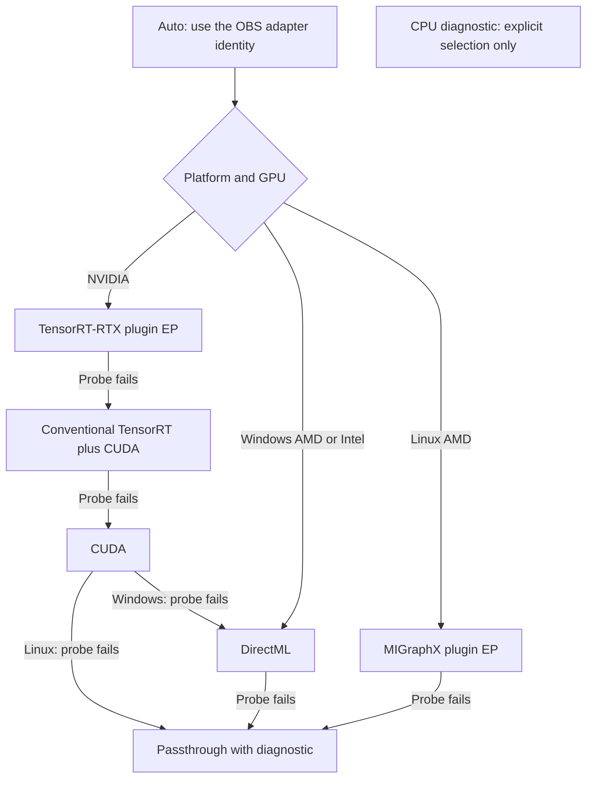

<!-- SPDX-License-Identifier: GPL-3.0-or-later -->
# Runtime bundles

W19's [packaging and licence review](packaging.md) describes the release recipes,
vendor-direct NVIDIA downloads, matching RTX SDK acknowledgements and Windows
DirectML baseline. The W06 assemblies and sizes recorded below remain development
evidence. Release bundles use the W19 inventory and full licence texts. Changing
between the DirectML and NVIDIA cores still requires restarting OBS; a combined
core has not been validated.

CorridorKey loads ONNX Runtime on the preparation worker. Neither the plugin nor
the backend helper imports `onnxruntime.dll` at startup. A missing runtime leaves
the filter available for passthrough and backend setup.

## Selection and isolation



Every candidate runs in a disposable native process before selection. The parent
enforces the deadline, terminates the process tree on cancellation or timeout,
and treats crashes, malformed JSON and missing responses as backend failures.
The helper runs W01's Add graph through IOBinding, checks its exact output, and
inspects ORT profiling events. GPU sessions set `session.disable_cpu_ep_fallback`;
a CPU partition or missing evidence of GPU execution fails the probe. A passing
Add graph does not certify a model's complete operator set.

Windows identity uses `luid:hhhhhhhh:llllllll`, with the numeric high and low
32-bit LUID fields. CUDA driver LUIDs are matched to DXGI adapters. Linux uses
`pci:dddddddd:bb:dd.f`; four-digit domains and hex case normalize before comparison.
Names and device ordinals never establish a match. Plugin EPs must expose LUID or
`pci_bus_id` metadata; absent identity fails safely. An empty OBS identity permits
hardware discovery but cannot produce an Auto selection for live inference.

`DisposableProbe` implements `ProviderProbe`; `select_provider` returns the
chosen capabilities and every attempt. An explicit backend tests only that
backend. `prepare_session` performs the preflight before creating an in-process
session. W09 maps its capabilities to `PrepareRequest::provider`, passes
`PrepareRequest::model` as `SessionConfig::model_lease`, and keeps the transport
lease and buffers alive until each synchronous worker call returns. W02/W07 can
use the same probe for Test backend. W06 does not change their property callbacks.

Production model preparation uses `prepare_graph` with ordered `SessionConfig`
alternatives for each graph. It probes the backend, compiles the actual graph in
the helper, and then creates that session in process. Each failed attempt retains
its backend, precision and reason. W09 can therefore choose TRT FP16 for stage
graphs and TRT/CUDA FP32 for RVM/MoGe without a global precision toggle. Keep all
in-process choices on a compatible core; separate DML and NVIDIA test bundles
cannot be mixed within one pipeline. The export-side policy excludes BF16 from
live preparation even when the tiny BF16 fixture passes. It remains available
only for explicit diagnostic probes.

## Library loading and compatibility

The loader resolves canonical full paths inside the bundle, checks every declared
file's SHA-256, inspects loaded modules for collisions, and resolves `OrtGetApiBase`.
It asks for the header's highest C API, currently 31, then tries lower APIs down
to 17. Plugin EP registration needs API 23 or newer in this implementation.
Classic CUDA/TensorRT and DirectML use the APIs available at the lower baseline.
Runtime version text is reported, not used as an upper-bound rejection rule.

Windows uses `LoadLibraryExW` with the DLL's own directory and system directory.
It does not change `PATH`, `SetDllDirectory`, or the working directory. Dependencies
listed in `preload` load by full path. Linux uses `dlopen` with `RTLD_NOW | RTLD_LOCAL`;
packages need `$ORIGIN` RUNPATH for private dependencies. The installed CUDA driver
is the exception: it comes from Windows System32 or the Linux system loader.

If another OBS plugin has loaded a different ORT core, CorridorKey refuses its
provider and reports a collision. It never borrows the other plugin's API table.
Loaded native modules and successful runtime environments remain pinned for the
process lifetime. Session resources still release normally. Restart OBS to change
the loaded core; replacing files in a live bundle is unsupported.

This also limits fallback after in-process initialization. The test NVIDIA core
is 1.31.1 and the test DirectML core is 1.24.4. They can be probed in separate
processes, but they cannot both be loaded by CorridorKey in one OBS process. Auto
must finish provider/model preparation before committing a core. W19 needs a
single DML-enabled core compatible with the chosen NVIDIA providers for seamless
in-process cross-provider fallback. Until that bundle is validated, a late failure
that needs another core produces passthrough and a restart diagnostic.

## Layout and descriptor

Install runtime files outside OBS's executable directory and outside any other
plugin's runtime directory. A proposed release layout is:

```text
corridorkey/data/
  tools/corridorkey_backend_probe.exe
  runtimes/windows-x64/<bundle-id>/
    rtx.json                         # one descriptor per candidate
    cuda.json
    onnxruntime.dll
    onnxruntime_providers_shared.dll
    onnxruntime_providers_nv_tensorrt_rtx.dll
    onnxruntime_providers_cuda.dll
    <required NVIDIA runtime DLLs>
    licenses/<component>/<original licence and notices>
```

The helper's Windows install target is `corridorkey/data/tools` for both OBS
layouts. Linux installs it under `${CMAKE_INSTALL_LIBEXECDIR}/corridorkey`;
W19 must package the private `.so` tree and resolve its absolute helper path.
Per-user downloads can use the plugin's config directory with the same versioned
bundle structure. Engine caches belong in a writable config/cache directory.

Descriptor schema 1 contains `id`, `backend`, `registration` (`plugin`, `classic`
or `cpu`), `runtime`, `runtime_build`, `provider_name`, `provider_build`, an optional
`provider`, ordered `preload`, `files` (relative path to SHA-256), and optional
session `options`. Paths cannot escape the descriptor directory. The loader
requires hashes for the core, selected EP and preloaded libraries. Descriptors
are trusted installer metadata; model downloads must not supply them. Installers
verify archive hashes, assemble the declared files, and publish a complete bundle
atomically before exposing its descriptor to the loader.

## Where providers come from

| Provider | Native acquisition and registration |
| --- | --- |
| TensorRT-RTX | NVIDIA's `onnxruntime-ep-nv-tensorrt-rtx-cu13` or `-cu12` wheel, or a source build of the EP ABI project. Register its full library path with `RegisterExecutionProviderLibrary`, enumerate devices, then append the matched device with `SessionOptionsAppendExecutionProvider_V2`. The tested 0.5.0 wheel contains TensorRT-RTX 1.7 libraries. [NVIDIA integration guide](https://nvidia.github.io/TensorRT-RTX-EP-ABI/integration-guide.html) |
| Conventional TensorRT | Matched ORT GPU build plus the required TensorRT/CUDA/cuDNN redistributables. The downloaded ORT 1.31.1 CUDA 13 DLL imports `nvinfer_10.dll`, `nvonnxparser_10.dll` and `cudnn64_9.dll`; a TensorRT 11 wheel cannot satisfy those names. Use TensorRT V2 options and append CUDA next. No conventional TensorRT runtime was installed for W06. [ORT guide](https://onnxruntime.ai/docs/execution-providers/TensorRT-ExecutionProvider.html) |
| CUDA | The tested GitHub ORT 1.31.1 CUDA 13 archive needs classic CUDA V2 append. Its DLL exports both `GetProvider` and `CreateEpFactories`, but direct plugin loading failed with Windows error 1114. Standalone `onnxruntime-ep-cuda12`/`-cuda13` plugin packages use registration plus device enumeration instead. The descriptor must say which mode its artifact needs. [Microsoft plugin guide](https://github.com/microsoft/onnxruntime/blob/main/docs/cuda_plugin_ep/QUICK_START.md) |
| DirectML | Use a DML-enabled ORT build, the official DirectML wheel's native DLLs, or the NuGet native artifacts. Fetch `OrtDmlApi` from the loaded core. Sessions are sequential with memory patterns disabled. W11 can supply its own `IDMLDevice` and command queue through the DML1 API. [ORT guide](https://onnxruntime.ai/docs/execution-providers/DirectML-ExecutionProvider.html) |
| MIGraphX | AMD documents `onnxruntime-ep-migraphx==1.0.0+rocm10.1.0`, explicit plugin registration, and a supported ORT 1.29.0 lane. Extract/build a matched native Linux bundle with its ROCm/MIGraphX dependencies. W06 has registration and device-selection code, but no AMD build or hardware result. Native Windows MIGraphX is not in Auto. [AMD installation guide](https://rocm.docs.amd.com/projects/ai-ecosystem/en/latest/inference/onnxruntime.html) |

These version numbers identify build/test inputs. Newer compatible versions may
pass the same probes. A successful registration alone does not establish core/EP
schema compatibility. The exact graph still has to compile and execute.

## Download sizes and redistribution

The development pins are in
[`windows-artifacts.json`](../../tools/backend_probe/windows-artifacts.json).
Sizes below were measured from those downloads and the native files used by the
probe; 1 MiB is 1,048,576 bytes. They exclude Python modules and debug symbols.

| Component | Download | Native test payload | Terms and packaging consequence |
| --- | ---: | ---: | --- |
| ORT 1.31.1 CUDA 13 archive | 294.78 MiB | Core: 16.90 MiB; CUDA EP: 187.72 MiB | MIT plus `ThirdPartyNotices.txt`; preserve both. [ORT licence](https://github.com/microsoft/onnxruntime/blob/v1.31.1/LICENSE) |
| RTX EP 0.5.0 CUDA 13 wheel | 105.74 MiB | RTX bundle including ORT/shared/CUDA runtime: 240.64 MiB | EP code is Apache-2.0. TensorRT-RTX runtime and CUDA runtime are separately licensed; the wheel's Apache metadata does not relicense them. [EP licence](https://github.com/NVIDIA/TensorRT-RTX-EP-ABI/blob/v0.5.0/LICENSE), [TensorRT-RTX terms](https://docs.nvidia.com/deeplearning/tensorrt-rtx/latest/reference/sla.html) |
| cuBLAS 13.0.2.14 wheel | 383.27 MiB | `cublas` plus `cublasLt`: 505.37 MiB; total tested CUDA bundle: 710.53 MiB | CUDA's redistributable list includes the runtime and BLAS DLLs. Its application/distribution conditions and third-party notices still apply. This tiny Add test did not require cuDNN; model packaging may. [CUDA EULA](https://docs.nvidia.com/cuda/eula/index.html) |
| ORT DirectML 1.24.4 wheel | 23.95 MiB | ORT plus DirectML.dll 1.15.4: 37.80 MiB | ORT is MIT. DirectML has Microsoft terms permitting distribution within Windows/Xbox applications, with restrictions on standalone offerings and preserving notices. [DirectML terms](https://www.nuget.org/packages/Microsoft.AI.DirectML/1.15.4/License) |
| Conventional TensorRT | Not downloaded | Not measured | Only the chosen SDK's listed distributables can ship, subject to its application and distribution conditions. [TensorRT terms](https://docs.nvidia.com/deeplearning/tensorrt/latest/reference/sla.html) |
| MIGraphX/ROCm | Not downloaded | Not measured | Audit the actual native package's component licences/notices before release; the provider name is not a licence inventory. [MIGraphX licence](https://github.com/ROCm/AMDMIGraphX/blob/develop/LICENSE) |

TensorRT-RTX permits distribution within an application with added functionality,
subject to its NVIDIA-GPU use and other conditions. Keep vendor libraries under
their own terms; the project's GPL section-7 permission permits loading them but
does not grant redistribution rights. The downloaded RTX wheel contains no
standalone licence/notice files. A release bundle must obtain and include the
matching NVIDIA terms and EP Apache notice; the development assembly is not a
release-ready licence package.

The installer should offer DirectML as the small Windows baseline and optional
NVIDIA downloads with displayed sizes and terms. Download on explicit setup,
verify pinned archives, and retain an uninstall receipt. Do not ship SDK developer
tools or whole Python wheels to end users. Linux runtime packaging still needs
ELF/RUNPATH and dependency checks on Ubuntu 24.04. W19 owns that release work.

## Sessions and caches

`Session` owns its ORT session, run options, binding and optional model reader
lease. It rejects non-tensor, empty or dynamic input/output shapes. Bound values
and their backing memory remain the caller's responsibility. Each call serializes
on the session, synchronizes bindings and supports ORT cooperative termination.
No session work belongs on the OBS render callback.

Cache identity covers manifest/graph/aggregate weight hashes, binding recipe,
actual core and EP/dependency identities, driver, GPU, architecture, precision,
shape/tile metadata and provider options. A changed identity uses a new SHA-256
directory. RTX gets `nv_runtime_cache_path`; conventional TensorRT gets separate
engine and timing options. The caches are not interchangeable.

Each session receives a private working copy of the last published cache. RTX
0.5.0 writes runtime cache files during session teardown, so publication happens
after ORT releases the session. An OS lock protects snapshot copying and
publication; inference does not hold it. A ready marker makes a fully published
entry reusable. Interrupted or mismatched publications are discarded under the
lock. Concurrent filters keep separate working files. A killed helper can leave
an unused `.working-*` directory; the installer/cache cleanup service can remove
these after confirming no helper or OBS process uses them. `Session::close`
reports publication errors; destruction releases resources and treats cache
publication as best effort. W09 must bound model-level recovery to one rebuild
and keep the old pipeline or passthrough while preparing a replacement.

The helper accepts `mode: "build"` with an actual static model graph, verified
weights identity, provider options and cache root. This contains session/engine
compilation in the disposable process. It explicitly reports that first-run JIT
and parity are still pending. Large-model compilation and conventional TensorRT
timing-cache builds have not been validated in W06.

For a prebuilt engine, pass its verified EPContext ONNX wrapper as `graph`, set
`prebuilt_context`, and include the engine bytes in the aggregate artifact/weight
hash. The session then avoids setting conventional TensorRT's FP16 build flag.
`session_options` carries ORT context settings; `options` carries provider settings.
The helper accepts the same fields. Neither path rewrites ONNX tensor types.
CUDA and RTX precision therefore follows the exported graph; conventional TRT's
FP16 option is a builder preference and does not change graph I/O types.

A future native builder in the helper can use TensorRT's strongly typed network
API and publish an EPContext wrapper through the same immutable model lease and
cache identity. That builder is not implemented here. NVIDIA documents that
strong typing forbids FP16/BF16 builder flags, and ORT documents loading externally
compiled engines through EPContext. Those are separate paths from setting
`trt_fp16_enable` on ORT's normal builder. [NVIDIA precision control](https://docs.nvidia.com/deeplearning/tensorrt/10.x.x/inference-library/precision-control.html),
[ORT embedded engines](https://onnxruntime.ai/docs/execution-providers/TensorRT-ExecutionProvider.html#embed-engine-model).

## Building and reproducing

Use ORT headers from `CORRIDORKEY_ORT_ROOT`, or enable the existing
`CORRIDORKEY_FETCH_ONNXRUNTIME` option to fetch the pinned header source. The
option now prepares headers only; native bundles are installed separately.
The default remains OFF. Linux builds also need OpenSSL development headers.

```sh
python tools/backend_probe/prepare-bundles.py --cache .cache
python -m pip install onnx==1.19.1 numpy ml_dtypes
python tools/backend_probe/generate-fixtures.py .cache/fixtures
cmake -S . -B build-runtime -DCORRIDORKEY_BUILD_PLUGIN=OFF -DCORRIDORKEY_ORT_ROOT=.cache/ort-sdk-1.31.1
cmake --build build-runtime --config Release
ctest --test-dir build-runtime -C Release --output-on-failure
```

Use the helper's actual build path for the generator in use. Check GPU load
before testing. This command performs one first run and five timed warm runs:

```sh
python tools/backend_probe/validate.py --helper build-runtime/Release/corridorkey_backend_probe.exe --bundle .cache/bundles/nvidia-1.31.1-rtx0.5/rtx.json --precision fp32 --output .cache/probe-rtx
```

Pass `--adapter` with the OBS LUID/PCI identity to require a match. Without it,
the CLI discovers a device and reports its identity; it does not validate OBS
interop. Use `--cache .cache/engines` to exercise cache creation/reuse. Responses
contain the actual negotiated API, device, precision, partition events and timings.
The JSON protocol is visible in `validate.py`; production callers use
`DisposableProbe` and `ProbeRequest` instead of Python.

## Production model activation

Normal filter builds use `models::installed_probe_config` to resolve the helper,
standard-op fixtures and the installer's `runtimes/probes.json`. Optional W19
bundles are found under the model cache's `runtime-cache/bundles` directory,
using descriptor names from the executable-pinned runtime recipe. Model packages
cannot supply runtime libraries or descriptors. W06 verifies bundle contents and
matches the OBS graphics adapter before loading graph sessions.

The filter holds W04's reader lease while sessions and frames use a package.
Engine work runs on the filter's preparation worker and in W06's disposable
helper. Its phase events feed W07's indeterminate building/testing state and
elapsed time. Cancel requests the same preparation stop source used by the
helper; in-process ORT creation reaches a safe boundary before returning. The
manager and OBS render callbacks do not wait for engine creation. Installing or
changing an optional runtime still requires the restart described by W19.
