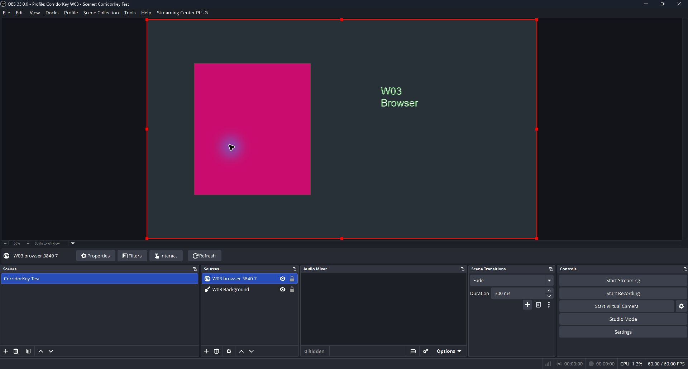
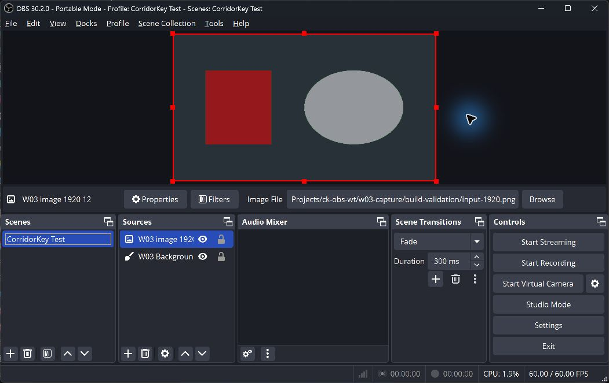

<!-- SPDX-License-Identifier: GPL-3.0-or-later -->
# W03 capture and pacing validation

29 October 2026. These tests use W01's deterministic fake pipeline. They do not
measure CorridorKey model quality or neural inference performance.

## Capture and ownership

`FilterInput` owns a three-slot `FramePool` and a transfer/inference worker.
The diagnostic checkbox defaults off and requires
`CORRIDORKEY_ENABLE_FAKE_FILTER=ON`. The ordinary build still passes video through
until a production pipeline is available. Diagnostic builds key the actual
filter input; W01's standalone synthetic fixture remains available to core tests.

The render callback uses `obs_source_process_filter_begin` with
`OBS_NO_DIRECT_RENDERING`, then `obs_source_process_filter_tech_end`. Its capture
effect copies the OBS-supplied input into a native-size texture. A second shader
pass samples the selected crop into the inference grid and converts premultiplied
source pixels to straight RGB. The fake currently uses a 512 x 512 grid with the
W01 settings adapter. W02 can supply other grid sizes through the existing settings
snapshot. This downscale is bilinear; model-specific antialiasing belongs to the
later preprocessing work.

Each slot owns native and grid render targets, a `gs_stagesurf`, an upload texture,
two completion fences and a bounded host byte buffer. Allocation, fence polling,
staged mapping, byte copying, output uploads and retirement run in
`OBS_TASK_GRAPHICS` tasks. One task combines readback and publication. Only the
worker waits for task completion; the render callback never waits. CPU conversion,
validation and the fake pipeline run on the worker without graphics ownership.
The worker never accesses OBS's D3D11 immediate context.

After staging, the plugin inserts a D3D11 event query or an OpenGL sync object.
A graphics task requires a later video tick and a completed zero-timeout fence query
before calling `gs_stagesurface_map`. D3D11 polling uses
`D3D11_ASYNC_GETDATA_DONOTFLUSH`; GL polling uses `glClientWaitSync` with flags and
timeout both zero. The public OBS staging map itself has no nonblocking flag.
The readiness check establishes that the preceding GPU copy has finished; mapping
can still incur driver overhead.
Unsupported fence APIs produce passthrough. Mapping errors stop the transport
until a reset, instead of retrying allocation every frame.

The native texture stays pinned by the input lease through inference and
presentation. The foreground and alpha are uploaded to the same slot as their
original frame. The composite shader computes `alpha = model_alpha * source_alpha`
and emits `float4(foreground * alpha, alpha)`, using `ONE, INVSRCALPHA` blending.
It samples source alpha from the retained frame, never from live input. Output
is the fake's coarse foreground and alpha; native reconstruction and refinement
are not implemented here. HDR input is bypassed.

Capture and submission each have a video-tick guard. Three views of a source
cannot submit three jobs in one tick. The scheduler admits one running job and
keeps at most one pending input, replacing it with a newer sequence when capacity
allows. A late staging completion cannot replace newer pending work. If all slots
are held, capture is skipped. The shared admission gate visits waiting instances
in registration order and permits one job across all instances. Device-specific
scheduling belongs to W16. The gate supports 64 registered instances.

Resize, source-target changes, settings changes, reset requests and enable signals
invalidate the generation. A change detected between video ticks bypasses the
old presentation until the next tick applies the reset. A gap of more than 500 ms
also resets on the next draw. Captures and draws retain their slots until the GPU
finishes. Destruction runs on `OBS_TASK_DESTROY`; that thread joins the worker
after callbacks detach. GPU retirement remains on graphics tasks during this join.
This depends on OBS keeping its graphics task queue alive while draining the
destroy queue, as OBS 30.2 does. Both tested hosts completed that shutdown path.
The render callback does not map, wait for a fence, join a worker, allocate
textures or validate pixels.

No W01 type, frame-pool or pipeline contract changed. W03 implements the existing
`FrameTransport` interface and uses the fake in manual mode from its own worker.
The added CMake fragment keeps the root build unchanged. Resource destruction
requires OBS graphics ownership. The transport must outlive every input lease
and presentation completion token that refers to its slots.

For this OBS transport, `original.storage->native_handle()` borrows a
`gs_texture_t *`. The memory domain records the host renderer. It is not a raw
D3D11 or GL handle; a later interop transport must use its own storage adapter
or obtain the renderer object through OBS while holding graphics ownership.

OBS references: [filter processing API](https://docs.obsproject.com/reference-sources#functions-used-by-filters),
[OBS 30.2 D3D11 staging implementation](https://github.com/obsproject/obs-studio/blob/30.2.0/libobs-d3d11/d3d11-subsystem.cpp),
[OBS 30.2 OpenGL staging implementation](https://github.com/obsproject/obs-studio/blob/30.2.0/libobs-opengl/gl-stagesurf.c),
and [OBS task dispatch and shutdown](https://github.com/obsproject/obs-studio/blob/30.2.0/libobs/obs.c).

## Build and automated checks

The diagnostic and default builds compile against the OBS 30.2.0 SDK with MSVC
19.44, C++20 and warnings treated as errors. The core suite has 21 passing test
cases. W03 adds checks for duplicate draws across a reset, newest-pending
replacement under slow inference, late staging completion, fair admission with
cancelled waiters, and ownership during generation invalidation.

All five W03 implementation translation units also compile to Linux x86-64 ELF
objects with Zig 0.15.2's Clang, the available Ubuntu OBS headers,
`-Wall -Wextra -Werror`, and the OpenGL implementation enabled. This checks object
compilation; linked Linux and live GL tests remain outstanding. WSL is not installed on the
validation machine.

## Timing method

The machine is Windows 11 with a Ryzen 9 5950X, 64 GB RAM and an RTX 5070 Ti.
`nvidia-smi` reported NVIDIA driver 610.62, KMD 616.92 and CUDA UMD 13.4.
Both hosts use D3D11, a 3840 x 2160 canvas and a 60 Hz video tick. Source dimensions
are measured before scene scaling; 1080p sources are enlarged only for the preview.
The collection is `CorridorKey Test`. No stream or recording runs during these tests.
Other desktop applications were running, and a separate default-plugin build ran
during part of the OBS 33 test. These runs do not measure streaming load or an
isolated system.

`Clock::now()` measures the diagnostic render callback, including passthrough.
"Self" subtracts CPU time inside `obs_source_process_filter_begin`, which draws
the upstream source. It includes the plugin's draw commands, capture passes and
bookkeeping. "Total" includes that upstream call. Neither measures GPU execution,
worker time or time spent waiting to enter the graphics context before the callback.
"Graphics task" measures the separate transfer task, including graphics ownership,
readback copies and result uploads. Tasks run on OBS's graphics thread and count
against its frame budget even though they are outside the filter callback.
Allocation is included when it occurs; percentile figures do not bound startup
or resize spikes.
Histogram bins are 10 microseconds wide; reported values are upper bounds for
the corresponding percentile. A saturated percentile is reported as infinity.
The 1080p target is self-time p95 below 1 ms.

The image fixture contains a green background, an opaque red rectangle and a
white ellipse with 50% source alpha. The browser fixture animates a magenta
rectangle over green with white text. Media tests use the supplied full-HD reporter
clip and `1871395_Green_Screen_Dancing_3840x2160.mp4`. The fake computes alpha as
`(red + blue) / 2`; green remaining in a media preview is not a model-quality result.

## OBS 33 results

Each row uses the last periodic report before switching sources, after at least
600 callbacks. Values are milliseconds; each pair is p50 / p95, rounded up to the
10-microsecond histogram boundary. Startup samples remain included. Each row
covers about 20 seconds.

| Source | Native size | Callbacks | Self p50 / p95 | Total p50 / p95 | Graphics task p50 / p95 | Submissions |
| --- | --- | ---: | ---: | ---: | ---: | ---: |
| Color | 1920 x 1080 | 1203 | 0.03 / 0.04 | 0.03 / 0.04 | 0.42 / 0.71 | 627 |
| Image | 1920 x 1080 | 1203 | 0.03 / 0.03 | 0.03 / 0.04 | 0.45 / 0.67 | 612 |
| Browser | 1920 x 1080 | 1203 | 0.03 / 0.04 | 0.03 / 0.05 | 0.23 / 0.64 | 604 |
| Media | 1920 x 1080 | 1202 | 0.02 / 0.03 | 0.03 / 0.04 | 0.39 / 0.71 | 597 |
| Color | 3840 x 2160 | 1203 | 0.03 / 0.06 | 0.03 / 0.07 | 0.36 / 0.84 | 614 |
| Image | 3840 x 2160 | 1204 | 0.03 / 0.04 | 0.03 / 0.04 | 0.36 / 0.67 | 603 |
| Browser | 3840 x 2160 | 1203 | 0.03 / 0.04 | 0.03 / 0.04 | 0.23 / 0.69 | 602 |
| Media | 3840 x 2160 | 1203 | 0.03 / 0.06 | 0.04 / 0.08 | 0.52 / 1.17 | 581 |

The 1080p callback target passes in these runs. The three-slot pool and transfer
tasks limit this fake path to about 29 to 31 submissions per second in the source
matrix. Capture drops when all slots are held; the graphics task runs roughly
once per video tick. The callback figures alone do not establish 60 processed
frames per second. The 4K media task p95 reaches 1.17 ms outside the callback.

## OBS 30.2 results

The final portable run used the same source matrix and timing method. Each row
covers about 20 seconds, including startup samples.

| Source | Native size | Callbacks | Self p50 / p95 | Total p50 / p95 | Graphics task p50 / p95 | Submissions |
| --- | --- | ---: | ---: | ---: | ---: | ---: |
| Color | 1920 x 1080 | 1202 | 0.02 / 0.03 | 0.03 / 0.04 | 0.24 / 0.40 | 601 |
| Image | 1920 x 1080 | 1204 | 0.03 / 0.04 | 0.03 / 0.05 | 0.27 / 0.47 | 647 |
| Browser | 1920 x 1080 | 1203 | 0.03 / 0.04 | 0.04 / 0.05 | 0.35 / 0.48 | 668 |
| Media | 1920 x 1080 | 1203 | 0.02 / 0.03 | 0.03 / 0.04 | 0.38 / 0.96 | 601 |
| Color | 3840 x 2160 | 1201 | 0.03 / 0.03 | 0.03 / 0.04 | 0.24 / 0.42 | 601 |
| Image | 3840 x 2160 | 1203 | 0.03 / 0.04 | 0.03 / 0.05 | 0.34 / 0.52 | 629 |
| Browser | 3840 x 2160 | 1203 | 0.03 / 0.04 | 0.04 / 0.05 | 0.37 / 0.66 | 615 |
| Media | 3840 x 2160 | 1201 | 0.03 / 0.05 | 0.04 / 0.07 | 0.45 / 1.06 | 614 |

The same lifecycle sequence passed on OBS 30.2, including the actual 0 x 0 image
source and all three injected failures. The status reported "No valid source
frame; passthrough." for zero size and "Result exceeds the maximum frame age;
passthrough." for the 400 ms delay. Duplicate-view testing recorded 5,436 callbacks,
777 captures, 777 submissions and 4,236 repeated draws. The host shut down
normally with zero reported leaks. Its test collection/profile and default plugin
were restored after testing.

[Selected timing and lifecycle records](w03-evidence.txt) are retained in the
repository; the full local logs also include OBS's host profiler. This host
processed about 30 to 33 frames/s in the source matrix.

## Lifecycle checks

OBS 33 completed the following sequence with the test driver in
[`tests/obs-w03.lua`](../../tests/obs-w03.lua):

- Remove the filter during 400 ms fake inference, then add it again.
- Draw the source twice in the scene, with a source projector and multiview open.
  One report recorded 5,507 callbacks, 749 captures, 749 submissions and 4,308
  duplicate draws. The capture/submission rate stayed at or below the 60 Hz tick.
- Disable and enable the filter, resize from 1080p to 4K and back, then move the
  same filter to a different parent source. The resumed status reported a fake
  key at the new native dimensions.
- Request 0 x 0 from the color source, which OBS clamps to 1 x 1. A separate
  unloaded-image test supplied a true 0 x 0 input: it made zero submissions and
  returned an invalid-input status. Loading a valid image recovered the key.
- Inject OOM, unavailable backend and invalid output. Each returned passthrough
  with its corresponding status reason. Clearing the fault resumed the fake key.
- Set a 400 ms delay with the 250 ms maximum frame age. Results expired and the
  filter passed through. Restore normal delay, then enable odd-sequence delay;
  output resumed with frame ownership intact.

The properties status was inspected through the OBS property API after each
fault. W03 exposes a current `StatusSnapshot`; refresh of an already-open property
panel belongs to W02. The final status wording distinguishes missing input and
expired results from backend failures.

OBS 33 shut down normally and reported one outstanding allocation. W00 recorded
the same count before this package; it has not been attributed. The installed
plugin was replaced with a fresh default build of `main` at `67b4062`, preferences
and the pre-test collection were restored, and `installed-obs.lock` was removed.

The local evidence directory is `build-validation/`. The final host logs are
`obs33-graphics.log` and `obs30-graphics.log`. Both hosts use diagnostic DLL SHA-256
`ba2fa82046822388fe36930fa3d4b4907934711ef95d1be0b842fa1eac39da8c`.
The screenshots were captured with this build.

## Reproducing the test scenes

Build with `CORRIDORKEY_ENABLE_FAKE_FILTER=ON` against the 30.2 SDK. Use the
[foundation build notes](../VALIDATION.md) for the shared toolchain and SDK paths.
The plugin data directory must include `effects/capture.effect`.

Run `python tests/create-w03-fixtures.py build-validation/fixtures`. In the
`CorridorKey Test` collection, load `tests/obs-w03.lua` through Tools > Scripts,
then set its fixture and footage directories. Use a separate test profile with
a 3840 x 2160 canvas and 60 FPS. The script clears the current test scene when
creating a new source. It never starts streaming or recording.

Write a command such as `1 image1920` to `command.txt` in the fixture directory.
Change the leading number on every command. Source commands are `color1920`,
`color3840`, `image1920`, `image3840`, `browser1920`, `browser3840`, `media1920`
and `media3840`. Allow at least 25 seconds per source. `image0` selects a missing
fixture to produce a true zero-size image source.

Lifecycle commands are `slow`, `normal`, `reorder`, `fault1`, `fault2`, `fault3`,
`status`, `remove`, `readd`, `duplicate`, `disable`, `enable`, `resize4k`,
`resize1080`, and `switch`. `duplicate` opens source and multiview projectors.
`switch` reparents the existing filter to a new color source. The three fault
numbers mean OOM, unavailable backend and invalid output. `status` logs the
current property text and native size. Keep the installed-OBS test lock for the
whole installed-host run, and close only the process started for testing.

## Integration follow-up

W08/W10 need to keep the documented OBS texture-handle convention or introduce
a typed storage adapter before consuming native frames. W16 still needs per-device
admission and transfer-throughput work under streaming load. These changes can
use the existing shared frame contracts.

## Remaining verification

Live Linux/OpenGL, a camera capture source, GPU reset/device loss, HDR, long-run
streaming, and real model transports remain unverified. There is no native refiner,
guided reconstruction or sensor-to-output latency measurement in this package.
The fake exercises ownership and scheduling; it does not establish the cost of
a neural model or a production upload path.
