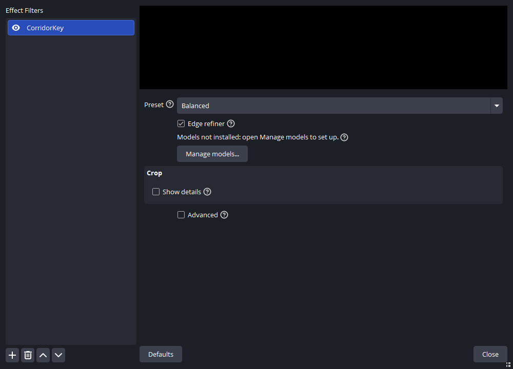
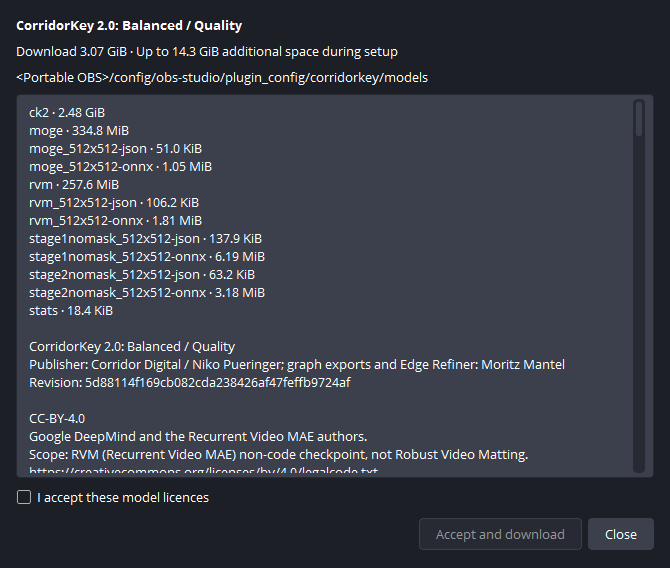
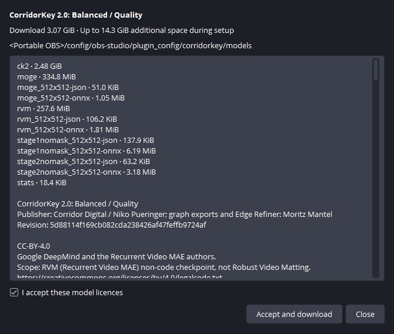
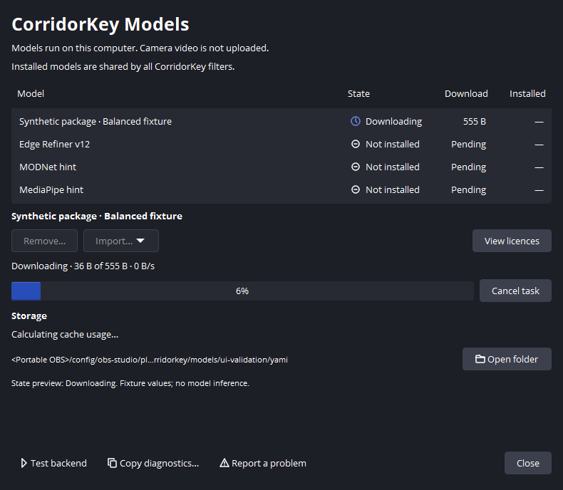
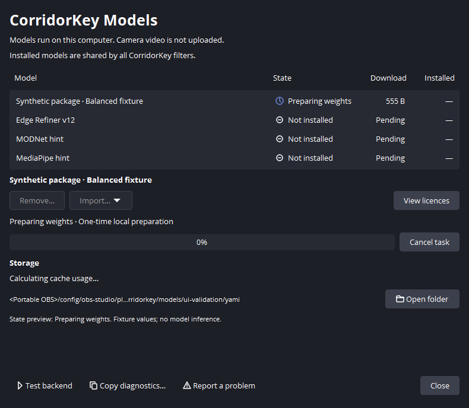
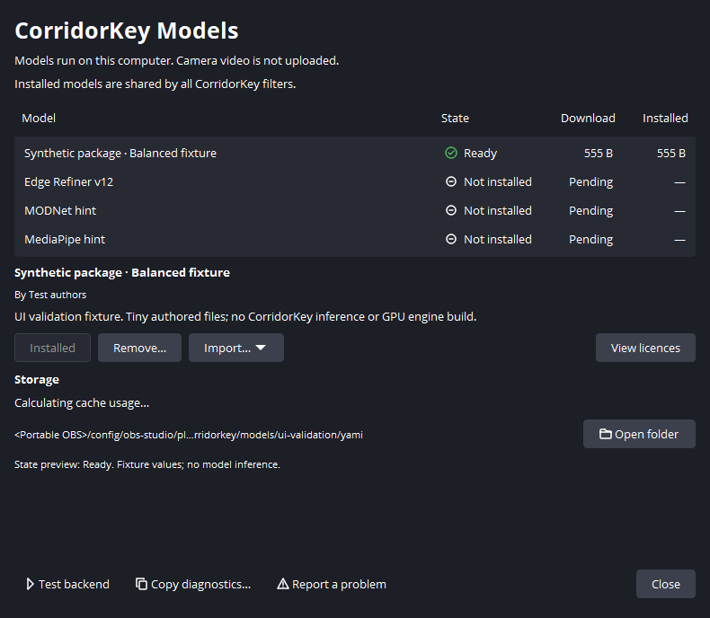

<!-- SPDX-License-Identifier: GPL-3.0-or-later -->
# First run: set up CorridorKey

Add CorridorKey to a camera or media source with a green screen. Models run on
your computer. Setup downloads model files from their publishers; camera video
is not uploaded.

## Add the filter

Select your source in OBS and open **Filters**. Under Effect Filters, click
**+**, choose **CorridorKey**, and keep Balanced selected. The status asks you
to open Manage models until the required package is installed.

## Choose the model

Click **Manage models...**, then **Set up CorridorKey**. The same manager is
available from the OBS Tools menu. Setup opens the licence review for CK2
Balanced / Quality; it does not start a download immediately.

The manager shows the current download size. Balanced and Quality share a
package; Facecam uses separate graphs and reuses the source checkpoints.
Edge Refiner v15 is a separate installation. Install it as well, or turn Edge
refiner off in the filter. Storage shows cache usage and free
space on the drive. Hover the folder path to read it in full, or choose Open folder.

## Accept the model licences

Read the required files, attribution and licence texts. CK2 weights and graphs
use the Corridor Key Licence. MoGe includes MIT and the DINOv2 Apache-2.0 notice;
DeepMind's Recurrent Video MAE checkpoint uses CC BY 4.0. These terms are separate
from the plugin's GPL licence.

If you accept the displayed terms, check **I accept these model licences**.
**Accept and download** becomes available. The plugin saves acceptance for the
exact package and licence versions shown.

## Download and prepare

Choose **Accept and download**. No Hugging Face account or token is needed.
You can keep using OBS or close the manager while it runs. **Cancel task** stops
at a safe boundary and preserves verified downloads for a retry.

The progress row shows bytes received and transfer rate during a download.
The plugin then checks each file's SHA-256 and prepares weights locally. Preparing
weights can continue after network activity stops. Balanced includes the Stage 2
files used by Quality.

## Check the result

Ready means the package files passed verification. An active filter loads the
package automatically and prepares its backend. Video stays unchanged until
the pipeline is ready. Return to the filter preview to check hair, clothing and
moving edges against your source. Open Crop to remove room edges outside the screen.

If you switch to a package that is not installed, the status explains that models
are missing. Open Manage models to install that package. For learned refinement,
install Edge Refiner v15 and enable **Edge refiner** near Model. The tile budget
is under Advanced; changing it prepares a replacement pipeline.

On supported Windows GPUs, refinement can keep tiles on the GPU. Staged tile
transfers are slower and can exceed the frame-age limit. If the status reports
high displayed age or returns to passthrough, turn Edge refiner off and compare.
See [performance](performance.md) for measured device and staged paths.

## If setup fails

A verification error needs a clean retry; a disk-space error needs more free
space on the cache drive. If the catalogue cannot be opened, reinstall the
plugin to restore its data files. **Copy diagnostics...** opens a report preview;
review it before sharing. Error codes and technical details are in diagnostics
and the status tooltip.

The bundled DirectML backend needs no TensorRT engine. Optional TensorRT setup
can spend time building an engine. Its activity bar means work is ongoing and
does not estimate time remaining. Restart OBS after changing runtime bundles.

These captures use real OBS 33 widgets. Setup and licence review use the bundled
production catalogue. Progress and Ready use labelled synthetic state fixtures,
not a repeated multi-gigabyte download or a live keying measurement. The properties
capture uses a test source; its GPU preview is not included by the widget capture.
Both themes at 100% and 150% are in the [capture index](../images/first-run/README.md).
