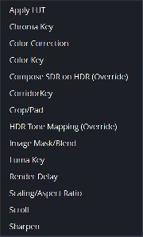
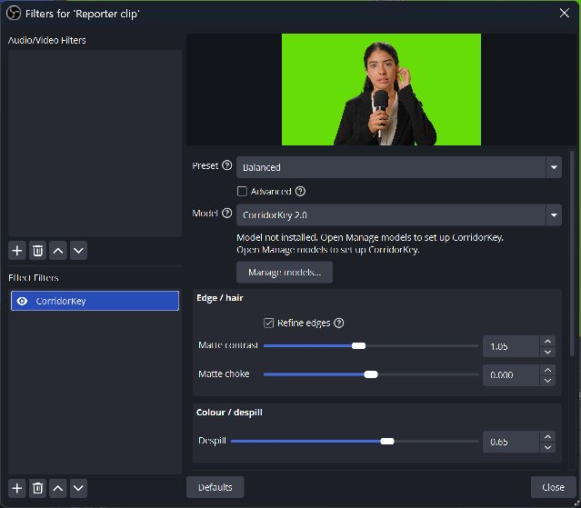
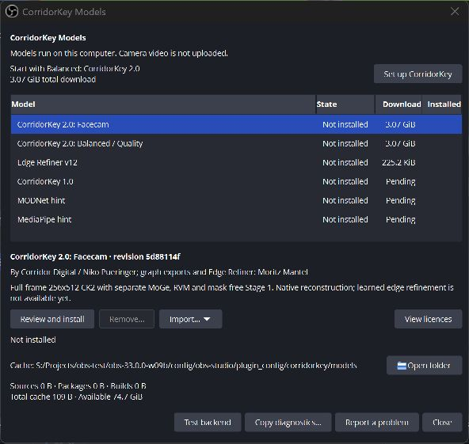
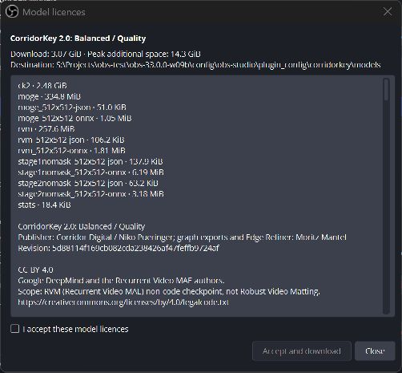
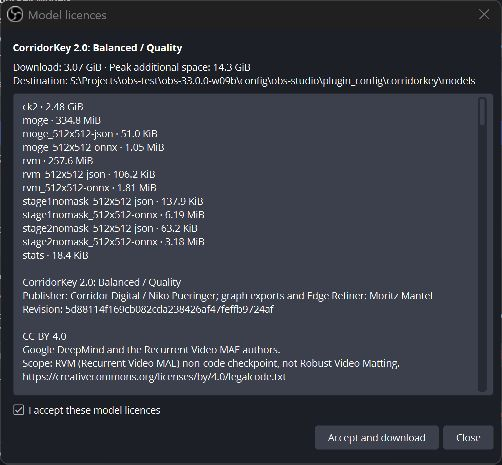
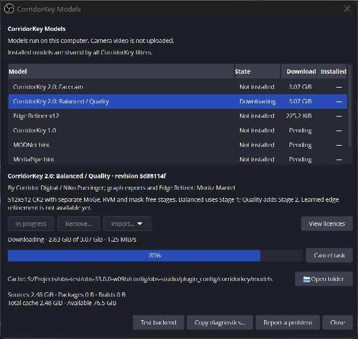
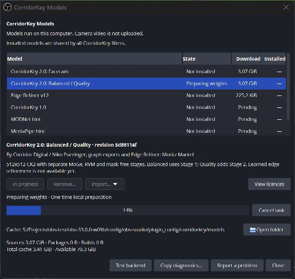
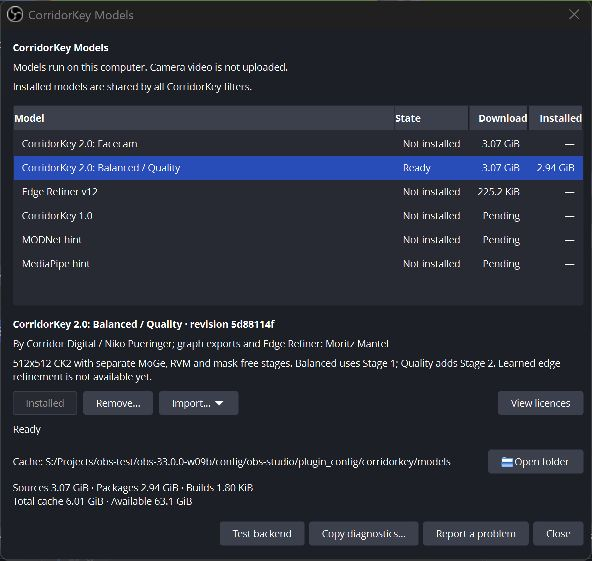
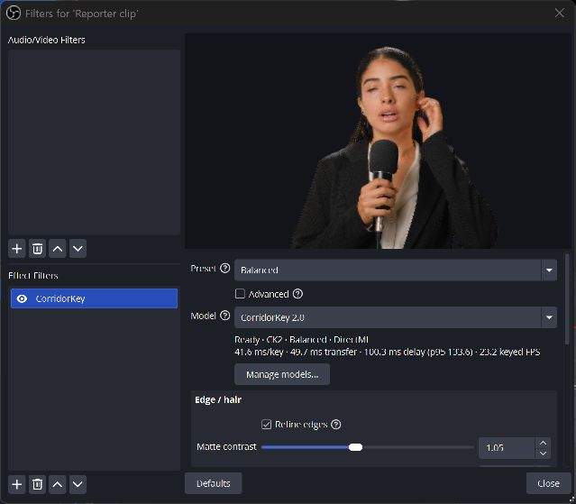
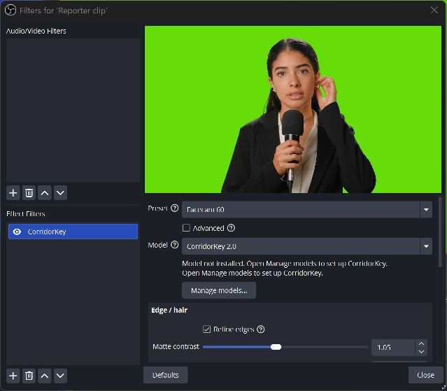

<!-- SPDX-License-Identifier: GPL-3.0-or-later -->
# First run: set up CorridorKey

Add CorridorKey to a camera or media source with a green screen. Models
run on your computer. The plugin downloads model files from their publishers;
it does not upload your camera video.

Windows may ask whether OBS should be allowed through the firewall, especially
when you start a new portable copy. CorridorKey does not need inbound network
access. You can choose **Cancel** on that prompt and continue model setup.

## Add the filter

Select your source in OBS and open **Filters**. Under Effect Filters, click
**+**, choose **CorridorKey**, and keep the default filter name.

Leave the preset on Balanced for the first setup. Before its model is installed,
video stays unchanged and the status asks you to open Manage models.

## Open the model manager

Click **Manage models...** in the filter, then **Set up CorridorKey**. You can
also open the same manager from the OBS Tools menu.

Setup selects CK2 Balanced / Quality. Its initial download is 3.07 GiB. The
manager also shows the additional disk space needed for source files, locally
prepared weights and backend caches. Keep that space available until preparation
finishes. Balanced and Quality share this package; Facecam has a separate graph
package and reuses the same downloaded checkpoints.

## Review and accept the model licences

Read the required files, attribution and complete licence texts. CK2 weights and
graphs use the Corridor Key Licence. MoGe includes MIT and the DINOv2 Apache-2.0
notice; DeepMind's Recurrent Video MAE checkpoint uses CC BY 4.0. These terms are
separate from the plugin's GPL licence.

If you accept the displayed terms, check **I accept these model licences**.
**Accept and download** then becomes available. Acceptance is saved locally for
these exact package and licence versions.

## Download and prepare the weights

Click **Accept and download**. No Hugging Face account or token is needed. You
can keep using OBS or close the manager while the task runs. Cancel task stops
at a safe boundary; verified downloads remain available for a retry.

The plugin checks SHA-256 for each file and prepares the ONNX weight files on
this computer. Preparing weights is a local step and can continue after network
activity stops. The package includes Stage 2 for Quality, even though Balanced
uses Stage 1.

## Start keying

Once preparation finishes, an active filter loads the package automatically.
The source stays in passthrough while the backend is being prepared. You do not
need to recreate the filter or set an environment variable.

Ready confirms that the package files passed verification. Once backend
preparation finishes, return to the filter preview to check the matte against
your source.

Balanced and Quality use a 512x512 analysis grid. Facecam uses 256x512. If you
switch to a package that is not installed, the filter returns to passthrough;
open Manage models to install the matching package.

The current pipeline reconstructs the matte against the native source frame.
To use learned refinement, install the separate Edge Refiner v12 package in
Manage models and accept its licence. Enable Edge refiner in the filter
properties. The tile budget selects the matching graph; changing the switch or
budget prepares a replacement pipeline while video stays in passthrough.

Refinement is still experimental. Its current tile transfers can exceed the
default frame-age limit and return video to passthrough. See the
[refiner measurements](../dev/refiner.md) for the current latency limits.

## Optional TensorRT preparation

The bundled DirectML backend needs no TensorRT engine. If you install an
optional NVIDIA runtime and use TensorRT, the manager shows Building TensorRT
engine with an indeterminate bar and elapsed time. The bar indicates ongoing
work; it does not estimate time remaining. Backend tests and session loading
appear as Testing backend. OBS stays responsive and shows passthrough until the
pipeline is ready. Cancel task requests cancellation without blocking the UI.
Restart OBS after installing or changing a runtime bundle.

## If setup fails

Check the status in the filter and manager. A verification error needs a clean
retry; a disk-space error needs more free space on the cache drive. If the model
catalogue cannot be opened, reinstall the plugin to restore its installed data.
Use View licences to review the accepted texts. Copy diagnostics opens a preview
so you can review the report before sharing it.

The screenshots use portable OBS 33 and Mixkit's
[female reporter clip](https://mixkit.co/free-stock-video/female-reporter-reporting-with-microphone-in-hand-on-a-chroma-28293/).
The footage and visible publisher licence texts retain their original terms.
See [Mixkit's licence](https://mixkit.co/license/).
The GPU was shared with another workload during capture. Live readouts in the
screenshots are not benchmark results.
