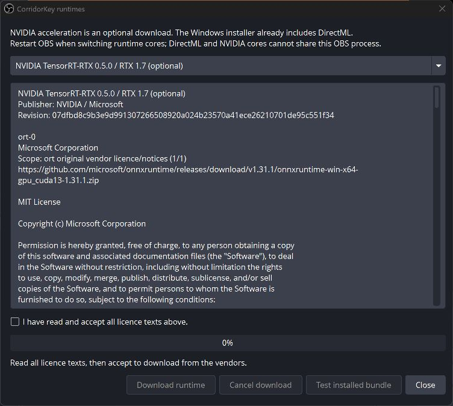

<!-- SPDX-License-Identifier: GPL-3.0-or-later -->
# Install CorridorKey

Use the packages from the project's [GitHub Releases](https://github.com/MinersWin/CorridorKey-for-OBS/releases).
Close every OBS instance before installing, upgrading or removing the plugin.
CorridorKey targets OBS 30.2 and newer. After installation, use the model manager
to download the packages needed by your chosen preset. Check the release notes
and test your scene before using a release candidate on stream.

The Windows package includes ONNX Runtime and DirectML for AMD, Intel and NVIDIA
GPUs supported by DirectML. Linux packages include the ORT core. Models and NVIDIA
acceleration download separately, after you accept their licences. The packages
contain no neural model weights, CorridorKey graphs or compiled model engines.
Two tiny synthetic Add graphs let the backend helper test a runtime.

## Windows installer

1. Download `corridorkey-<version>-windows-x64-setup.exe` and `SHA256SUMS.txt`.
   In PowerShell, run `Get-FileHash .\corridorkey-<version>-windows-x64-setup.exe -Algorithm SHA256`
   and compare the result with the matching checksum line.
2. Run the installer. These builds are unsigned. Windows SmartScreen may show
   "Windows protected your PC". Check the download source and checksum first;
   if you trust the release, choose **More info**, then **Run anyway**. The model
   catalogue is signed separately; that does not remove the SmartScreen warning.
3. Read the licence and select your OBS folder. The installer detects the normal
   OBS installation, and lets you browse to a custom installation.
4. Check the host range: OBS 33+ uses a flat plugin folder; OBS 30.2–32 uses
   `bin/64bit`. Compatible newer OBS versions use the modern layout.
5. Finish installation, open OBS and add **CorridorKey** under a source's
   **Filters → Effect Filters**. Use **Manage models** to review model availability.


The installer writes to `%ProgramData%\obs-studio\plugins\corridorkey`.
It never puts ORT or NVIDIA DLLs beside `obs64.exe`. If it finds a manual
`obs-plugins\64bit\corridorkey.dll` copy, it asks you to back it up and remove it
before continuing. Keep one module copy for each host.

## Portable OBS and manual Windows installs

Use a zip for portable OBS. Start OBS in portable mode so it also keeps its
configuration beside the portable installation.

| Host | Zip | Files to copy |
| --- | --- | --- |
| Portable OBS 33+ | `windows-x64-modern.zip` | Copy the archive's `corridorkey` folder into `<OBS>\plugins\`. The module is `<OBS>\plugins\corridorkey\corridorkey.dll`, beside `data\`. |
| Portable OBS 30.2–32 | `windows-x64-legacy.zip` | Copy `corridorkey\bin\64bit\corridorkey.dll` to `<OBS>\obs-plugins\64bit\`. Copy the contents of `corridorkey\data\` to `<OBS>\data\obs-plugins\corridorkey\`. |

For a manual system install, extract the chosen zip into
`%ProgramData%\obs-studio\plugins\`. Pick the layout for that host and remove
the previous module layout first. Do not overlay both zips. A shared system
plugin folder serves one selected host layout; use separate portable copies
when testing old and new OBS side by side.

## Optional NVIDIA acceleration

Open **Tools → CorridorKey runtimes…** in OBS. Choose TensorRT-RTX on supported
RTX GPUs, or the larger TensorRT 10 / CUDA bundle where appropriate. Read the
complete licence texts, select the acceptance checkbox, then choose
**Download runtime**. Stop streaming and recording before starting a download.



The downloader resumes interrupted transfers, checks archive and extracted-file
SHA-256 hashes, and exposes a bundle only after verification finishes. Downloads
come from Microsoft's and NVIDIA's official publisher URLs. Python, pip, the
CUDA Toolkit and a global `PATH` change are not required on the user's machine.

Restart OBS after installing or changing a runtime. The bundled DirectML core
and the optional NVIDIA core are different builds; they cannot run together in
the same OBS process. A failed backend must leave video in passthrough and report
the reason. **Test installed bundle** uses a separate helper and synthetic data;
it does not certify model compatibility or predict CorridorKey frame rate.
Select the backend in the filter's Advanced controls, or leave it on Auto.
The filter checks the selected model graphs before activating the pipeline.

Allow about 0.53 GB for the Windows RTX download, or over 3 GB for conventional
TensorRT/CUDA. The Linux NVIDIA bundle downloads about 5 GB. Leave room for both
the archives and extracted libraries. Current exact sizes and licence evidence
are in [packaging](../dev/packaging.md). MIGraphX remains unavailable until its
matched AMD dependencies have been validated; AMD Linux hardware was not tested.

## Ubuntu and other native Linux OBS installs

Use the `.deb` for your Ubuntu release: the 24.04 lane targets compatible OBS
30.2–32 builds, including PPA installations. Ubuntu's original OBS 30.0 package
is below the supported floor. The 26.04 lane provides a separate Qt/distro build
for newer hosts, including OBS 33. These Linux lanes need hosted CI validation;
they have not been run on the Windows development machine.

```sh
sha256sum --check SHA256SUMS.txt --ignore-missing
sudo apt install ./corridorkey-<version>-ubuntu-24.04-amd64.deb
```

Replace `24.04` with `26.04` when appropriate. A dependency failure means the
package does not match your native OBS/Qt installation; use the correct lane
instead of forcing `dpkg` to ignore dependencies. The packages install to:

```text
/usr/lib/x86_64-linux-gnu/obs-plugins/corridorkey.so
/usr/share/obs/obs-plugins/corridorkey/
/usr/libexec/corridorkey/
```

The `.tar.xz` contains the same `usr/` tree. For a manual system install, inspect
it with `tar -tf <archive>`, then extract it with `sudo tar -xJf <archive> -C /`.
Keep the archive's file list for removal. Close OBS and remove an older manual
module before switching to the `.deb`. The tarball does not resolve system
dependencies. It is built for the named Ubuntu lane, not every Linux distribution.

Optional NVIDIA downloads use the same **Tools → CorridorKey runtimes…** window.
The default Linux ORT core is for diagnostics; CPU is not an automatic live-video
fallback. GPU probes and model preparation still have to pass.

Flatpak OBS is out of scope. These system paths are outside its sandbox; copying
the native package into a Flatpak installation is not a supported installation.

## Upgrade, rollback and uninstall

Close OBS, then run the new installer or install the new `.deb`. The Windows
installer replaces the chosen host layout and removes the alternate module from
its own target. It keeps settings, accepted licences, downloaded models and
runtime caches. For a zip or tar install, replace the plugin files with OBS
closed, keeping the user configuration directory.

To roll back, back up your configuration, close OBS and reinstall the previous
package for the same host layout and distro. Keep the previous checksum file.
Retained caches may need a new licence acceptance if the catalogue changes.
Do not replace a runtime library while OBS has it loaded.

On Windows, remove **CorridorKey for OBS** in Installed apps, or run its
`unins000.exe`. If the default model cache exists, the uninstaller asks whether
to remove it. **No** keeps the downloads; **Yes** removes that user's default
model and runtime cache. Silent uninstall always keeps it. OBS scenes, profiles
and filter settings remain. Other users' caches and custom external cache
locations require separate manual removal.

For a manual Windows installation, remove the plugin files you copied. On Linux,
run `sudo apt remove obs-corridorkey`, or remove the tarball's recorded files.
User downloads remain under the OBS configuration directory, normally
`~/.config/obs-studio/plugin_config/corridorkey/models`. The Windows default is
`%APPDATA%\obs-studio\plugin_config\corridorkey\models`; portable OBS uses
`<OBS>\config\obs-studio\plugin_config\corridorkey\models`. Remove a cache
manually only after closing OBS and checking the location.

If the module does not appear, check the OBS log, host layout and duplicate
copies first. Report the host, OS, selected backend and relevant log lines in a
[GitHub issue](https://github.com/MinersWin/CorridorKey-for-OBS/issues).
