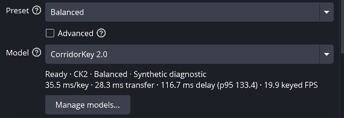
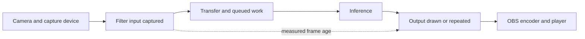
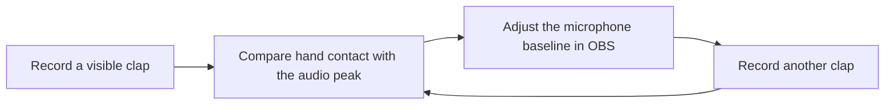
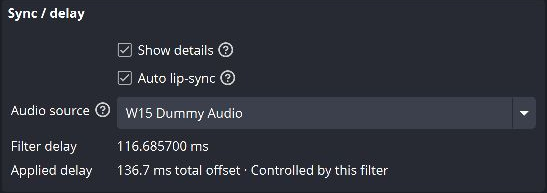

<!-- SPDX-License-Identifier: GPL-3.0-or-later -->
# Lip-sync and filter delay

CorridorKey can add its measured video delay to one audio source. Auto lip-sync
starts off. Choose the microphone that belongs to this camera before enabling it.



These earlier screenshots use a diagnostic build, a test card and muted dummy audio. The current layout puts Sync / delay under Advanced; its controls work the same way.
The numbers describe that test pipeline, not a CorridorKey model benchmark.

## What the delay means

Filter delay measures the time from capturing a frame at this filter's input to
drawing that same frame's result. When OBS draws the result again, its age keeps
increasing. The status line shows median delay over a rolling window of up to five seconds; its tooltip includes p95. Transfer timing is available in diagnostics.
The p95 is the age at or below which 95% of sampled presentations fall.

Processing time and transfer time describe completed frames. They do not include
the extra age of a repeated result. Transfer includes staged capture, waiting for
the captured pixels and preparing/uploading the output. The older screenshots use simulated processing delays; their values are not
neural inference measurements.



The plugin cannot measure the camera's sensor and capture latency, the audio
interface's latency, or the encoder and player's buffering. A clap recording
checks the complete path you actually use.

## Set the baseline with a clap test

1. Turn Auto lip-sync off. Bypass CorridorKey so you can calibrate the camera and
   microphone without the filter's added delay.
2. Record a few claps with your hands visible near the microphone. Use your usual
   camera mode, audio interface settings and recording path.
3. Open the recording in an editor that shows the audio waveform. Find the first
   frame where your palms meet and compare it with the clap's audio peak.
4. If the sound arrives first, increase that microphone's **Sync Offset** in OBS's
   **Advanced Audio Properties** by the measured difference. If sound arrives
   later, reduce the offset. A camera delay may be needed when audio is already
   too late; an audio offset cannot remove hardware buffering.
5. Repeat the recording until the clap lines up, then enable CorridorKey again.
   Leave Auto lip-sync off while setting this baseline.



Frame stepping limits the precision of this check. Repeat several claps before
changing the baseline by a small amount. A preview, a local recording and a stream
player can have different buffering, so verify the destination that matters.

## Enable Auto lip-sync

Open this camera's **Filters**, select **CorridorKey**, enable **Advanced**, and
expand **Sync / delay** with **Show details**. Enable **Auto lip-sync** and select **Audio source**.
The existing OBS sync offset becomes the baseline. Source selection uses its
persistent ID, so renaming the microphone keeps the pairing.



The total offset is:

```text
microphone baseline + measured median filter delay + Sync trim
```

Wait for two seconds of valid video. **Applied delay** shows the actual total
offset and whether this filter controls it. **Advanced** reveals **Sync trim**,
which adjusts the correction after measurement. **Expert** reveals **Delay limit**;
the default caps the added correction, including trim, at 250 ms in either
direction. The baseline itself stays separate from that limit.

The controller checks twice a second. It changes an offset at most once every
two seconds, ignores changes below 5 ms, and limits later adjustments to 10 ms per
second. The first correction applies after the initial sample window. Small
differences between the current median and the applied offset are expected.

## Manual edits, shared microphones and interruptions

Editing the microphone's sync offset in OBS releases automatic control. Your
manual value stays in place. Turn Auto lip-sync off and on to resume from that
new baseline. A filter already waiting for the same microphone also respects the
manual edit.

Only one filter can control a microphone at a time. Another filter reports
**Controlled by another filter**. If two cameras share one microphone and have
different delays, choose which camera should determine the correction.

Disabling, bypassing or deleting the filter, losing valid video, and pipeline
errors restore the baseline only when the microphone still has the last value
written by this filter. Switching audio sources restores the old source before
claiming the new one. Deleting a microphone stops control; select its replacement
explicitly. Reopening the audio picker refreshes displayed source names.

## Limits

A median correction cannot align every frame when video age varies. Watch p95:
a large gap from the median means motion may fall out of sync even when the
average looks right. A result older than the configured **Stale limit** returns
to live passthrough and pauses automatic correction. A slower pipeline needs
less processing work or a faster backend, even if a larger delay limit is allowed.

Changing a microphone's OBS offset affects every scene and output that uses that
same source. Auto lip-sync cannot give a shared source a different offset in each
scene, and it cannot calibrate lip motion or recognize a clap automatically.
