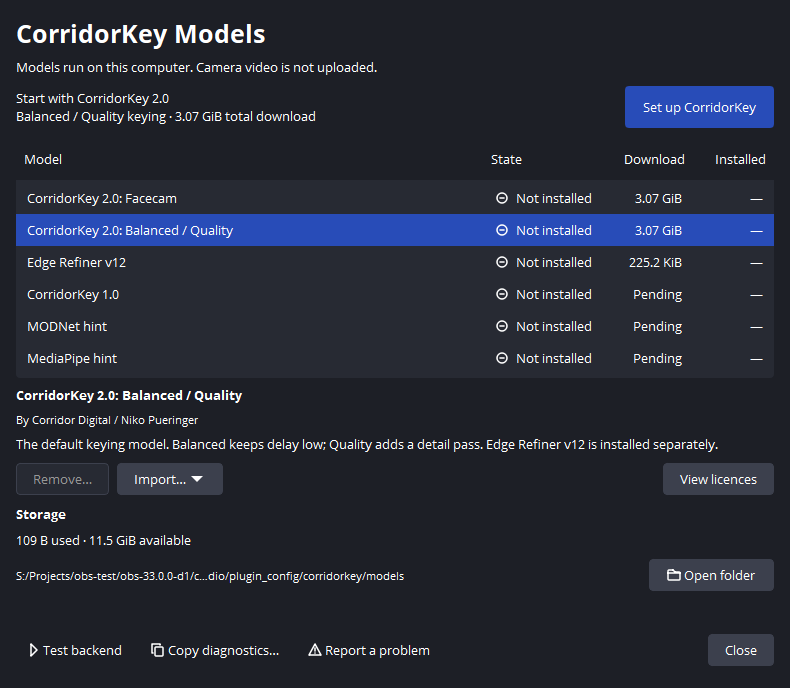
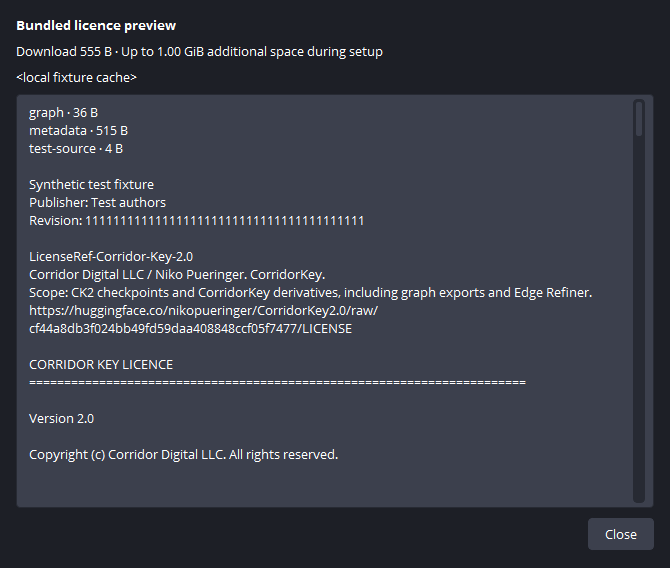
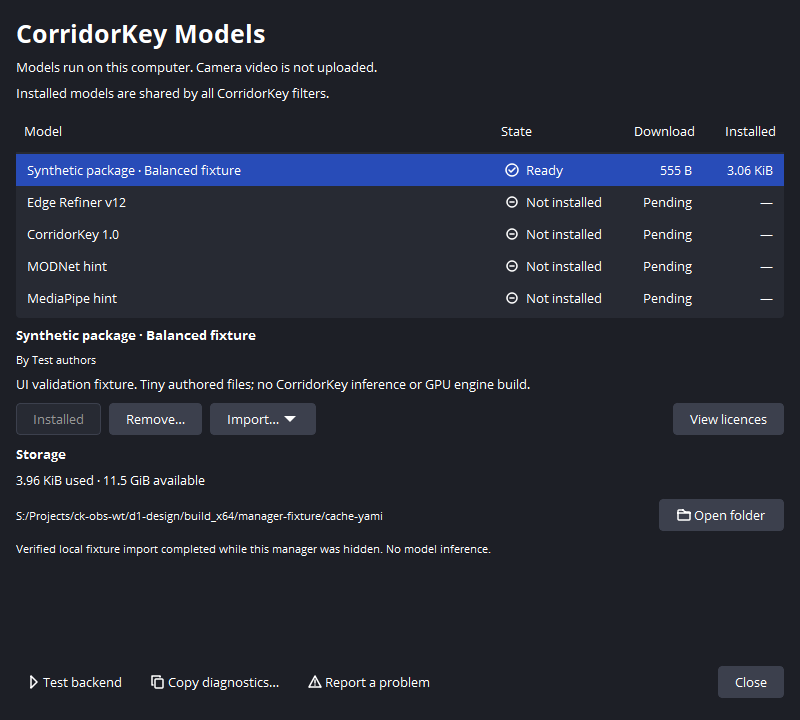
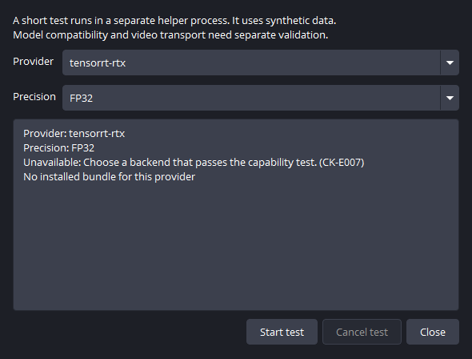
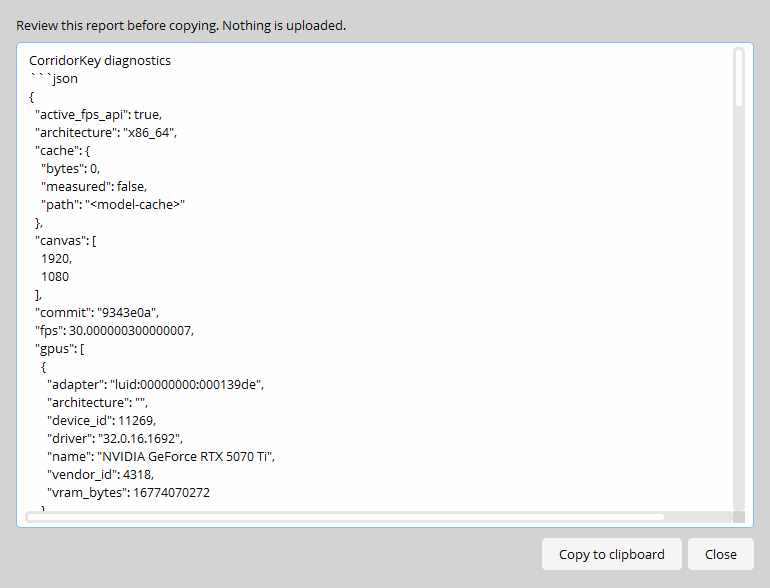

<!-- SPDX-License-Identifier: GPL-3.0-or-later -->
# Managing models

Open **Manage models...** in a CorridorKey filter, or choose **Tools → CorridorKey Models...**.
Both open the same window. You can keep using OBS while it is open. Closing the
manager leaves an installation running; **Cancel task** requests cancellation.

The catalogue offers CK2 Facecam, CK2 Balanced / Quality, and Edge Refiner v12.
Choose Set up CorridorKey for Balanced. CK1 and hint packages remain unavailable.
The [first-run guide](first-run.md) explains setup, licence acceptance and recovery.

## Installing a package

Choose **Set up CorridorKey** for the recommended
Balanced CK2 set, or select another model and choose **Review and install**.
The review window lists the required files, download size, peak additional disk
space, cache destination, attribution and complete licence texts.

Read every required licence before checking **I accept these model licences**.
Then choose **Accept and download**. The plugin saves a local receipt for those
exact texts and that package revision. A changed package or licence needs a new
acceptance. Declining starts no download.

CorridorKey attribution credits Corridor Digital / Niko Pueringer. CK2 packages
also carry the Microsoft/MoGe MIT text and DINOv2 Apache notice, and the DeepMind
RVM CC BY 4.0 text. Scroll through the review window to read each dependency's
terms. The plugin's GPL licence does not change the model licences.

The bundled [MoGe/DINOv2 notice](../images/model-manager/yami-moge-licence.png)
and [RVM licence](../images/model-manager/yami-rvm-licence.png) have their own
attribution and text. These licence previews use the tiny test package's file
list; the licence text comes directly from the bundled records.

## Progress and recovery

Downloads show bytes received, total size when known, and a sampled transfer
rate. Verification checks file hashes. Preparing weights creates local model
files. Steps without a measured total use an activity indicator.

**Ready** means the package files passed verification. An active filter then
prepares its backend and loads the package through a reader lease. Video stays
in passthrough until that pipeline is ready. TensorRT preparation shows an
activity indicator and elapsed time; it does not block the manager.

Cancel preserves verified downloads and resumable partial files. Retry can reuse
them. An error explains the next action. Diagnostics retain stable `CK-E` codes for troubleshooting. A failed
update leaves existing revisions in place. Installing alone never changes the
active revision. The filter selects a revision after successful preparation.

The following captures use a tiny local UI fixture. The state previews are
labelled in the window. Building, testing and update previews illustrate the
layout; they provide no model or GPU performance measurements.

| State | Yami | Yami Light |
| --- | --- | --- |
| Not installed | [View](../images/model-manager/yami-not-installed.png) | [View](../images/model-manager/yami-light-not-installed.png) |
| Awaiting acceptance | [View](../images/model-manager/yami-acceptance.png) | [View](../images/model-manager/yami-light-acceptance.png) |
| Downloading | [View](../images/model-manager/yami-downloading.png) | [View](../images/model-manager/yami-light-downloading.png) |
| Verifying | [View](../images/model-manager/yami-verifying.png) | [View](../images/model-manager/yami-light-verifying.png) |
| Preparing weights | [View](../images/model-manager/yami-binding.png) | [View](../images/model-manager/yami-light-binding.png) |
| Building TensorRT engine | [View](../images/model-manager/yami-building.png) | [View](../images/model-manager/yami-light-building.png) |
| Testing | [View](../images/model-manager/yami-testing.png) | [View](../images/model-manager/yami-light-testing.png) |
| Ready | [View](../images/model-manager/yami-ready.png) | [View](../images/model-manager/yami-light-ready.png) |
| Update available | [View](../images/model-manager/yami-update.png) | [View](../images/model-manager/yami-light-update.png) |
| Error and retry | [View](../images/model-manager/yami-error.png) | [View](../images/model-manager/yami-light-error.png) |

## Offline import and disk space

Select an available package, open **Import...**, and choose a folder or ZIP.
The bundle must contain `blobs/<sha256>` files matching that package's trusted
manifest. Import uses the same licence review, space checks and verification as
a download. A bundle cannot add an unsigned package to the catalogue.

**Open folder** opens the model cache. Storage shows total cache bytes and free
space on the drive. Hover the usage summary for source, prepared-model and
backend-build totals. The shortened folder path has its full value in a tooltip. An installed package includes its graphs, bound weights and
receipts. Shared sources are counted once in the cache total.

**Remove...** asks you to confirm. A model being installed or held by a reader
lease cannot be removed. Remove the filters using that package, then retry.
Removing an unused selected revision also clears its current-selection receipt. A refused removal
keeps that selection intact.
Removal keeps shared source downloads, so the cache total may fall by less than
the total download size. Keep cache files intact while OBS is using them.

## Testing a backend

Choose **Test backend**, select a provider and FP32 or FP16, then choose
**Start test**. Stop streaming and recording first. The test uses synthetic data
in a separate helper process, with a 25-second deadline. You can cancel it;
closing its window also requests cancellation.

A successful test reports the selected provider, precision, session preparation,
first-run and warm-median timings returned by the helper. The result covers its
small standard-operation fixture. It does not establish CorridorKey frame rate
or native video transport support. An unavailable provider explains whether its
runtime bundle, helper or test configuration is missing or failed.

## Asking for help

**Copy diagnostics...** opens a report you can review. **Copy to clipboard**
copies it only after that review. The current report includes build versions,
model revisions, states, error codes and cache byte counts. It excludes personal
paths, scene names, logs and media. Backend, pipeline and timing details appear when those services have reported them.

**Report a problem** opens the [GitHub issue chooser](https://github.com/MinersWin/CorridorKey-for-OBS/issues/new/choose).
It does not send a report. Add the reviewed diagnostics and describe what you
were doing when the problem occurred.

State symbols have text labels, so colour is never the only cue. The window follows OBS's fonts and theme. On smaller screens, scroll the content
to reach the model actions; the bottom controls remain visible. See the
[compact window](../images/model-manager/yami-light-compact.png),
[100% scale](../images/model-manager/yami-first-run.png) and
[150% scale](../images/model-manager/yami-1.5-first-run.png) examples.
