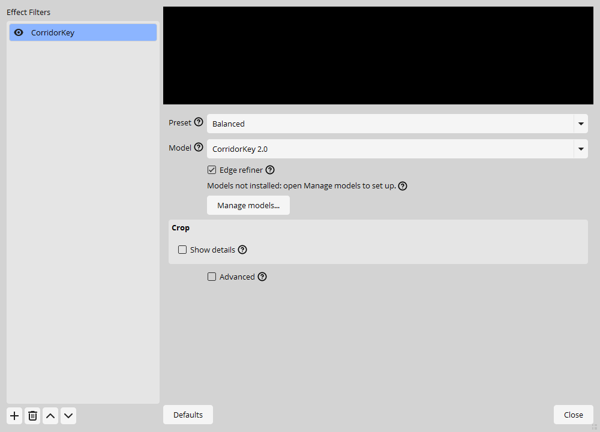
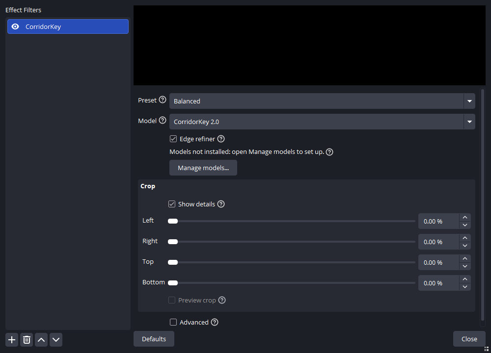

<!-- SPDX-License-Identifier: GPL-3.0-or-later -->
# Filter settings

Add CorridorKey through your source's Filters window. Start with Balanced and leave Advanced off until you need a specific adjustment. Hover a control or its question-mark icon for help.

Install the required model through Manage models before expecting a keyed image. Missing models or an unavailable backend leave video unchanged and show a recovery message. Unavailable choices stay grey until a compatible model or backend declares support.

## Presets and model choice

| Preset | Working grid, H × W | Subject crop | Detail stage | Edge tiles | Key rate |
| --- | --- | --- | --- | --- | --- |
| Facecam 60 | 256 × 512 | Off | Off | 384 | Up to 60 FPS, capped by OBS |
| Balanced, default | 512 × 512 | On | Off | 512 | Follow OBS |
| Quality | 512 × 512 | On | Every frame | 768 | Follow OBS |
| Custom | Keeps your edits | Keeps your edits | Keeps your edits | Keeps your edits | Keeps your edits |

Editing a quality control selects Custom. Choosing a named preset explicitly restores that preset. Manual crop, microphone pairing, sync trim, output view survive. Reset quality restores the selected preset; from Custom it restores Balanced.

CK1 starts in Custom with a proposed 384 × 384 grid, Chroma hint and RGB guided edges. Its refiner defaults off. These CK1 choices still need export evaluation; the CK2 prototype's speed measurements do not apply to CK1. Switching between CK1 and CK2 restores each pipeline's saved quality, backend, hints and experiments.

Manage models opens installation, licence review and backend tests. Selecting a model or hint in the properties never starts a download.

## Reading the panel

The standard view contains Preset, Model and Edge refiner, followed by status, Manage models and Crop. Advanced reveals quality, edge, colour, hint, output and sync controls. Expert adds backend experiments. Crop, Output / debug and Sync / delay have Show details checkboxes that only expand the form.

The status below Edge refiner explains what to do when models or a backend are missing. Once timing is available, one line shows the model, backend, keyed fps, milliseconds per key and filter delay. Delay is the age of the captured input when displayed; it excludes camera and encoder latency. Hover for error codes, p95 delay and dropped/repeated counts. Status refreshes every two seconds while the form is idle, and pauses while a control is being edited.

The panel uses OBS's font, spacing and colours. These captures show a test source without installed models. Widget capture excludes the GPU-rendered preview; these are settings examples, not keying comparisons.

## Model controls

| Option | Default | Visibility and range | Effect |
| --- | --- | --- | --- |
| Preset (`profile`) | Balanced | Standard; Facecam 60 / Balanced / Quality / Custom | Start with Balanced. Facecam 60 prioritizes speed; Quality adds a detail stage. Editing quality selects Custom. |
| Model (`model_id`) | CK2 | Standard; CK2 / CK1 | Choose a pipeline. Each keeps its own quality settings and requires separate model installation. |
| Model revision (`model_revision`) | Saved verified revision | Saved, hidden; Verified revision | Retains the model revision used by the saved settings. Choosing a preset within CK2 preserves it. |

## Quality and speed

| Option | Default | Visibility and range | Effect |
| --- | --- | --- | --- |
| Backend (`backend`) | Auto | Advanced; Auto / TensorRT-RTX / TensorRT / CUDA / DirectML / MIGraphX / CPU diagnostic | Auto uses a backend that passes compatibility checks. CPU is an explicit diagnostic choice, never an automatic live fallback. |
| GPU (`device`) | OBS adapter | Expert; Auto or probed adapters | Prefer the OBS adapter. Another GPU can require slower transfer. Only probed adapters are offered. |
| Key rate (`target_fps`) | Follow OBS (Facecam: 60) | Advanced; Follow OBS, 15, 24, 25, 30, 50, 60 FPS | Accepted frames per second, capped by the OBS rate. Zero follows OBS; output rendering keeps its normal rate. |
| Grid (`grid`) | 512 × 512 (Facecam: 256 × 512) | Advanced; Installed static grids; H × W | Working height × width, separate from source size. Only installed static graph variants can run. |
| Subject crop (`roi_enabled`) | On (Facecam: Off) | Advanced; Off / On | Focus CK2 on the foreground inside your manual crop. |
| Detail interval (`stage2_interval`) | Off (Quality: Every frame) | Advanced; Off / Every frame; Expert: 2 to 4 frames | Off uses Stage 1. Every frame adds Stage 2. Expert intervals 2 to 4 reuse detail and may leave trails. |
| Tile budget (`refiner_max_tiles`) | 512 (Facecam: 384; Quality: 768) | Advanced; Installed fixed batches, 64 to 1536 in steps of 64 | More native-resolution edge tiles can improve hair but take longer. Only installed fixed batches can run; zero/all-tiles is not a live mode. |
| ROI margin (`roi_padding`) | 0.20 | Advanced; 0.05 to 0.5; step 0.05 | Margin around the automatic foreground box; leave room for moving hands and hair. |
| Video memory (`use_rvm_temporal`) | On | Advanced; Off / On | Use previous frames for temporal features. Reset after cuts or source changes. |

## Edge and hair

| Option | Default | Visibility and range | Effect |
| --- | --- | --- | --- |
| Edge refiner (`refiner_enabled`) | On (CK1: Off) | Standard; Off / On | Recover edges from native pixels. Requires a compatible refiner model and transfer path. CK1 needs an evaluated experimental package. |
| Edge method (`guide_mode`) | Refiner (CK1: RGB guided) | Advanced; Refiner / RGB guided / Bilinear / Chroma legacy | RGB guided is the fallback if refinement is unavailable. Bilinear reveals the model detail limit. Chroma legacy is experimental. |
| Refiner (`refiner_model`) | v12 | Advanced; Installed model or validated source ID | Use an installed compatible model: v12 is the reference; older versions are for comparison. Arbitrary checkpoint paths are not accepted. |
| Hair radius (`guided_radius`) | 2 px | Advanced; 1 to 12 px; step 1 | Guided-filter neighborhood in low-grid pixels. Larger values can smooth detail. |
| Edge smoothness (`guided_eps`) | 0.0005 | Expert; log10 epsilon −5 to −2; step 0.1; exact epsilon saved | Stored as exact epsilon; the UI uses log10 from −5 to −2. Larger values smooth more.  |
| Matte contrast (`alpha_contrast`) | 1.05 | Advanced; 0.7 to 1.5; step 0.01 | Increase separation around mid-opacity. Too much removes translucent detail. |
| Matte choke (`alpha_offset`) | 0 | Advanced; -0.2 to 0.2; step 0.005 | Negative shrinks opacity; positive expands it. Check hair and motion blur. |
| Black point (`clip_black`) | 0 | Advanced; 0 to 0.5; step 0.005 | Alpha at or below this becomes transparent. White point must be at least 0.01 higher. |
| White point (`clip_white`) | 1 | Advanced; 0.5 to 1; step 0.005 | Alpha at or above this becomes solid. Keep at least 0.01 above Black point. |
| Band minimum (`refiner_band_lo`) | 0.004 | Expert; 0 to 0.1; step 0.001 | Lowest alpha considered for edge refinement. Raising it can lose faint hair. |
| Band gain (`refiner_band_gain`) | 10 | Expert; 0 to 20; step 0.5 | Higher positive gain allows more weight at low alpha. Zero disables weighting. |

## Colour and despill

| Option | Default | Visibility and range | Effect |
| --- | --- | --- | --- |
| Colour method (`unmix_mode`) | Delta | Advanced; Delta / Compositing equation | Delta transfers model colour correction onto native detail. Compositing equation is experimental. |
| Interior colour (`unmix_inner`) | 1 | Advanced; 0 to 1; step 0.05 | Model colour correction in solid areas. Edges retain full correction. |
| Despill (`despill_strength`) | 0.65 | Advanced; 0 to 1; step 0.02 | Remove green spill after refinement. Reduce if neutral or coloured details shift. |
| Screen (`screen_color`) | Green | Advanced; Green / Blue | CK1 uses a separate blue-screen checkpoint. CK2 v12 presets are evaluated for green. |

## Manual crop

Each cut removes a percentage before inference. Pixels outside the crop become transparent while the output canvas keeps the source size. Moving a slider keeps the selected output view. Preview crop is disabled until the renderer can clear a temporary view when properties close. View → Crop is an explicit, saved inspection view.

| Option | Default | Visibility and range | Effect |
| --- | --- | --- | --- |
| Left (`cut_left`) | 0% | Standard; 0 to 45 %; step 0.5 | Cut from the left before inference. Outside pixels become transparent. |
| Right (`cut_right`) | 0% | Standard; 0 to 45 %; step 0.5 | Remove room edges from the right. Source output size stays unchanged. |
| Top (`cut_top`) | 0% | Standard; 0 to 45 %; step 0.5 | Cut from the top; leave space for hair and movement. |
| Bottom (`cut_bottom`) | 0% | Standard; 0 to 45 %; step 0.5 | Cut from the bottom before inference; the output canvas stays unchanged. |

## Hints

CK1 always lists Chroma, CK2 Stage 1 and MODNet. Learned hints remain unavailable until their dependencies are installed. MediaPipe, imported masks and the future Custom hint appear only when a manifest declares them. A person-only hint can omit chairs, props or other people. CK2 hint controls require Expert.

| Option | Default | Visibility and range | Effect |
| --- | --- | --- | --- |
| Hint source (`hint_source`) | Chroma | Advanced; Chroma / CK2 Stage 1 / MODNet / MediaPipe / Imported mask / Custom hint | Chroma is cheap. CK2 Stage 1 needs its full dependencies. Person models such as MODNet may exclude props or chairs. Selecting a row never downloads a model. |
| Screen match (`hint_similarity`) | 0.40 | Advanced; 0 to 1; step 0.01 | Chroma similarity used to seed background. Calibration is provisional; inspect Hint output. |
| Hint softness (`hint_smoothness`) | 0.10 | Advanced; 0.01 to 0.5; step 0.01 | Width of the chroma transition, not final matte sharpness. |
| Hint rate (`hint_refresh`) | 1 frame | Advanced; 1 to 8; step 1 | Refresh every N accepted frames. Reuse may expose delayed guides during motion. |
| Mask source (`hint_mask`) | None | Expert; Installed model or validated source ID | Use a validated full-frame linear mask aligned with this frame and crop. A source that creates a filter loop cannot be used. |
| Hint mode (`hint_mode`) | Off | Expert; Off / Previous / Chroma / Blend / External | CK2 hints are experimental. Measured profiles use Off. |
| Previous hint (`temporal_hint_quality`) | 0 | Expert; 0 to 0.95; step 0.05 | Trust in previous alpha. Zero disables it; high values can leave trails. |
| Chroma trust (`chroma_hint_quality`) | 0.75 (dormant) | Expert; 0 to 1; step 0.05 | Trust in the experimental CK2 chroma hint; not a native CK1 input. |
| Mask trust (`external_hint_quality`) | 0.50 (dormant) | Expert; 0 to 1; step 0.05 | High confidence can make CK2 copy the rough mask. |
| Mask blur (`external_hint_soft`) | 0 px | Expert; 0 to 64; step 1 | Box-blur the external guide twice, in inference pixels. This does not blur final alpha. |

## Output and inspection

Inspection views replace program output and can appear on stream or in a recording. Return View to Key and Inspect to Transparent for normal transparent output.

| Option | Default | Visibility and range | Effect |
| --- | --- | --- | --- |
| View (`obs_view`) | Key | Advanced; Key / Alpha / Hint / Foreground / Crop / Input / Tile coverage / ROI | Inspection replaces output and may appear on stream or recording. Crop sliders never enable a view automatically. |
| Inspect (`view_mode`) | Transparent | Advanced; Transparent / Checker / Black / Alpha / Side by side | Transparent is normal Key output. Other backgrounds and Side by side explicitly change output. |
| Preview colour (`bg_color_rgb`) | Black | Advanced; RGB picker; 0 to 1 per channel (8-bit storage) | Inspection background only; normal Key output remains transparent. |
| Bypass (`bypass`) | Off | Advanced; Off / On | Show original input and stop inference submissions. |

## Sync and delay

Auto lip-sync is off by default. Choose the microphone paired with this camera before enabling it. The source picker saves its persistent ID. Manual offset edits release automatic control; the plugin restores the baseline offset when it stops controlling the microphone. See the [lip-sync guide](lip-sync.md) for a clap test.

| Option | Default | Visibility and range | Effect |
| --- | --- | --- | --- |
| Auto lip-sync (`auto_sync`) | Off | Advanced; Off / On | Add measured filter delay to one explicitly selected microphone. Other latency may still need correction. |
| Audio source (`audio_source_id`) | None | Advanced when sync is enabled; actual audio sources | Choose the paired microphone by persistent ID. One filter may own its offset; manual changes release ownership. |
| Sync trim (`sync_trim_ms`) | 0 ms | Advanced; -250 to 250 ms; step 1 | Extra correction after measured delay. Negative values cannot make already-delayed audio arrive earlier. Verify with a clap recording. |
| Delay limit (`sync_limit_ms`) | 250 ms | Expert; 50 to 1000 ms; step 10 | Maximum added audio delay. Large values cannot fix a backend that falls behind. |
| Stale limit (`stale_timeout_ms`) | 250 ms | Expert; 100 to 1000 ms; step 10 | Return to live input if no fresh keyed result arrives in this time. |

Filter delay shows the median age from captured input to the displayed result. Applied delay is the extra offset added to the microphone and its current sync state. Unavailable measurements are labelled rather than shown as zero. Neither readout includes camera or encoder delay.

## Expert controls

Experiments stay unavailable until their implementation and graph support are declared. Reset memory requests a new temporal state through the filter controller. Use Copy diagnostics in Manage models to review the full report; backend testing is available there too.

| Option | Default | Visibility and range | Effect |
| --- | --- | --- | --- |
| Guide scale (`guided_scale`) | Full size | Expert; 1 / 0.5 | Reduce legacy guided pass resolution only on supported paths. Refiner sampling remains native. |
| Keep aspect (`aspect_fix`) | Off | Expert; Off / On | Preserve source proportions in the grid. May change measured preset results. |
| Geometry rate (`moge_interval`) | 3 frames | Expert; 1 to 8; step 1 | Refresh geometry every N accepted frames, or sooner when motion exceeds the threshold. |
| Motion limit (`moge_motion_threshold`) | 0.05 | Expert; 0.005 to 0.15; step 0.005 | Mean RGB change of a 32×32 thumbnail triggering geometry refresh. Lower values refresh more often. |
| ROI smoothing (`roi_smoothing`) | 0.80 | Expert; 0 to 0.95; step 0.05 | Higher values move the automatic crop more slowly. |
| Alternate stages (`stagger_s1_s2`) | Off | Expert; Off / On | Experimental alternating stages. The prototype flickered; not recommended for streaming. Requires a declared graph capability. |
| Precision (`precision`) | Auto | Expert; Auto / FP16 / FP32 / BF16 | Only graph/backend-validated precision is offered. Lower precision is not always faster. |
| Transfer (`transport`) | Auto | Expert; Auto / Interop / Staged grid / Staged tiles / Staged full frame | Interop keeps pixels on GPU. Staged paths can add delay and require a successful capability test. |
| Head detail (`head_pass`) | Off | Expert; Off / On | Experimental second Stage-1 pass with separate model state. Requires an installed supported graph; adds work. |
| Head grid (`head_size`) | 512 | Expert; 512 to 768; step 256 | Installed static height/width for the separate head pass. |
| Head tiles (`head_max_tiles`) | 256 | Expert; Installed fixed batches, 64 to 1536 in steps of 64 | Installed fixed refiner tile budget for the head pass. |
| Min. head gain (`head_min_gain`) | 1.3 | Expert; 1 to 4; step 0.1 | Only run if head sampling improves by at least this factor. |

Tile size is read-only in Expert: v12 has a 32-pixel center with a 10-pixel halo. Its upper alpha-band cutoff is 0.996. The installed graph defines these constants; they are not additional quality sliders.

## Older settings

Settings carry a schema version. Native saves retain effective values and the model revision so a future default change does not alter an existing instance. Invalid numbers are clamped to the documented ranges. Unsupported saved grids stay saved; the pipeline must report a compatible fallback or passthrough before running them.

Lua's old crop_left and crop_top were normalized absolute edges. Its crop_right and crop_bottom were absolute boundaries: 0.8 meant cutting 20%, not 80%. Migration converts each missing percentage cut once. Existing cut_* values take priority, and absent right/bottom bounds mean the full frame.

The old five grid names map to their working sizes and subject-crop settings. A named Lua profile retains the controls that the prototype actually overrode, including Stage 2 and tile budget. Existing motion thresholds and other saved adjustments survive. C-RADIO is retired and stays off, with a migration notice if it was enabled. Arbitrary refiner paths become package choices; unknown paths produce a notice. Legacy microphone names require selecting the microphone again by ID.

Python paths, UDP ports, Spout output, fixed bridge resolution and PyTorch/Triton compilation switches have no native control. OBS supplies the input and output size; the inference worker and backend own scheduling and compilation. The [schema integration notes](../dev/settings-schema.md) list their dispositions.
